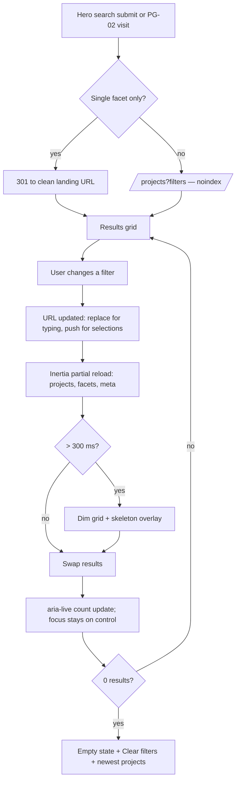

# DESIGN.md — Gemcon City Limited Website

> Visual, interaction and motion specification. Behaviour, data and acceptance criteria live in `REQUIREMENT.md`; this document references them by ID (`PG-*`, `FR-*`, `HERO-*`, `SEO-*`, `ADM-*`, `CMS-*`). Version 1.0.0 · 25 Oct 2026.

Sources cited inline: **[Logo]** `logo.jpeg`; **[Rancon]** rancondevelopments.com; **[bti]** btibd.com; **[Shanta]** shantaholdings.com; **[Polpharma]** polpharmabiologics.com; **[Dash]** `dashboard-1…6.png`.

---

## 1. Design principles and brand personality

**Personality: engineered, grounded, optimistic.** The logo is a hexagon built from teal and coral triangles with a bold, wide geometric wordmark **[Logo]** — precise construction (engineered), heavy confident letterforms (grounded), and a warm coral counterpoint to the teal (optimistic).

| ID | Principle | What it means in practice |
|---|---|---|
| DP-01 | Photography leads, chrome recedes | Large, full-bleed project imagery; UI uses warm neutrals so photos carry colour **[Rancon]** |
| DP-02 | Facts before adjectives | Every project surfaces size, bedrooms, handover, location, approvals in the first screen; stats are typographic, not decorative **[Rancon][bti]** |
| DP-03 | Built from triangles | The hexagon's 60° geometry appears as a subtle motif: triangular section dividers, the 60° clip in image masks, the map pattern, list bullets |
| DP-04 | Teal acts, coral invites | Teal = primary actions and navigation; coral = the single highest-value invitation per view (Enquire, Book a visit). Never more than one coral CTA per viewport |
| DP-05 | Motion explains, never blocks | Reveals follow reading order; nothing hides content from crawlers or reduced-motion users (REQUIREMENT SEO-PERF-012, SEO-A11Y-005) **[Polpharma]** |
| DP-06 | One clear next step | Each section ends with one action; lead capture is always within one tap on mobile (sticky contact bar) **[bti]** |
| DP-07 | Calm density | Generous vertical rhythm on public pages; compact, scannable density in admin **[Dash]** |

---

## 2. Color system

### 2.1 Brand colours extracted from the logo

Sampled from the 200×46 JPEG, saturated pixels only (median) **[Logo]**:

| Role | HEX | Use |
|---|---|---|
| Brand teal | `#027685` | Primary (becomes `teal-600`) |
| Brand coral | `#EC6B51` | Accent (becomes `coral-500`) |
| Mark grey | `#635C5B` | Warm neutral reference (neutral scale hue 40°) |

### 2.2 Scales (50–950)

The canonical definition of every token is the CSS in §13; the tables in §2 are the readable view of the same values.

Generated in OKLCH from each brand colour's hue, stepping lightness and tapering chroma at the ends; brand colours are kept exactly at their anchor step.

| Step | teal (primary) | coral (accent) | stone (neutral, warm) |
|---|---|---|---|
| 50 | `#EFF9FB` | `#FFF4F2` | `#FEF9F7` |
| 100 | `#DDF1F5` | `#FFE7E1` | `#F7F2F0` |
| 200 | `#BDE3EA` | `#FFCEC2` | `#EAE5E3` |
| 300 | `#91CCD7` | `#FEA794` | `#D9D3D0` |
| 400 | `#60AFBD` | `#EF7B63` | `#A6A09E` |
| 500 | `#3392A1` | **`#EC6B51`** (logo) | `#797371` |
| 600 | **`#027685`** (logo) | `#B8432C` (adjusted, see 2.5) | `#5C5755` |
| 700 | `#055A66` | `#963826` | `#46413F` |
| 800 | `#01464F` | `#782C1D` | `#2F2A28` |
| 900 | `#01343C` | `#5B2014` | `#1E1918` |
| 950 | `#001F24` | `#3A0F07` | `#100C0B` |

Secondary colour = the stone neutral scale used as the supporting surface family (warm, matching the logo's grey), with teal-50/100 tints as secondary brand surfaces.

**Semantic scales**

| Step | success | warning | error | info |
|---|---|---|---|---|
| 50 | `#EFFAF1` | `#FFF5E9` | `#FFF4F2` | `#F1F8FE` |
| 100 | `#DDF4E1` | `#FDEAD0` | `#FEE7E4` | `#DFEFFE` |
| 200 | `#BEE7C5` | `#F7D5A6` | `#FECDC7` | `#BCE0FF` |
| 300 | `#93D39F` | `#EBB66A` | `#FEA69C` | `#8AC8FC` |
| 400 | `#62B777` | `#D59219` | `#FE6C61` | `#56A9EB` |
| 500 | `#359A54` | `#AF7603` | `#E2403A` | `#2389D1` |
| 600 | `#0A7E3A` | `#8D5E05` | `#C2181D` | `#036EAE` |
| 700 | `#03612A` | `#6C4701` | `#99020E` | `#025486` |
| 800 | `#004B1E` | `#543600` | `#780108` | `#024068` |
| 900 | `#023816` | `#402801` | `#5D0005` | `#013050` |
| 950 | `#00220A` | `#271700` | `#3A0002` | `#001C32` |

### 2.3 Semantic tokens (shadcn-vue variables)

Public site uses **light** tokens globally and **dark** tokens inside dark-surface sections (`.theme-dark` scope: footer, dark CTA bands, hero text area, sticky mobile bar). The public site does not offer a full dark-mode toggle in v1. The admin supports light, dark and system (`ADM-SCR-20`).

| Token | Light | Dark | Notes |
|---|---|---|---|
| `--background` | `#FFFFFF` | `#001F24` (teal-950) | |
| `--foreground` | `#1E1918` (stone-900) | `#FEF9F7` (stone-50) | |
| `--card` | `#FFFFFF` | `#092C31` | dark card = teal hue, L 0.27 |
| `--card-foreground` | `#1E1918` | `#FEF9F7` | |
| `--popover` | `#FFFFFF` | `#092C31` | |
| `--popover-foreground` | `#1E1918` | `#FEF9F7` | |
| `--primary` | `#027685` (teal-600) | `#91CCD7` (teal-300) | |
| `--primary-foreground` | `#FFFFFF` | `#001F24` | |
| `--secondary` | `#EFF9FB` (teal-50) | `#14363C` | |
| `--secondary-foreground` | `#01464F` (teal-800) | `#FEF9F7` | |
| `--muted` | `#F7F2F0` (stone-100) | `#14363C` | |
| `--muted-foreground` | `#5C5755` (stone-600) | `#A6A09E` (stone-400) | |
| `--accent` | `#F7F2F0` (stone-100) | `#14363C` | shadcn hover/selected surface (not the brand accent) |
| `--accent-foreground` | `#1E1918` | `#FEF9F7` | |
| `--brand-accent` | `#B8432C` (coral-600) | `#EF7B63` (coral-400) | coral CTA fill |
| `--brand-accent-foreground` | `#FFFFFF` | `#001F24` | |
| `--brand-accent-decor` | `#EC6B51` (coral-500) | `#EC6B51` | decoration and large display only |
| `--destructive` | `#C2181D` (error-600) | `#FE6C61` (error-400) | |
| `--destructive-foreground` | `#FFFFFF` | `#001F24` | |
| `--success` / `--success-foreground` | `#0A7E3A` / `#FFFFFF` | `#62B777` / `#001F24` | |
| `--warning` / `--warning-foreground` | `#8D5E05` / `#FFFFFF` | `#D59219` / `#001F24` | |
| `--info` / `--info-foreground` | `#036EAE` / `#FFFFFF` | `#56A9EB` / `#001F24` | |
| `--border` | `#EAE5E3` (stone-200) | `#314D52` | decorative dividers (no contrast requirement) |
| `--input` | `#797371` (stone-500) | `#6C858A` | form control boundary, ≥ 3:1 (adjusted, 2.5) |
| `--ring` | `#027685` | `#EF7B63` | focus ring |
| `--surface-subtle` | `#FEF9F7` (stone-50) | `#001F24` | alternating section bg, admin canvas |
| `--surface-brand` | `#EFF9FB` (teal-50) | `#092C31` | brand-tinted section bg |
| `--chart-1` | `#027685` | `#60AFBD` | |
| `--chart-2` | `#EC6B51` | `#EF7B63` | |
| `--chart-3` | `#01464F` | `#BDE3EA` | |
| `--chart-4` | `#AF7603` | `#D59219` | |
| `--chart-5` | `#797371` | `#A6A09E` | |
| `--sidebar` | `#001F24` | `#001F24` | admin sidebar is dark in both modes **[Dash]** |
| `--sidebar-foreground` | `#EAE5E3` | `#EAE5E3` | |
| `--sidebar-primary` | `#EF7B63` | `#EF7B63` | active indicator bar, logo tile |
| `--sidebar-primary-foreground` | `#001F24` | `#001F24` | |
| `--sidebar-accent` | `#14363C` | `#14363C` | active/hover item background |
| `--sidebar-accent-foreground` | `#FEF9F7` | `#FEF9F7` | |
| `--sidebar-border` | `#314D52` | `#314D52` | |
| `--sidebar-ring` | `#EF7B63` | `#EF7B63` | |
| `--sidebar-muted` | `#91CCD7` | `#91CCD7` | group labels |

### 2.4 Gradients

| Token | Definition | Use |
|---|---|---|
| `--gradient-brand` | `linear-gradient(135deg, #01464F 0%, #055A66 45%, #027685 100%)` | Brand CTA bands, OG fallback images |
| `--gradient-dusk` | `linear-gradient(160deg, #001F24 0%, #01343C 55%, #055A66 100%)` | Dark sections, footer |
| `--gradient-sunrise` | `linear-gradient(135deg, #B8432C 0%, #EC6B51 60%, #FEA794 100%)` | Decorative accents only (no text on it below 24 px) |
| `--gradient-hero-bottom` | `linear-gradient(to top, rgb(16 12 11 / var(--overlay)) 0%, rgb(16 12 11 / calc(var(--overlay) * .55)) 45%, rgb(16 12 11 / 0) 100%)` | Hero overlay `gradient-bottom` (HERO §6.2) |
| `--gradient-hero-left` | `linear-gradient(to right, rgb(16 12 11 / var(--overlay)) 0%, rgb(16 12 11 / calc(var(--overlay) * .4)) 60%, rgb(16 12 11 / 0) 100%)` | Hero overlay `gradient-left` |
| `--gradient-mesh` | `radial-gradient(60% 50% at 15% 20%, rgb(2 118 133 / .55), transparent 70%), radial-gradient(45% 40% at 85% 30%, rgb(236 107 81 / .35), transparent 70%), radial-gradient(55% 50% at 50% 100%, rgb(51 146 161 / .40), transparent 70%), #001F24` | Animated gradient background (MOT-GRAD) |
| `--glow-primary` | `0 0 0 1px rgb(2 118 133 / .35), 0 8px 24px -6px rgb(2 118 133 / .55)` | Glowing primary button (MOT-GLOW) |
| `--glow-accent` | `0 0 0 1px rgb(236 107 81 / .35), 0 10px 28px -8px rgb(236 107 81 / .60)` | Glowing coral CTA |

### 2.5 Contrast table (WCAG 2.2 AA)

Ratios computed with the WCAG relative-luminance formula. Pass thresholds: normal text 4.5:1, large text (≥ 24 px, or ≥ 18.66 px bold) 3:1, UI component boundaries and focus indicators 3:1.

| ID | Pairing (foreground / background) | Ratio | Result |
|---|---|---|---|
| TOK-C01 | stone-900 `#1E1918` / white | 17.39 | Pass — body text |
| TOK-C02 | stone-600 `#5C5755` / white | 7.12 | Pass — muted text |
| TOK-C03 | stone-600 / stone-50 `#FEF9F7` | 6.82 | Pass |
| TOK-C04 | stone-600 / stone-100 `#F7F2F0` | 6.41 | Pass |
| TOK-C05 | stone-600 / teal-50 `#EFF9FB` | 6.65 | Pass |
| TOK-C06 | teal-600 `#027685` / white (links, text) | 5.34 | Pass |
| TOK-C07 | white / teal-600 (primary button) | 5.34 | Pass |
| TOK-C08 | white / teal-700 `#055A66` (primary hover) | 7.89 | Pass |
| TOK-C09 | teal-700 / stone-50 | 7.56 | Pass |
| TOK-C10 | teal-700 / teal-50 | 7.37 | Pass — secondary button |
| TOK-C11 | **coral-500 `#EC6B51` / white** | **3.09** | **Fail for normal text.** Adjustment: coral-500 restricted to decoration and text ≥ 24 px; coral CTA fill uses coral-600 `#B8432C` |
| TOK-C12 | white / coral-600 `#B8432C` (accent button) | 5.42 | Pass |
| TOK-C13 | coral-700 `#963826` / coral-50 | 6.74 | Pass — accent badge |
| TOK-C14 | coral-800 `#782C1D` / coral-50 | 8.95 | Pass |
| TOK-C15 | coral-500 / teal-950 `#001F24` | 5.56 | Pass — accent text on dark |
| TOK-C16 | coral-400 `#EF7B63` / stone-950 | 7.12 | Pass |
| TOK-C17 | teal-950 / coral-400 (dark accent button) | 6.29 | Pass |
| TOK-C18 | stone-50 / teal-950 (dark bg) | 16.46 | Pass |
| TOK-C19 | stone-400 `#A6A09E` / teal-950 | 6.67 | Pass — dark muted |
| TOK-C20 | stone-400 / dark card `#092C31` | 5.75 | Pass |
| TOK-C21 | stone-400 / dark muted `#14363C` | 5.02 | Pass |
| TOK-C22 | teal-300 `#91CCD7` / teal-950 | 9.68 | Pass — dark links |
| TOK-C23 | teal-300 / dark card | 8.35 | Pass |
| TOK-C24 | coral-400 / dark card | 5.43 | Pass |
| TOK-C25 | stone-200 `#EAE5E3` / teal-900 `#01343C` | 10.79 | Pass |
| TOK-C26 | white / stone-950 (hero text on full overlay) | 19.45 | Pass |
| TOK-C27 | white / stone-600 (worst-case mid-tone photo under 35% overlay, approximated) | 7.12 | Pass; HERO overlay minimum 35% (REQUIREMENT §6.2) plus text-shadow `0 1px 2px rgb(0 0 0 / .35)` as backup |
| TOK-C28 | success-700 / success-50 | 7.14 | Pass |
| TOK-C29 | warning-700 / warning-50 | 7.67 | Pass |
| TOK-C30 | error-600 / white; white / error-600 | 6.10 | Pass |
| TOK-C31 | info-700 / info-50 | 7.49 | Pass |
| TOK-C32 | error-400 `#FE6C61` / teal-950 | 6.17 | Pass |
| TOK-C33 | **stone-400 input border / white** | **2.58** | **Fail (1.4.11).** Adjustment: `--input` = stone-500 `#797371` → 4.66 Pass |
| TOK-C34 | **dark input border `#556E73` / dark card** | **2.73** | **Fail.** Adjustment: `--input` dark = `#6C858A` → 3.78 on card, 4.39 on bg, 3.30 on muted: Pass |
| TOK-C35 | teal-600 focus ring / white | 5.34 | Pass |
| TOK-C36 | coral-400 focus ring / teal-950 | 6.29 | Pass |
| TOK-C37 | stone-200 `#EAE5E3` border / white | 1.25 | Decorative only — never the sole indicator of a control |
| TOK-C38 | teal-600 / coral-500 | 1.73 | Never pair as text/background |
| TOK-C39 | white / success-600 `#0A7E3A`; white / warning-600 `#8D5E05`; white / info-600 `#036EAE` | 5.17 / 5.62 / 5.46 | Pass — solid status badges |
| TOK-C40 | teal-950 / success-400, warning-400, info-400, error-400 (dark-mode fills) | 7.01 / 6.51 / 6.77 / 6.17 | Pass |
| TOK-C41 | stone-200 `#EAE5E3` / dark muted `#14363C` (admin sidebar item text on active bg) | 10.36 | Pass |
| TOK-C42 | coral-400 indicator / `#14363C` (active bar, non-text) | 4.74 | Pass (≥ 3:1) |
| TOK-C43 | teal-600 / stone-50 (links on subtle sections) | 5.11 | Pass |
| TOK-C44 | stone-500 input border / stone-50 | 4.46 | Pass (≥ 3:1) |
| TOK-C45 | white / teal-500 `#3392A1` | 3.64 | Large text and icons only; excluded from gradients carrying text |

### 2.6 Usage rules

| Do | Don't |
|---|---|
| Use teal-600 for primary buttons, links, active states | Use coral-500 for body text or small labels on white (TOK-C11) |
| Use one coral (coral-600) CTA per viewport for the top conversion action | Put two coral buttons side by side |
| Use stone neutrals for text and surfaces; keep photos the main colour | Tint photos with brand colours (except hero overlay, which is neutral stone-950) |
| Use `--gradient-brand`/`--gradient-dusk` behind white text (every stop passes with white; the lightest stop, teal-600, gives 5.34:1) | Add lighter teal stops (teal-500 gives only 3.64:1 with white) to these gradients |
| Use semantic colours only for status meaning | Use success green as a decorative brand colour |
| Pair badges as `-50` background + `-700/-800` text | Use `-500` text on `-100` backgrounds |

### 2.7 Tailwind v4 theme mapping

Tokens are declared once as CSS custom properties (§13) and exposed to Tailwind with `@theme inline`, which is the shadcn-vue Tailwind v4 pattern (REQUIREMENT §12.1). Utilities: `bg-primary`, `text-muted-foreground`, `bg-brand-accent`, `border-input`, `ring-ring`, `bg-teal-600`, `text-coral-700`, `bg-stone-50`. Raw scale utilities are allowed only in components that need a specific step (badges, charts); everything else uses semantic tokens so dark sections work by scope.

---

## 3. Typography

### 3.1 Families

| Role | Family | Why |
|---|---|---|
| Display / headings / numbers | **Manrope Variable** (200–800) | The logo wordmark is a bold, wide geometric sans with squared, engineered terminals **[Logo]**; Manrope's geometric-grotesque forms at 700–800 echo it, it has tabular figures (`tnum`) for prices, areas and stats, and its wide counters stay legible at display sizes |
| Body / UI | **Inter Variable** (100–900) | Optimised for screens at 14–18 px, excellent for dense admin tables and forms, neutral enough to let Manrope carry the brand |
| Code / slugs (admin) | `ui-monospace, "SF Mono", "Cascadia Code", Menlo, monospace` | System stack; used for slugs like **[Dash]** `/marine-engineering` chips |

Delivery: self-hosted via `@fontsource-variable/manrope` and `@fontsource-variable/inter` 5.3.0, Latin subset WOFF2 only, `font-display: swap`, preloads per REQUIREMENT SEO-PERF-007, fallback metrics via `fontaine`. Self-hosting (vs Google Fonts CDN) avoids a third-party connection, works under strict CSP, and keeps consent-free. Future Bangla (F2): Noto Sans Bengali Variable added as a second family in the stack.

### 3.2 Type scale (fluid, `clamp()`; 1 rem = 16 px; mobile min at 360 px, desktop max at 1440 px)

| Token | Size (`clamp`) | Mobile → desktop | Weight | Line height | Letter spacing | Family | Use |
|---|---|---|---|---|---|---|---|
| `text-display` | `clamp(2.5rem, 1.75rem + 3.33vw, 5rem)` | 40 → 80 px | 800 | 1.02 | -0.03em | Manrope | Hero headline |
| `text-h1` | `clamp(2.125rem, 1.625rem + 2.22vw, 3.5rem)` | 34 → 56 | 800 | 1.08 | -0.025em | Manrope | Page H1 |
| `text-h2` | `clamp(1.75rem, 1.4rem + 1.56vw, 2.75rem)` | 28 → 44 | 700 | 1.12 | -0.02em | Manrope | Section headings |
| `text-h3` | `clamp(1.375rem, 1.225rem + 0.67vw, 1.875rem)` | 22 → 30 | 700 | 1.2 | -0.015em | Manrope | Sub-sections, card titles (large) |
| `text-h4` | `clamp(1.125rem, 1.05rem + 0.33vw, 1.375rem)` | 18 → 22 | 700 | 1.3 | -0.01em | Manrope | Card titles |
| `text-lead` | `clamp(1.125rem, 1.05rem + 0.33vw, 1.375rem)` | 18 → 22 | 400 | 1.55 | 0 | Inter | Intro paragraphs |
| `text-body` | `1rem` | 16 | 400 | 1.65 | 0 | Inter | Body |
| `text-body-lg` | `1.125rem` | 18 | 400 | 1.65 | 0 | Inter | Article body ≥ 768 px |
| `text-sm` | `0.875rem` | 14 | 400/500 | 1.5 | 0 | Inter | UI, captions, table cells |
| `text-xs` | `0.8125rem` | 13 | 500 | 1.45 | 0.005em | Inter | Meta, helper text (never below 13 px) |
| `text-overline` | `0.75rem` | 12 | 600 | 1.3 | 0.14em, uppercase | Inter | Eyebrows (≥ 4.5:1 required as small text) |
| `text-stat` | `clamp(2.25rem, 1.75rem + 2.22vw, 3.75rem)` | 36 → 60 | 800 | 1 | -0.03em, `tnum` | Manrope | Counters |
| `text-price` | `clamp(1.25rem, 1.15rem + 0.44vw, 1.5rem)` | 20 → 24 | 700 | 1.2 | -0.01em, `tnum` | Manrope | Prices |
| `text-fact` | `1.125rem` | 18 | 700 | 1.3 | 0, `tnum` | Manrope | At-a-glance values |

Admin uses the same families with a fixed (non-fluid) scale: page title 28/36 700 Manrope; card title 18/26 600 Manrope; body 14/22 Inter; table 14/20 Inter (13/18 compact); label 13/18 500; KPI value 36/40 800 Manrope `tnum` **[Dash]** KPI cards.

Number formatting styles: prices `৳ 1.45 crore` (compact) and `৳ 1,45,00,000` (full, compare table); areas `1,850 sft`; land `5 katha`; ranges with en dash `1,650–2,100 sft`.

Rules: max line length 68ch for prose (`max-w-prose` = 68ch); no font weights below 400 for text under 24 px; never all-caps for sentences (only overlines and short labels ≤ 3 words).

---

## 4. Spacing, grid and layout

| Token group | Values |
|---|---|
| Spacing scale | Tailwind 4 default (`--spacing: 0.25rem`): 1 = 4 px … 32 = 128 px. Component padding uses 2/3/4/6/8; section gaps 12/16/24 |
| Containers | `--container-content: 80rem` (1280 px), `--container-wide: 90rem` (1440 px, galleries and maps), `--container-narrow: 48rem` (768 px, articles/forms), prose 68ch |
| Gutters (inline padding) | 16 px (< 640), 24 px (640–1023), 32 px (1024–1279), 40 px (≥ 1280) |
| Breakpoints | `sm` 640, `md` 768, `lg` 1024, `xl` 1280, `2xl` 1536 (Tailwind defaults); container queries (`@container`) for cards and blocks |
| Grid | 4 columns < 768 (gap 16), 8 columns 768–1023 (gap 24), 12 columns ≥ 1024 (gap 24; 32 ≥ 1280) |
| Section rhythm | `--section-sm: clamp(2.5rem, 2rem + 2.2vw, 4rem)`; `--section-md: clamp(3.5rem, 2.6rem + 4vw, 6rem)`; `--section-lg: clamp(4.5rem, 3.2rem + 5.8vw, 8rem)` (block `spacing` sm/md/lg, CMS-PB-001). Heading → content gap 32–48 px |
| Radius | `--radius-xs` 4 px (chips), `--radius-sm` 6 px (inputs, small buttons), `--radius-md` 8 px (buttons), `--radius-lg` 12 px (cards), `--radius-xl` 16 px (modals, media), `--radius-2xl` 24 px (feature panels), `--radius-full` 9999 px (pills, avatars). shadcn `--radius` = 0.5rem. Restrained radii keep the engineered character **[Logo]** |
| Shadows | `--shadow-xs: 0 1px 2px rgb(16 12 11 / .06)`; `--shadow-sm: 0 1px 3px rgb(16 12 11 / .08), 0 1px 2px rgb(16 12 11 / .04)`; `--shadow-md: 0 6px 16px -4px rgb(16 12 11 / .10), 0 2px 4px rgb(16 12 11 / .05)`; `--shadow-lg: 0 16px 32px -8px rgb(16 12 11 / .14), 0 4px 8px rgb(16 12 11 / .05)`; `--shadow-xl: 0 28px 56px -12px rgb(16 12 11 / .22)`; glows §2.4 |
| Elevation map | 0 page; 1 cards (`xs`, hover `md`); 2 sticky header (`sm` after scroll), dropdowns (`md`); 3 drawers, sheets (`lg`); 4 modals (`xl`); toasts (`lg`) |
| Z-index | `--z-base 0`, `--z-raised 10` (card hover), `--z-sticky 100` (tab bar, filter bar), `--z-header 200`, `--z-compare-bar 250`, `--z-mobile-bar 260`, `--z-dropdown 300`, `--z-overlay 400`, `--z-drawer 410`, `--z-modal 500`, `--z-lightbox 600`, `--z-toast 700`, `--z-skip-link 800` |

---

## 5. Iconography and imagery

### 5.1 Icons

`@lucide/vue` (REQUIREMENT §12.1), 1.75 px stroke (2 px at ≤ 16 px). Sizes: 16 (inline, table actions), 20 (buttons, inputs), 24 (nav, feature cards), 32 (amenity tiles), 40 (empty states, inside 72 px circle). Icons inherit `currentColor`. Decorative icons `aria-hidden="true"`; icon-only buttons always have `aria-label` and a tooltip (fixes **[Dash]** unlabeled star/eye/toggle). Amenity icons chosen from an allowlist (≈ 60 names) mapped in admin (DM-AMEN.icon). Custom SVG set (6 icons, drawn on the logo's 60° grid): hexagon mark, katha, road width, facing/compass, RAJUK seal, handover key.

### 5.2 Photography art direction

- Architectural exteriors at golden or blue hour; verticals corrected; sky retained; no heavy HDR **[Rancon]**.
- Interiors with daylight, warm-neutral styling matching the stone palette; people sparingly and natural.
- Construction progress photos: wide, dated, consistent vantage point per project for comparison.
- No stock photos of generic skylines from other countries; no watermarks; renders labelled "Artist's impression" in captions (admin field `credit`).
- Team portraits: plain stone-100 background, 4:5, shoulders up, consistent lighting.

### 5.3 Aspect ratios and `sizes` per context

| Context | Ratio | `sizes` attribute | Loading |
|---|---|---|---|
| Hero (desktop) | fill container (`object-fit: cover`, focal point) | `100vw` | eager, `fetchpriority=high` |
| Hero mobile crop | 4:5 | `100vw` | eager |
| Project card | 4:3 | `(min-width:1280px) 400px, (min-width:768px) 45vw, 92vw` | lazy |
| Project detail gallery hero | 16:9 (desktop), 4:3 (mobile) | `(min-width:1440px) 1440px, 100vw` | eager first, lazy rest |
| Gallery thumbnails | 1:1 | `160px` | lazy |
| Floor plan | intrinsic (contain on stone-50) | `(min-width:1024px) 640px, 92vw` | lazy |
| News card | 16:10 | `(min-width:1280px) 400px, (min-width:768px) 45vw, 92vw` | lazy |
| Article cover | 16:9 | `(min-width:1024px) 960px, 100vw` | eager |
| Segment tile | 3:4 (desktop) / 16:9 (mobile) | `(min-width:1024px) 25vw, 92vw` | lazy |
| Team portrait | 4:5 | `(min-width:1024px) 280px, 45vw` | lazy |
| Partner logo | intrinsic, max-height 48 px | `160px` | lazy |
| OG image | 1.91:1 (1200×630) | — | — |

### 5.4 Placeholders and skeletons

- Image placeholder: `--muted` background with a centred 32 px hexagon outline at 20% opacity; for media with known dominant colour (computed at conversion: average colour of the `thumb`), that colour fills the box before load (no blur-up JS).
- Skeleton: `--muted` blocks with radius matching the element; shimmer = 1.4 s linear gradient sweep (`MOT-SKELETON`), disabled under reduced motion (static blocks).
- Map placeholder (CMP-MAP-02): stone-50 with a 60° triangular grid pattern (SVG, 2% teal), pin icon, area name and "Show interactive map" button.

---

## 6. Component specifications

Format per component: **Anatomy** · **Variants / sizes** · **States** · **Responsive** · **Accessibility** · **Built on** (shadcn-vue component → Reka UI primitive). States not listed behave as the button/input defaults in CMP-BTN-01 / CMP-FORM-01. All components read semantic tokens (§2.3) so they work inside `.theme-dark` scopes.

### 6.1 Foundations

**CMP-BTN-01 Button**

| Aspect | Spec |
|---|---|
| Anatomy | Optional leading icon · label · optional trailing icon / spinner |
| Variants | `primary` (bg primary, fg primary-foreground); `accent` (bg brand-accent — the coral CTA, max one per viewport, DP-04); `secondary` (bg secondary, fg secondary-foreground); `outline` (1 px input border, transparent); `ghost`; `link` (underline on hover, offset 4 px); `glow` (primary + `--glow-primary`, MOT-GLOW); `on-media` (white/10% bg, white text, backdrop-blur 8 px, for hero) |
| Sizes | `sm` h-9 (36 px) px-3 text-sm; `md` h-11 (44 px) px-5 text-sm/600; `lg` h-13 (52 px) px-7 text-base/600; `icon` 44×44 (36×36 `icon-sm` admin only). Radius `--radius-md` |
| States | hover: primary → teal-700, accent → coral-700, outline → bg accent; active: translateY(1px), shadow none; focus-visible: 2 px ring `--ring` + 2 px offset (background colour); disabled: 50% opacity, `cursor-not-allowed`, no hover; loading: label kept (width locked), spinner replaces leading icon, `aria-busy="true"`, clicks ignored |
| Responsive | Full-width (`w-full`) inside forms and sheets < 640 px |
| A11y | Native `<button>`/`<a>`; icon-only requires `aria-label` + Tooltip; touch targets ≥ 44 px on public site |
| Built on | shadcn-vue `Button` (cva variants extended) |

**CMP-BADGE-01 Badge / status chip** — Anatomy: optional dot or icon · label. Variants: `lifecycle` (upcoming = info-50/700, ongoing = teal-50/700, ready = success-50/700, handed_over = stone-100/700), `booking` (booking_open = coral-50/coral-800, limited_units = warning-50/700, sold_out = stone-200/stone-800), `featured` (coral-600/white), `neutral`, admin `status` (draft = stone-100/700, scheduled = info-50/700, published = success-50/700, archived = stone-200/600, pending revision = warning-50/700). Sizes `sm` 22 px text-xs, `md` 26 px text-sm. On media: white/90% background. A11y: text always present (colour never the only signal). Built on `Badge`.

**CMP-FORM-01 Form controls**

| Aspect | Spec |
|---|---|
| Anatomy | Label (text-sm/500, required marker "*" with `aria-hidden` and "(required)" visually hidden) · control · helper text (text-xs muted) · error text (text-xs destructive with alert-circle icon) |
| Controls | Input (h-11 public / h-10 admin), Textarea (min 4 rows, auto-grow to 12), Select (Reka Select, not native — fixes **[Dash]** native selects), Combobox (searchable, grouped — areas by city), Phone input (country select defaulting to 🇧🇩 +88, formats `01XXX-XXXXXX` as typed), Checkbox, Radio group (as cards for lead step 1), Switch, Date picker (Popover + Calendar, display `DD MMM YYYY`), Date range (admin), File upload (dropzone with list), Slider (price/size range, dual thumb) |
| States | default border `--input`; hover border stone-600; focus: border primary + 3 px ring primary/25%; invalid: border destructive + ring destructive/20%, `aria-invalid="true"`; disabled: bg muted, 60% text; read-only: no border, bg muted |
| Validation UX | Validate on blur, then on change once a field has errored; on submit failure: error summary (`role="alert"`) above the form listing linked errors, focus moves to it; server errors mapped to fields from Inertia `errors` |
| Responsive | Single column < 768; two columns for short pairs (name/phone) ≥ 768 |
| A11y | `<label for>`; helper/error via `aria-describedby`; required via `aria-required`; groups in `<fieldset><legend>` |
| Built on | `Input`, `Textarea`, `Select`, `Combobox`, `Checkbox`, `RadioGroup`, `Switch`, `Calendar`, `Popover`, `Slider`, `Label`, `Field` |

**CMP-FORM-02 Multi-step lead form** (FR-LEAD project_inquiry) — Step indicator "Step 1 of 2" with 2-segment progress bar; Step 1 = three radio-card groups (timeline, purpose, contact time) **[bti]**; Step 2 = contact fields + consent + Turnstile (managed, rendered only on step 2); buttons Back (outline) / Continue (primary) / Send enquiry (accent). Step change moves focus to the step heading and announces via `aria-live`. Skipping step 1 is allowed ("Skip" link) so visitors in a hurry are not blocked.

**CMP-MODAL-01 Dialog, Sheet, Drawer** — Dialog: centred, max-w 560 (forms) / 720 (compare picker), radius xl, shadow xl, overlay stone-950/60 with 4 px backdrop blur; Sheet: side (right, 480 px, admin detail) and bottom (mobile filters, search; max-h 90svh, drag handle, swipe-down to close). States: open animates MOT-MODAL. A11y: focus trap, `Esc` closes, focus returns to trigger, `aria-labelledby` title, `inert` on background; Lenis stopped while open (§8.3). Built on `Dialog`, `Sheet`, `Drawer` (vaul-vue via shadcn-vue).

**CMP-TOAST-01 Toast** — Anatomy: icon (status) · title · description (optional) · action (optional) · close. Variants success, info, warning, error. Position bottom-right desktop (24 px inset), top-center mobile (below header). Durations 4 s success/info, 6 s warning, errors persist until dismissed. Max 3 visible, stack with 8 px offset. A11y: polite live region; errors `role="alert"`; pause on hover/focus. Built on `Sonner` (vue-sonner). Motion MOT-TOAST.

**CMP-TABS-01 Tabs** — Underline style (2 px primary indicator sliding, MOT-TAB) for content tabs; pill style (segment filter on PG-12). Keyboard: arrow keys move, Home/End, automatic activation for ≤ 6 tabs. Built on `Tabs`.

**CMP-TABS-02 Section tab bar (project detail)** — Sticky below header (top = header height), horizontally scrollable on mobile with edge fade masks; links are anchors (`#overview` …) that smooth-scroll (Lenis offset = header + bar height) and update the active item through IntersectionObserver (rootMargin `-40% 0px -55% 0px`) **[Rancon]**. Hidden tabs for empty sections. A11y: `<nav aria-label="Project sections">` with `aria-current="true"` on the active link (not ARIA tabs, since these are page anchors).

**CMP-ACC-01 Accordion** — FAQ rows with question (text-h4) and chevron rotating 180° (MOT-ACC); single-open by default, multiple on PG-18. Height animates via Reka's `--reka-accordion-content-height`. Built on `Accordion`.

**CMP-BREAD-01 Breadcrumbs** — Home › Section › Page; separator chevron 14 px; last item `aria-current="page"` (plain text); truncates middle items to "…" menu on < 640 px. Rendered on every page except home (SEO-ONP-005). Built on `Breadcrumb`.

**CMP-PAGI-01 Pagination** — Prev / numbered (first, last, current ±1, ellipses) / Next; real `<a href="?page=n">` (FR-SRCH-007); 44 px targets; current `aria-current="page"`; mobile shows "Page 3 of 9" with Prev/Next only. Built on `Pagination`.

**CMP-EMPTY-01 Empty state** — 72 px muted circle with 40 px icon, title (text-h4), one-sentence body, one action **[Dash]** Enquiries empty state (kept). Variants: no results (filters), no content yet (admin), error (with retry).

**CMP-SKEL-01 Skeleton** — §5.4; shapes provided for project card, news card, table row, KPI card, media tile.

### 6.2 Header and navigation

**CMP-HEAD-01 Site header**

| Aspect | Spec |
|---|---|
| Anatomy | Logo (left; light/dark variants) · primary nav (centre/left, ≤ 7 items) · utilities (right): phone hotline (≥ 1280), shortlist heart with count, "Enquire" accent button · mobile: logo · shortlist · menu button |
| Variants | `transparent` (over hero: no bg, white text, logo-light, bottom gradient stone-950/35% → 0 for legibility); `solid` (bg background/92% + `backdrop-blur-md`, border-bottom border, shadow-sm); `hidden` (scrolled down) |
| Behaviour | Starts `transparent` on pages whose first block is a hero (setting `transparent_on_hero`), otherwise `solid`. Switches to `solid` after 24 px scroll. Hides on scroll down > 120 px (translateY(-100%), 280 ms) and reappears on any scroll up (≥ 8 px delta) — "headroom" pattern; always shown when focus is inside it or a menu is open |
| Sizes | Height 80 px desktop, 64 px < 1024 |
| States | nav link hover: underline grows from left (MOT-UNDERLINE); active section: 2 px coral-500 underline (decorative, label also bold); focus ring per CMP-BTN-01 |
| A11y | `<header>` with `<nav aria-label="Main">`; skip link precedes it; mega menu triggers are buttons with `aria-expanded` |
| Built on | `NavigationMenu` |

**CMP-NAV-02 Mega menu** — Opens on hover (150 ms intent delay) or click/Enter; panel full container width under header, radius-b xl, shadow lg, up to 4 columns (CMS-NAV-003): `auto:segments` (icon + label + one-line description), `auto:locations` (top 8 areas with counts), `auto:featured_projects` (3 mini cards 4:3), custom link list. Footer row: "View all projects →". Closes on Esc, outside click, or pointer leaving for 300 ms. Keyboard: Tab enters panel, arrow keys move within columns. Motion MOT-MEGA. Built on `NavigationMenu` content/viewport.

**CMP-NAV-03 Mobile menu** — Full-screen sheet from right (100vw, max 420 on tablet), dark scope (`--gradient-dusk`), large links (text-h3) with accordion for children, bottom area: hotline, WhatsApp, Enquire button, social icons. Opens with MOT-MENU (links stagger). Focus trapped; Esc closes; body scroll locked (Lenis stopped).

**CMP-BAR-01 Sticky mobile contact bar** **[bti]** — < 1024 px only, fixed bottom, safe-area padding, 64 px: Call (`tel:`), WhatsApp, Enquire (accent). Shown after the hero leaves the viewport, hidden while a form field is focused (keyboard open) and when the footer is visible. `aria-label="Quick contact"`. z `--z-mobile-bar`. On PG-04 the Enquire button opens the enquiry sheet with project prefilled.

**CMP-FOOT-01 Footer** — Dark scope (`--gradient-dusk`), container content. Rows: (1) logo + about text + newsletter form (email + subscribe); (2) 4 menu columns (`footer_1…4`) + offices (address, phone, email); (3) top 8 locations links (SEO-ONP-005); (4) legal menu · © {year} · "A Gemcon Group company" (link) · "Reduce motion" toggle · social icons. Mobile: columns become accordions (except contact). A11y: `<footer>` with `<nav aria-label="Footer">` per column group.

### 6.3 Hero and search

**CMP-HERO-01 Hero — image** (REQUIREMENT §6)

| Aspect | Spec |
|---|---|
| Anatomy | Media layer (`<picture>`, focal point) · overlay (§2.4 hero gradients, `--overlay` from admin 0.35–0.80) · content (eyebrow overline, H1 `text-display`, subheadline `text-lead`, CTAs) · search widget (CMP-SEARCH-01) · scroll cue (12 px chevron, bounce MOT-CUE, hidden under reduced motion) |
| Variants | height `full` (100svh, min 560), `large` (80svh), `medium` (60svh); align left (content max 720 px, bottom-left, 15% from bottom) or center; overlay solid/gradient-bottom/gradient-left |
| States | Text visible at first paint (HERO-032); reveal MOT-REVEAL-HERO animates clip-path only |
| Responsive | < 768: mobile crop source (4:5) if provided; H1 max 4 lines; CTAs stack full width; search collapses to button (HERO-043) |
| A11y | H1 only when hero is first block; decorative image `alt=""` else alt; text-shadow backup (TOK-C27) |
| Built on | Custom component; `Button` |

**CMP-HERO-02 Hero — video** — As CMP-HERO-01 with the poster as the `<picture>`; `<video>` injected per HERO-025/026, fades in (MOT-HERO-VIDEO). Control: 44×44 pause/play button bottom-right (on-media variant), `aria-label` "Pause background video"/"Play background video", `aria-pressed`. No captions needed (no audio, decorative, `aria-hidden` video).

**CMP-HERO-03 Hero — slider** — 2–5 slides (images only); crossfade 700 ms (`MOT-SLIDE`), Ken Burns scale 1.0 → 1.06 over the interval (off on reduced motion); controls: prev/next 44 px, dots with "Slide n of N", pause/play always visible when autoplay is on. Only slide 1 is eager/preloaded; others lazy. Built on Embla. A11y: `aria-roledescription="carousel"`, slides `role="group" aria-label="n of N"`, autoplay pauses on hover/focus.

**CMP-SEARCH-01 Search widget**

| Aspect | Spec |
|---|---|
| Anatomy | Segmented control (All / Residential / Commercial / Land) · Location combobox · Status select · Size select · Bedrooms select · "Search projects" accent button |
| Variants | `hero` (floating card: bg background/95%, radius xl, shadow xl, p-3, fields inline with 1 px dividers, 72 px tall on ≥ 1024); `inline` (on PG-02 top, no shadow); `compact` (mobile trigger button opening a bottom sheet) |
| States | Fields show selected value or placeholder; button loading during navigation |
| Responsive | ≥ 1024 one row; 768–1023 two rows (2 + 3 fields); < 768 trigger button "Search projects" (full width, h-13) with a summary of current filters |
| A11y | Real `<form method="get">` (HERO-042); each field labelled (visually hidden labels in `hero` variant, visible in sheet) |
| Built on | `ToggleGroup`, `Combobox`, `Select`, `Button`, `Sheet` |

### 6.4 Listings and detail

**CMP-CARD-01 Project card**

| Aspect | Spec |
|---|---|
| Anatomy | Media (4:3, radius lg, image zoom on hover MOT-CARD-IMG) with badges top-left (lifecycle, booking) and heart top-right · body: area/city overline · name (H3 `text-h4`, the card's only link target with stretched-link overlay) · facts row (icons + values: size range sft, beds, baths, land katha) in a `<dl>` · footer: price-from (`text-price`, only if shown) or "Price on request" muted · compare checkbox (PG-02/03/06 only) |
| Variants | `default` (vertical); `horizontal` (list/map view, media 40%); `mini` (mega menu, similar projects: no facts row); `featured` (2-col span on ≥ 1280 in grids, larger title) |
| Sizes | min width 280 px (container query switches facts to 2×2 under 340 px) |
| States | hover (pointer: fine): lift translateY(-4px), shadow md, image scale 1.04, optional tilt (MOT-TILT, `featured_projects`/`feature_cards` with tilt enabled); focus-visible on title link: ring around the whole card (`:focus-within`); loading: CMP-SKEL-01; shortlisted heart filled coral-500 with 1.6 px stroke (non-text) |
| Responsive | 1 col < 640, 2 cols 640–1023, 3 cols ≥ 1024, 4 cols on `wide` containers ≥ 1536 |
| A11y | Single link in card (no nested interactive elements inside the link); heart and compare are separate buttons with labels "Add {name} to shortlist" / "Compare {name}"; facts use `<dl>` not headings (fixes **[bti]** H6 misuse) |
| Built on | `Card`, `Badge`, `Checkbox`, `Toggle` |

**CMP-FILT-01 Filters panel**

| Aspect | Spec |
|---|---|
| Anatomy | Desktop: horizontal filter bar sticky under header (h-16): keyword input, Segment, Area (multi combobox), Status, Size (popover with dual slider + presets), Bedrooms (1–5+ toggle group), Price (popover dual slider, only when FR-SRCH-005), "More" (booking state, featured) · right: result count, sort select, Grid/Map toggle. Active filters row below: removable chips + "Clear all" |
| Mobile | "Filters (n)" button + sort button sticky under header; Filters opens bottom sheet with stacked sections (accordion), sticky footer "Show {count} projects" (count updates live) + "Clear" |
| States | Pending request: result grid dims to 60% with skeleton overlay after 300 ms (CMP-SKEL); option with 0 results disabled + "(0)"; error: inline alert with retry |
| A11y | Each control labelled; result count in `aria-live="polite"` ("24 projects found"); chips are buttons "Remove filter: Uttara" |
| Built on | `Popover`, `Slider`, `ToggleGroup`, `Combobox`, `Select`, `Sheet`, `Badge` |

**CMP-GAL-01 Gallery and lightbox**

| Aspect | Spec |
|---|---|
| Anatomy | Detail hero gallery: 1 large (16:9) + 4 tiles grid (desktop) with "View all {n} photos" button on the last tile **[Rancon]**; category tabs in lightbox (Exterior, Interior, Amenity, Site, Night) |
| Mobile | Swipeable Embla strip (1 slide, 4:3) with counter "1 / 24" |
| Lightbox | PhotoSwipe 5: full-screen dark (stone-950/96%), caption + credit at bottom, zoom (pinch, double-tap, wheel), arrows, counter, close; keyboard ←/→/Esc; preloads ±1 |
| States | Tile hover: scale 1.03 + dim overlay 15%; loading: placeholder §5.4 |
| A11y | Tiles are buttons "Open photo 3 of 24: {alt}"; lightbox `role="dialog"` with focus trap; captions read by screen readers |
| Built on | Custom + PhotoSwipe + Embla; `Dialog` not used (PhotoSwipe manages its own) |

**CMP-FACTS-01 At a glance** — Responsive grid of fact items (icon 24 · label text-xs muted · value `text-fact`): 2 cols < 640, 3 cols 640–1023, 4 cols ≥ 1024; RAJUK number with seal icon and copy button; custom facts appended. Semantic `<dl>`. **[Rancon]**

**CMP-UNIT-01 Unit types and floor plans** — Tabs per unit type (CMP-TABS-01) or select on < 640; panel: floor plan image (contain, stone-50 bg, click → lightbox) beside a spec list (size, beds, baths, balconies, facing, floors, availability badge, price if shown) and "Enquire about Type A" (prefills unit). Availability `sold_out` greys the tab label and adds "(sold out)".

**CMP-PROG-01 Construction progress** **[Rancon]** — Big percentage (`text-stat`, counts up MOT-COUNTER), 4-stage segmented bar (Foundation, Structure, Finishing, Complete; filled segments teal-600, current pulses subtly MOT-PULSE), "Updated {Month YYYY}" and note; below: timeline of updates (date · % · note · photo strip opening lightbox). `role="progressbar"` with `aria-valuenow`.

**CMP-NEAR-01 Nearby places** — List of rows: category icon · name · "{n} min {drive/walk}"; 2 columns ≥ 768.

**CMP-MAP-01 Interactive map** — Leaflet with OSM tiles, custom hexagon-shaped markers (teal-600 fill, white border; active coral-500), clusters (teal circles with count), popups = CMP-CARD-01 `mini`. Height: 560 px (listing map view), 420 px (area page). Controls: zoom ± (44 px), "Reset view". Scroll-wheel zoom disabled until map is clicked/focused (prevents scroll trap with Lenis; container has `data-lenis-prevent` only while active). A11y: a visually-hidden list of the same projects precedes the map ("Projects on this map"), markers are focusable buttons with labels.

**CMP-MAP-02 Map facade** — §5.4 pattern box (16:9, radius lg) with address, "Show interactive map" (outline button → loads keyless Google embed iframe with `title="Map of {project}"`) and "Open in Google Maps ↗" link (FR-LOC-007).

**CMP-ENQ-01 Enquiry panel** — Desktop (≥ 1024): sticky right column card (top = header + tab bar + 24 px) on PG-04 with project name, price-from or "Price on request", primary actions: "Enquire" (accent, opens CMP-FORM-02 inline in the card), "Book a site visit" (outline, dialog), "Download brochure" (ghost, gated dialog), WhatsApp link (with WhatsApp green icon only; text stays foreground colour), hotline. Mobile: replaced by CMP-BAR-01 + inline enquiry section near page end.

**CMP-PERSON-01 Person card** (replaces "agent card": no public agents, REQUIREMENT DEC-06) — Used for leadership/team (PG-08) and the "Your sales contact" mini card in the enquiry panel (shows hotline, not an individual). Anatomy: portrait 4:5 (grayscale → colour on hover, MOT-PORTRAIT) · name (H3) · role · LinkedIn icon link. Variant `mini` (64 px avatar, name, role).

**CMP-TEST-01 Testimonial** — Quote mark (decorative coral-500 48 px, `aria-hidden`), quote text (text-lead, max 4 lines in carousel with "Read more" expanding), person (photo 48 px circle, name, designation/project link). Carousel variant (Embla, 1 / 2 / 3 per view by breakpoint, arrows + dots, no autoplay) and grid variant. Real text, never images (fixes **[bti]**). `<figure><blockquote><figcaption>`.

**CMP-STAT-01 Stats / counters** — Items: value (`text-stat`, `tnum`, final value in HTML) + suffix + label (text-sm muted); 2 cols < 768, 3–6 across ≥ 1024 with vertical dividers; counts up once in view (MOT-COUNTER). Screen readers get the final value only (animated number container `aria-hidden`, a visually hidden final value sibling).

**CMP-CTA-01 CTA band** — Full-bleed band: `brand` (`--gradient-brand`), `gradient` (`--gradient-mesh`, animated MOT-GRAD), `image` (photo + stone-950/55% overlay). Content: H2, one sentence, primary CTA (on dark: `accent` dark tokens) + secondary (outline white). Min height 320 px; centred ≤ 768 px. Decorative triangle cluster (DP-03) at the right edge ≥ 1024, `aria-hidden`.

**CMP-MARQ-01 Partner marquee** **[Polpharma]** — Two copies of the logo row in a track translating -50% (MOT-MARQUEE); logos grayscale 100% + opacity 70% → colour/100% on hover; edge fade masks 80 px. Pause on hover and focus-within; pause/play button (visually hidden until focused, then visible top-right). Second copy `aria-hidden="true"` + `inert`.

**CMP-NEWS-01 News card** — Cover 16:10 · category chip · title (H3 `text-h4`, 3-line clamp) · excerpt (2-line clamp) · date (`DD MMM YYYY`) · read time. Featured variant: horizontal, cover 60%.

**CMP-VIDEO-01 Video facade** — Poster (16:9) + 72 px circular play button (on-media) + duration chip; click loads `youtube-nocookie.com` iframe with `autoplay=1` (or native `<video controls>` for uploads with captions track if provided). `title` on iframe.

**CMP-COMPARE-01 Compare bar and table** — Floating bar bottom-centre (above CMP-BAR-01 on mobile): up to 3 mini thumbnails with remove buttons + "Compare (n)" primary; slides up MOT-SLIDE-UP. Table (PG-21): sticky first column (attribute names) and sticky header row with project mini cards; differing values highlighted with teal-50 background; horizontal scroll on mobile with first column pinned.

**CMP-COOKIE-01 Consent banner** — Bottom sheet card (max-w 560, left-aligned desktop; full width mobile), text + "Accept all" (primary) / "Reject non-essential" (outline, equal prominence) / "Preferences" (link → dialog with category switches). Never blocks content; no consent wall. Focus not stolen on load; reachable as first landmark after skip link.

**CMP-SHARE-01 Share row (articles)** — Copy link (toast "Link copied"), Facebook, LinkedIn, WhatsApp share URLs (no SDKs).

### 6.5 Page-builder block components (`CMP-BLK-*`)

Each block type in REQUIREMENT §8.1 maps to one Vue component composed of the components above:

| Block | Component | Composition |
|---|---|---|
| hero | CMP-BLK-HERO | CMP-HERO-01/02/03 + CMP-SEARCH-01 |
| page_header | CMP-BLK-PAGEHEAD | H1, intro (`text-lead`), breadcrumb, optional bg image with overlay (min-h 320 px) |
| intro_statement | CMP-BLK-INTRO | Large statement (text-h2 weight 600, max 22ch per line) with split-line reveal (MOT-SPLIT) + side image mask reveal |
| featured_projects | CMP-BLK-FEATURED | CMP-CARD-01 carousel (Embla, 1.15 / 2.2 / 3 per view) or grid; header with "View all" link |
| project_grid | CMP-BLK-GRID | CMP-CARD-01 grid |
| segment_tiles | CMP-BLK-SEGMENTS | 2–4 tall image tiles (3:4) with label and arrow; hover expands flex-grow 1 → 1.4 (desktop) |
| stats_counters | CMP-BLK-STATS | CMP-STAT-01 |
| progress_highlight | CMP-BLK-PROGRESS | 1–3 CMP-PROG-01 summaries with photo |
| testimonials | CMP-BLK-TESTIMONIALS | CMP-TEST-01 |
| partners_marquee | CMP-BLK-MARQUEE | CMP-MARQ-01 |
| latest_news | CMP-BLK-NEWS | CMP-NEWS-01 ×3/6 |
| cta_band | CMP-BLK-CTA | CMP-CTA-01 |
| rich_text | CMP-BLK-RICH | Prose styles (§3), narrow/wide |
| image_text | CMP-BLK-IMGTXT | 2-col 6/6 (≥ 1024), image mask reveal (MOT-MASK) |
| feature_cards | CMP-BLK-FEATURES | Icon cards (radius lg, border, p-6), optional MOT-TILT |
| process_steps | CMP-BLK-STEPS | Numbered steps "01–08" in Manrope 800 coral-500 (decorative, ≥ 24 px) with connecting line drawing on scroll (MOT-LINE) **[Polpharma]** |
| timeline | CMP-BLK-TIMELINE | Vertical (mobile) / alternating (desktop) milestones with year chips |
| tabbed_pillars | CMP-BLK-PILLARS | CMP-TABS-01 with image crossfade **[Polpharma]** |
| team_grid | CMP-BLK-TEAM | CMP-PERSON-01 grid (2 / 3 / 4 cols) |
| faq | CMP-BLK-FAQ | CMP-ACC-01 |
| gallery | CMP-BLK-GALLERY | Grid or masonry (CSS columns) + PhotoSwipe |
| video | CMP-BLK-VIDEO | CMP-VIDEO-01 |
| awards | CMP-BLK-AWARDS | Logo/image + title + issuer + year cards, 2–6 cols |
| locations_grid | CMP-BLK-LOCATIONS | Area tiles (image 3:2, name, project count) |
| offices | CMP-BLK-OFFICES | Office cards (address, phones, email, hours, CMP-MAP-02) |
| form | CMP-BLK-FORM | Form (CMP-FORM-01/02) with side rich content; 7/5 split |
| quote | CMP-BLK-QUOTE | Large quote (text-h2 600), photo, name, role |
| parallax_band | CMP-BLK-PARALLAX | Full-bleed image with MOT-PARALLAX and optional heading |

### 6.6 Admin components (`CMP-ADM-*`)

Layout derived from **[Dash]**; see §12 for screen composition.

| ID | Component | Spec | Built on |
|---|---|---|---|
| CMP-ADM-SHELL | App shell | Sidebar (280 px expanded / 72 px collapsed) + main column (top bar 64 px, content). Collapsed state persisted in a cookie (so first paint is correct). < 1024: sidebar becomes an off-canvas `Sheet` | `SidebarProvider`, `Sidebar` |
| CMP-ADM-SIDEBAR | Sidebar | Dark (`--sidebar`); header: logo tile (40 px coral-400 rounded-md with hexagon mark) + "Gemcon City" + overline "Dashboard" (coral-400) **[Dash]** brand block; groups with uppercase labels (`--sidebar-muted`, text-overline): Overview, Content, Sales, Library, SEO, System; items 44 px, icon 20 + label + count badge (stone-200 on `#14363C`, pill) **[Dash]**; active: bg `--sidebar-accent`, 3 px left bar `--sidebar-primary`, text white 600; hover: bg `#092C31`; collapsed: icons with tooltips, badges as dots; footer: "Collapse" button + user mini profile. Keyboard: arrows within list, focus ring coral-400 | `Sidebar`, `SidebarMenu`, `Tooltip`, `Badge` |
| CMP-ADM-TOPBAR | Top bar | Left: breadcrumbs (text-sm, last item foreground 600) **[Dash]**; right: command search trigger (input-look button 320 px with "Search the dashboard" and `/` kbd hint) **[Dash]**, "View site" outline button (opens in new tab, external-link icon), notifications inbox (bell, unread count badge coral), theme toggle, avatar menu (profile, 2FA, sign out). Sticky, bg background/90% + blur, border-bottom | `Breadcrumb`, `Kbd`, `DropdownMenu`, `Avatar` |
| CMP-ADM-PAGEHEAD | Page header | Title (28/36 Manrope 700) + one-line description (text-sm muted) **[Dash]** + actions right (secondary actions as ghost-with-icon e.g. "Sectors", "Users"; primary as filled button e.g. "+ New project") **[Dash]**; optional tabs below; border-bottom; padding 32 px | — |
| CMP-ADM-KPI | KPI card | Icon tile (40 px, muted bg, 20 px icon) top-left, corner arrow link (↗) top-right **[Dash]**, value (36 px Manrope 800 `tnum`), label (overline), delta chip (▲ success / ▼ destructive / — muted) + comparison text; zero-state "—" with helper text (fixes **[Dash]** raw zeros); entire card is a link to the filtered list; skeleton while loading | `Card` |
| CMP-ADM-QUICK | Quick action tile | Icon tile + label, 72 px tall, border, hover bg accent **[Dash]** | `Button` (outline, large) |
| CMP-ADM-TABLE | Data table | Container card (radius lg, border). **Toolbar** (h-16, p-4): global search (w-80), filter buttons (each opens a popover per ADM-TBL-003, shows count when active), "Reset", right: saved views dropdown, column menu (visibility checkboxes, drag order list, width steppers), density toggle, export menu (CSV/XLSX), primary action if any. **Active filter chips** row. **Header**: sticky (top = top bar), text-xs 600 uppercase tracking .06em muted **[Dash]**, sort indicator icons (↕ / ↑ / ↓) with `aria-sort`, resize handle (4 px hit area 12 px) on hover, drag handle on hover for reorder. **Rows**: 56 / 40 px density, hover bg muted/50, selected bg teal-50 (dark: `#14363C`), checkbox column 48 px, primary cell: avatar/thumbnail + title (600) + secondary line muted **[Dash]** (who + role pattern), row actions: inline icon buttons with tooltips for top 2 actions + kebab menu for rest. **Bulk bar**: slides up from bottom of table (sticky bottom 24 px) when selection > 0: "{n} selected" · "Select all {total}" link · action buttons · close (MOT-SLIDE-UP). **Footer**: "Showing 1–25 of 312" · rows per page select · pagination (first/prev/page input/next/last) **[Dash]** | `Table`, `Popover`, `Command`, `DropdownMenu`, `Checkbox`, `Select`, `Pagination`, TanStack v8 |
| CMP-ADM-SORTLIST | Reorderable list | Row cards with drag handle (⋮⋮), thumbnail/icon tile, title + chips (featured, slug in mono chip) + description + meta line, right controls: star (feature), visibility switch, Edit (primary sm), duplicate, delete — every icon button labelled with tooltip **[Dash]** Businesses screen; keyboard reorder via handle (Space to lift, arrows to move, Space to drop, live announcements) | `vue-draggable-plus`, `Switch`, `Tooltip` |
| CMP-ADM-FORM | Form layout | Two-column editor: main (max 880 px) with sections (`Card` with title + description left 1/3, fields right 2/3 on ≥ 1280; stacked below) and a right rail (320 px, sticky): status + publish actions (Save draft, Preview, Publish/Publish changes, Schedule), publish checklist (CMP-ADM-CHECKLIST), SEO panel (CMP-ADM-SEO), revision info. Sticky bottom action bar on < 1280. Unsaved-changes guard on navigation (Inertia `router.on('before')` confirm dialog) | `Card`, `Field`, `Tabs` |
| CMP-ADM-CHECKLIST | Publish checklist | List of rules with ✓ (success) / ✕ (destructive) and "Fix" links that scroll/focus the field; Publish disabled while any ✕ | — |
| CMP-ADM-SEO | SEO panel | Meta title/description inputs with character counters (colour turns warning outside ranges SEO-ONP-001/002), Google SERP preview (desktop/mobile), OG preview card (1200×630 crop), robots select, canonical override | `Input`, `Textarea`, `Select` |
| CMP-ADM-MEDIA | Media library | **[Dash]** layout: left folders card (All files, Unfiled, tree, "+ New folder") + upload dropzone card beneath ("Choose files or drop them here · Up to 12 MB each"); main card: toolbar (search, type, date, sort, "Missing alt" toggle) + grid (tiles 180 px: thumb 4:3, filename truncated, dimensions · size) or list view toggle (top-right segmented control **[Dash]**); selecting a tile opens the detail drawer (preview, alt/caption/credit/title, focal point picker, tags, folder, usages list, replace, delete); footer "Showing 1–24 of 312", per-page, pagination. Upload progress list docks bottom-right | `Card`, `ToggleGroup`, `Sheet`, `Progress` |
| CMP-ADM-PICKER | Media picker | Dialog (max-w 1080) with the library in selection mode (single/multiple, type filter preset), "Upload new" tab, footer with selected count + Insert | `Dialog` |
| CMP-ADM-FOCAL | Focal point picker | Image with crosshair draggable/clickable; arrow keys move 1% (Shift 10%); live preview thumbnails at 16:9, 4:3, 1:1, 4:5 | — |
| CMP-ADM-BUILDER | Page builder | Three panes: block list (left 320 px: draggable rows with type icon, label/first heading, visibility eye toggle, kebab: duplicate/delete/move), block form drawer (right 480 px `Sheet`, non-modal on ≥ 1440 so preview stays visible), live preview (centre iframe with device toggles 1280/834/390 and zoom-to-fit). "+ Add block" opens a categorised gallery dialog with thumbnails of all 28 types. Invalid blocks outlined destructive with error count. Undo toast on delete (8 s) | `Sheet`, `Dialog`, `Tabs`, `vue-draggable-plus` |
| CMP-ADM-RTE | Rich text editor | Tiptap with toolbar (H2/H3/H4 select, bold, italic, link, lists, quote, image from library, YouTube, table, hr, undo/redo), bubble menu for links, heading-order warnings inline, word count + read time footer; prose styles identical to public (§3) | `Toggle`, `Popover` |
| CMP-ADM-KANBAN | Lead board | Columns per status (min 280 px, horizontal scroll), header with count; cards: name, project, type badge, phone (masked for Viewer), age ("2 h"), assignee avatar, follow-up chip (overdue = destructive). Drag between columns; won/lost open reason dialog. Keyboard alternative: card "Move to…" menu | `Card`, `DropdownMenu`, `vue-draggable-plus` |
| CMP-ADM-LEAD | Lead detail drawer | `Sheet` right 560 px: header (name, status select, assignee select, call/WhatsApp/email buttons), tabs: Details (answers, UTM, source), Timeline (activities with icons), Notes (RTE light), Follow-up (date picker) | `Sheet`, `Tabs`, `Select` |
| CMP-ADM-CMDK | Command palette | `/` or Ctrl/⌘+K; grouped results (Projects, Leads, Posts, Pages, Settings, Actions); recent items; arrow navigation; Enter opens | `Command`, `Dialog` |
| CMP-ADM-NOTIF | Notifications popover | 380 px popover from bell: tabs All/Unread, items with icon, title, time, unread dot; "Mark all read", "View all" | `Popover`, `ScrollArea` |
| CMP-ADM-TREE | Tree editor | Menus and locations: nested draggable rows with indent guides, collapse toggles, inline add child, keyboard indent/outdent (Tab/Shift+Tab when a row's handle is focused) | `vue-draggable-plus` |
| CMP-ADM-REV | Revision diff | Side-by-side or inline field diff; rich text diff with ins (success-50) / del (error-50 + strikethrough) | — |
| CMP-ADM-CHART | Charts | Line and bar charts using `--chart-1…5`, 1 px grid stone-200, axis text-xs muted, tooltips; built with shadcn-vue `Chart` (Unovis) | `Chart` |
| CMP-ADM-CONFIRM | Confirm dialog | Title states the action and count ("Delete 3 projects?"), body explains consequence, destructive button labelled with the verb ("Delete projects"); type-to-confirm for irreversible bulk deletes > 20 rows | `AlertDialog` |
| CMP-ADM-STATUS | Status badges | CMP-BADGE-01 admin variants; activity actions as soft badge with dot **[Dash]** ("● Signed in") | `Badge` |
| CMP-ADM-INFO | Key/value panel | Maintenance "Application" and "Data" cards **[Dash]**: rows label (muted) / value (600) with status dot (success/warning/muted) | `Card` |

---

## 7. Page-level layouts

Notation: `D` desktop (≥ 1280), `T` tablet (768–1279), `M` mobile (< 768). Column counts refer to the 12/8/4 grid (§4). Every page uses CMP-HEAD-01, CMP-FOOT-01 and (except home) CMP-BREAD-01; mobile adds CMP-BAR-01 on PG-01, 02, 03, 04, 06, 10, 11.

### LAY-HOME (PG-01)

```
D ┌──────────────────────────────────────────────────────────────┐
  │ HEADER (transparent)                                          │
  │ HERO 100svh: eyebrow / H1 display / sub / CTAs   [▶ pause]   │
  │ ┌ SEARCH WIDGET (hero variant, one row) ─────────────────────┐│
  └──────────────────────────────────────────────────────────────┘
  INTRO STATEMENT  [statement 7 cols | image mask reveal 5 cols]
  FEATURED PROJECTS  H2 + "View all" | carousel 3 per view
  SEGMENT TILES  4 tall tiles, hover-expand
  STATS COUNTERS  4–6 across on --surface-brand
  ONGOING PROJECTS  grid 3 cols (project_grid status=ongoing)
  PROGRESS HIGHLIGHT  1–3 progress summaries
  TESTIMONIALS  carousel 3 per view
  PARTNERS MARQUEE  full-bleed
  LATEST NEWS  3 cards
  CTA BAND (landowner)  gradient mesh
  FOOTER
```

T: hero search in two rows; featured carousel 2.2 per view; segment tiles 2×2; stats 3 across. M: hero full height with search trigger button; intro image below text; carousels 1.15 per view (peek); segment tiles stacked 16:9; stats 2×2; testimonials 1 per view; news stacked; sticky contact bar after hero.

### LAY-PROJ-LIST (PG-02, PG-03)

```
D  BREADCRUMB · H1 (e.g. "Ongoing Projects in Bangladesh") · intro (PG-03, ≤ 2 lines + "Read more")
   FILTER BAR (sticky) ─ keyword | Segment | Area | Status | Size | Beds | Price | More || 24 results | Sort | Grid/Map
   ACTIVE CHIPS
   GRID 3 cols × 4 rows (12)        |  or MAP VIEW: list 5 cols (horizontal cards) + map 7 cols sticky
   PAGINATION
   LOCATIONS LINKS (top areas for this segment/status)
   FAQ (PG-03 when set) · CTA BAND
```

T: grid 2 cols; map view = full-width map with list below toggled. M: "Filters (n)" + "Sort" sticky buttons; 1-col cards; map view full-screen sheet with bottom card carousel synced to markers.

### LAY-PROJ-DETAIL (PG-04)

```
D  BREADCRUMB
   GALLERY HERO (1 large 8 cols + 2×2 tiles 4 cols, "View all 24 photos")
   TITLE BLOCK 8 cols: badges · H1 name · tagline · area, city (link) · facts strip (size, beds, handover)
                  4 cols: ENQUIRY PANEL (sticky from here down) — price-from / Price on request, Enquire, Book visit, Brochure, WhatsApp, hotline
   SECTION TAB BAR (sticky): Overview · At a glance · Amenities · Plans · Gallery · Video · Progress · Location · Documents
   8 cols content (panel continues in 4 cols):
     OVERVIEW rich text + highlights (image_text-like alternating)
     AT A GLANCE (CMP-FACTS-01, 3 cols inside)
     AMENITIES icon grid (4 cols)
     UNIT TYPES & FLOOR PLANS (CMP-UNIT-01)
     GALLERY (category tabs + masonry)
     VIDEO / VIRTUAL TOUR (CMP-VIDEO-01)
     DESIGN TEAM (architect/engineer/contractor cards)
     PROGRESS (CMP-PROG-01)
     LOCATION: CMP-MAP-02 + NEARBY (CMP-NEAR-01)
     DOCUMENTS (brochure + docs; gated ones show lock icon)
     FAQ (project FAQs)
   SIMILAR PROJECTS (3 cards, full width)
   CTA BAND
```

T: enquiry panel moves below title block as a full-width card, then reappears as sticky bottom bar (CMP-BAR-01 variant with "Enquire" + "Book visit"); content 8/8 cols. M: gallery strip (swipe) with counter; title block; facts strip 2×2; tab bar horizontal scroll; sections stacked; inline enquiry form (CMP-FORM-02) before similar projects; sticky contact bar.

### LAY-LOC-LIST (PG-05)

D: H1 "Locations" + intro; per city: H2 city name + area tiles 4 cols (image 3:2, name, "{n} projects"). T: 3 cols. M: 2 cols, compact tiles (image 1:1).

### LAY-LOC-DETAIL (PG-06)

```
D  AREA HERO (60svh image, H1 "Flats & Commercial Spaces in Bashundhara R/A", city chip)
   INTRO 8 cols (rich text) | AREA FACTS 4 cols (card list)
   SEGMENT PILLS (links to /locations/{area}/{segment} when they exist)
   PROJECTS IN AREA grid 3 cols (+ pagination if > 12)
   MAP OF AREA (CMP-MAP-01, 420 px)
   NEARBY AREAS (chips/tiles)
   FAQ · CTA BAND
```

T: intro full width then facts 2 cols. M: hero 50svh; facts as 2-col grid; map behind "Show map" button.

### LAY-ABOUT (PG-07) / LAY-SERVICES (PG-09) / LAY-LANDOWNER (PG-10) / LAY-NRB (PG-11) / LAY-CUSTOM (PG-25)

Builder pages: blocks stack in admin order using each block's layout (§6.5). Default seeded order:

| Page | Seeded blocks |
|---|---|
| About | page_header (image) → intro_statement → tabbed_pillars (mission, vision, values) → timeline → stats_counters → image_text (Gemcon Group parent) → awards → partners_marquee → cta_band |
| Services | page_header → feature_cards (5 services) → process_steps → image_text ×2 → faq → cta_band |
| Landowner | hero (medium) → feature_cards (benefits) → process_steps (5 steps) → rich_text (terms overview) → project_grid (status = handed_over, 3) → faq (landowner) → form (landowner) |
| NRB | hero (medium) → feature_cards (why buy) → process_steps (remote buying) → rich_text (payment/legal) → testimonials (nrb) → faq (nrb) → form (nrb) |

Block layouts at T/M follow §6.5 component responsiveness; forms: 7/5 split D, stacked T/M with side content above the form.

### LAY-TEAM (PG-08)

D: page_header; Leadership: 3-col large portraits with bio expand; Management: 4 cols; Team groups: 5 cols mini. T: 3/3/4. M: 1 col leadership (horizontal card), 2 cols others.

### LAY-NEWS-LIST (PG-12, PG-13)

D: H1 + category description (PG-13); featured post horizontal card (12 cols); category pills (tabs-pill, links); grid 3 cols × 3; pagination. T: 2 cols. M: 1 col; pills scroll horizontally.

### LAY-NEWS-DETAIL (PG-14)

D: narrow container (768): breadcrumb, category chip, H1, meta row (date · read time · author), cover 16:9 (wide container 1040), body prose (68ch), tags, share row, related projects (2 mini cards) in body end, author card; then full container: related posts 3 cols; newsletter CTA band. T/M: same single column; cover full-bleed on M.

### LAY-CAREERS (PG-15) / LAY-CAREER-DETAIL (PG-16)

PG-15 D: builder intro blocks; "Open roles" H2 + filters (department, location, type) + list rows (title, department, location, type, deadline, chevron) — rows are links; empty state with CV drop form. M: rows become stacked cards.
PG-16 D: 8 cols content (H1, meta chips, description sections) + 4 cols sticky summary card (deadline countdown text, "Apply now" scrolls to form); apply form full width below (2-col fields). M: summary card above content; sticky "Apply" button at bottom.

### LAY-CONTACT (PG-17)

D: page_header; 7/5 split: contact form | contact card (hotline large, WhatsApp, email, hours); offices row (cards with CMP-MAP-02 each); social row. T: stacked, offices 2 cols. M: hotline + WhatsApp buttons first (full width), then form, then offices.

### LAY-FAQ (PG-18)

D: H1 + search within FAQs (client-side filter); category tabs (vertical list 3 cols left, accordions 9 cols right). T/M: category select/pills on top, accordions full width; CTA "Still have questions?" band.

### LAY-SEARCH (PG-19)

Query input large (autofocus only when arriving with empty `q`), result groups (Projects as horizontal cards, News as compact rows, Pages as rows) each with "See all in projects" links; empty state with suggestions (popular areas). Single column all breakpoints, narrow container.

### LAY-SHORTLIST (PG-20) / LAY-COMPARE (PG-21)

PG-20: H1 "Your shortlist ({n})", note "Saved on this device only"; grid 3/2/1 cols with remove buttons; actions "Compare selected" and "Enquire about all". Empty state with CTA to projects.
PG-21: CMP-COMPARE-01 table; sticky header cards; M: horizontal scroll with first column pinned (120 px).

### LAY-THANKS (PG-22)

Centred narrow card: success icon (success-600 in 72 px circle), H1 (per form, editable), message, "What happens next" 3 steps, buttons (WhatsApp us, Back to project / Explore projects); similar projects row below (project forms).

### LAY-LEGAL (PG-23, PG-24)

Narrow container: H1, "Last updated {date}", table of contents (sticky left on D ≥ 1280, collapsible on T/M) generated from H2s, prose body.

### LAY-ERROR (PG-26)

Full-height centred: large status number (Manrope 800, `text-display`, coral-500 decorative), H1 message (editable), search box (404) + 3 popular projects (404), Home button; 503 shows maintenance message and expected return time. Minimal header (logo only) for 500/503 to avoid failing dependencies.

---

## 8. Motion and animation system (`MOT`)

### 8.1 Global motion tokens

| Token | Value | GSAP equivalent | Use |
|---|---|---|---|
| `--dur-instant` | 100 ms | 0.1 | Press feedback |
| `--dur-fast` | 180 ms | 0.18 | Hover, colour |
| `--dur-base` | 280 ms | 0.28 | Menus, toasts, header |
| `--dur-slow` | 480 ms | 0.48 | Modals, sheets, tab content |
| `--dur-reveal` | 900 ms | 0.9 | Scroll reveals |
| `--dur-mask` | 1200 ms | 1.2 | Image mask reveals |
| `--ease-standard` | `cubic-bezier(0.2, 0, 0, 1)` | `"power2.out"` | Default UI |
| `--ease-out-expo` | `cubic-bezier(0.16, 1, 0.3, 1)` | `"expo.out"` | Reveals, masks |
| `--ease-in-out` | `cubic-bezier(0.65, 0, 0.35, 1)` | `"power3.inOut"` | Page transition, crossfades |
| `--ease-spring` | `cubic-bezier(0.34, 1.56, 0.64, 1)` | `"back.out(1.6)"` | Magnetic release, heart toggle |
| `--stagger-tight` | 60 ms | `stagger: 0.06` | Lists of chips, links |
| `--stagger-base` | 90 ms | `stagger: 0.09` | Cards |
| `--stagger-text` | 80 ms per line | `stagger: 0.08` | Split-line headings |
| `--reveal-distance` | 32 px (24 px on M) | `y: 32` | Reveal offset |

### 8.2 Global rules

| ID | Rule |
|---|---|
| MOT-R01 | Animate only `transform`, `opacity`, `clip-path`, `filter` (opacity/blur on ≤ 2 elements at once). Never `width/height/top/left/margin`. |
| MOT-R02 | Content is visible by default in HTML/SSR/snapshot output. JS sets "from" states immediately before animating, only for elements below the initial viewport (`ScrollTrigger` `start` not yet passed). Above-the-fold elements are not hidden (REQUIREMENT SEO-PERF-012, HERO-032). |
| MOT-R03 | `prefers-reduced-motion: reduce` **or** the site "Reduce motion" toggle **or** `settings.motion.enabled=false` → motion runtime not loaded; CSS transitions limited to colour/opacity ≤ 180 ms; marquee static (wraps to grid); counters show final value; parallax/tilt/magnetic off; Lenis off (native scroll); video autoplay off. |
| MOT-R04 | Touch devices (`(hover: none) or (pointer: coarse)`): magnetic, tilt, cursor-follow effects off; parallax intensity halved; reveals shortened (`--dur-reveal` × 0.7). |
| MOT-R05 | Cleanup on Inertia navigation: each page creates its animations inside `gsap.context(() => …, root)` in `onMounted`; `onUnmounted` calls `ctx.revert()`; `router.on('navigate')` → `ScrollTrigger.refresh()` after the new page's images with explicit dimensions mount (no waiting for load). Directives (`v-reveal`, `v-magnetic`, `v-tilt`, `v-parallax`) register with the page context and remove listeners in `unmounted`. |
| MOT-R06 | Budget: ≤ 12 active ScrollTriggers per viewport; animations target ≥ 55 fps on a Moto G Power–class device (checked in M5 with Chrome performance profiling); no long tasks > 50 ms caused by motion setup (setup batched in `requestIdleCallback`). |
| MOT-R07 | Where motion conflicts with SEO, accessibility or Core Web Vitals, motion is removed for that case (e.g. hero text never starts hidden; marquee never hides duplicate content from AT incorrectly). |

### 8.3 Smooth scroll coexistence (Lenis + ScrollTrigger + anchors + modals)

- One Lenis instance created in `SiteLayout` (persistent layout) after the motion runtime loads; options `lerp: 0.1`, `wheelMultiplier: 1`, `smoothWheel: true`, `syncTouch: false` (native touch scrolling on mobile).
- Driven by GSAP's ticker: `gsap.ticker.add((t) => lenis.raf(t * 1000)); gsap.ticker.lagSmoothing(0)`; `lenis.on('scroll', ScrollTrigger.update)`.
- Anchors: a delegated click handler intercepts same-page `href="#…"` links and calls `lenis.scrollTo(target, { offset: -(headerHeight + tabBarHeight + 16), duration: 1.0 })`, then moves focus to the target (`tabindex="-1"`) and updates `history.replaceState`. On page load with a hash, scroll after mount with `immediate: true`.
- Modals, sheets, mega menu, lightbox, mobile menu: `lenis.stop()` on open, `lenis.start()` on close; scrollable inner panels carry `data-lenis-prevent`.
- Inertia navigation: new visits call `lenis.scrollTo(0, { immediate: true })` unless `preserveScroll`; back/forward restoration is left to Inertia (Lenis reads the native position; `lenis.resize()` after mount).
- Maps and horizontal carousels: `data-lenis-prevent` while interacting.
- Keyboard scrolling (Space, PageDown, arrows) remains native.

### 8.4 Effect specifications

| ID | Effect | Technique | Trigger | Duration / easing | Delay / stagger | Used by | Mobile | Reduced motion | Performance safeguards |
|---|---|---|---|---|---|---|---|---|---|
| MOT-SMOOTH | Smooth scrolling | Lenis 1.3.27 | Wheel/trackpad | lerp 0.1 | — | Whole public site (not admin) | Off for touch (`syncTouch:false`) | Off | Native scroll position kept; no transform-scrolled wrapper; stopped during modals |
| MOT-REVEAL | Scroll reveal (fade-up) | GSAP + ScrollTrigger via `v-reveal` | Element top reaches 85% of viewport (`start: "top 85%"`), once | `--dur-reveal`, `expo.out`; `y: 32 → 0`, `opacity 0 → 1` | `data-delay` 0–300 ms | Section headings, cards, text blocks, CTA bands | `y: 24`, duration × 0.7 | Visible immediately | `once: true` → trigger killed after play; batch with `ScrollTrigger.batch` for grids |
| MOT-REVEAL-HERO | Hero text reveal | GSAP SplitText (lines) + clip-path | On mount | 900 ms `expo.out`, `clip-path: inset(0 0 100% 0) → inset(0)` per line, **opacity stays 1** | lines 80 ms | Hero eyebrow, H1, sub, CTAs (CTAs fade-up 200 ms after) | Same | No animation | Runs after first paint; H1 text present in HTML; does not delay LCP (image is LCP) |
| MOT-SPLIT | Split-line heading reveal | SplitText lines + `yPercent: 100 → 0` inside overflow-hidden line wrappers | `top 80%`, once | 900 ms `expo.out` | `--stagger-text` | intro_statement, H2s marked `data-split` | Same, shorter | Plain text | `SplitText.revert()` on unmount; re-split on resize debounced 250 ms; `aria-label` kept on the original element (SplitText `aria: "auto"`) **[Polpharma]** |
| MOT-STAGGER | Stagger | `ScrollTrigger.batch` | Batch enters at 85% | Each item MOT-REVEAL | `--stagger-base` (cards), `--stagger-tight` (chips/links), max total 600 ms | Card grids, amenity grids, stats, footer links on first view, mobile menu links | Same | All visible | Batched (one trigger per grid) |
| MOT-GRAD | Animated gradient background | CSS: `--gradient-mesh` with `@property`-registered positions animated via keyframes (`background-position` on a 200% layer) — no JS | Always while in view (IntersectionObserver toggles `animation-play-state`) | 18 s linear infinite alternate | — | CTA band `gradient`, about hero accents | Same (paused when off-screen) | Static gradient | Paused off-screen; single layer; static gradient variant is the default for `brand` style |
| MOT-GLOW | Glowing button | CSS `box-shadow` (`--glow-primary/accent`) + pseudo-element conic-gradient border rotating | Hover/focus (pointer) ; idle pulse once on first view for hero CTA | Hover 280 ms; rotation 4 s linear infinite while hovered | — | `glow` button variant (hero primary CTA, CTA bands) | Static glow (no rotation) | Static shadow | Pseudo-element with `transform: rotate` only; animation removed when not hovered |
| MOT-MAGNETIC | Magnetic button | `v-magnetic`: pointermove within 1.4× button bounds → `gsap.quickTo` x/y (max 10 px), label moves 1.3× | Pointer proximity | quickTo 0.4 s `power3.out`; release `--ease-spring` 0.6 s | — | Hero CTAs, CTA band buttons, footer "Enquire" | **Disabled** on touch (MOT-R04) | Disabled | `quickTo` (no new tweens per move); listeners attached only when pointer is fine; rAF-throttled |
| MOT-TILT | 3D tilt card | `v-tilt`: pointermove → `rotateX/rotateY` max 6°, `transform-style: preserve-3d`, inner image translateZ 20 px, glare layer opacity 0–0.15 | Pointer over card | quickTo 0.3 s; reset 0.6 s `power2.out` | — | feature_cards (when tilt on), featured project cards | **Disabled** on touch | Disabled | `will-change: transform` only while hovered; perspective on parent (1000 px) |
| MOT-MASK | Image mask reveal | GSAP `clip-path` polygon: hexagon-aligned diagonal wipe `polygon(0 100%, 0 100%, 0 100%) → full rect` + inner image `scale 1.15 → 1` | `top 80%`, once | `--dur-mask`, `expo.out` | 0–150 ms | image_text, intro side image, segment tiles, about images | Duration × 0.7, simple vertical wipe | Image visible | clip-path + transform only; image has dimensions (no CLS) |
| MOT-PARALLAX | Parallax | `v-parallax`: ScrollTrigger `scrub: true`, image `yPercent: -10 → 10` inside overflow-hidden frame (image 120% height) | Scroll through element | Scrub (linear) | — | parallax_band, page_header bg, hero (≤ 8%) | Intensity halved (±5%) | Static | `scrub` with GPU transform; disabled when element height < 200 px |
| MOT-MARQUEE | Infinite marquee | CSS keyframes `translateX(0 → -50%)` on a duplicated track; speed from block setting (60/40 s) | Always while in view | Linear infinite | — | partners_marquee | Same speed, touch drag not supported | Static wrapped grid | Paused off-screen and on hover/focus-within (`animation-play-state`); duplicate track `aria-hidden` + `inert`; pause button |
| MOT-COUNTER | Animated counters | GSAP tween on a proxy object updating `textContent` with `Intl.NumberFormat('en-IN')` | `top 85%`, **once** | 1.6 s `power2.out` | `--stagger-base` | stats_counters, progress % | Same | Final value shown | Final value in HTML (SEO); width reserved with `tnum` + `min-width: {final digits}ch` (no CLS) |
| MOT-PAGE | Page transitions | Inertia router events + CSS: on `start` add `.is-navigating` to `<main>` after 150 ms (opacity 1 → 0.6, `--dur-base`) + top progress bar (Inertia `progress`, colour coral-500, delay 150 ms); on `navigate` new page main content fades/rises in (`opacity 0 → 1`, `y 12 → 0`, 240 ms `--ease-standard`) | Inertia visit | 240 ms | — | All public pages | Same | No transition (instant) | No exit animation blocking the visit; initial SSR/snapshot render never animates (class added only for client visits); scroll handled per §8.3; focus moved to main H1 container + live announcement (§11) |
| MOT-SKELETON | Skeleton loading | CSS shimmer gradient | Shown when a partial reload or lazy component exceeds 300 ms | 1.4 s linear infinite | — | Listings filter reloads, map/gallery lazy load, admin tables first load, KPI cards | Same | Static blocks | Never shown for initial server/snapshot HTML; minimum display 400 ms once shown (prevents flash) |
| MOT-TOAST | Toast animation | vue-sonner CSS | Toast added/removed | Enter 280 ms `--ease-out-expo` (y 16 → 0, opacity), exit 180 ms; stack shift 280 ms | — | All toasts | Enter from top on mobile | Opacity only | CSS transitions; max 3 visible |
| MOT-HERO-VIDEO | Hero video fade-in | CSS opacity transition on `<video>` | `canplaythrough` | 600 ms `--ease-standard` | — | CMP-HERO-02 | Not applicable (no video < 1024) | No video | Poster stays underneath; no layout change |
| MOT-MODAL | Dialog/sheet | Reka data-state + `tw-animate-css` | Open/close | Dialog: 280 ms scale 0.96 → 1 + fade; Sheet: 320 ms translate; overlay fade 200 ms | — | All dialogs/sheets | Bottom sheets on M | Fade only, 120 ms | — |
| MOT-MEGA | Mega menu | Reka NavigationMenu viewport | Open/switch | 280 ms height/opacity (viewport uses `--reka-navigation-menu-viewport-height`, transform scale-y on content) | Columns 40 ms | CMP-NAV-02 | n/a | Fade only | — |
| MOT-MENU | Mobile menu | GSAP timeline | Open | Sheet 420 ms `expo.out`; links `y 24 → 0` | `--stagger-tight` | CMP-NAV-03 | — | Instant | Timeline reversed on close (280 ms) |
| MOT-CARD-IMG | Card image zoom | CSS transform | Hover (fine pointer) | 600 ms `--ease-standard`, scale 1 → 1.04 | — | CMP-CARD-01, news cards, tiles | Off | Off | `overflow: hidden` frame |
| MOT-UNDERLINE | Link underline | CSS `background-size` 0 → 100% | Hover/focus | 280 ms | — | Nav, footer, inline links | n/a | Instant | — |
| MOT-LINE | Process line draw | SVG `stroke-dashoffset` scrubbed | Scroll through steps | Scrub | — | process_steps | Same | Full line | One trigger |
| MOT-TAB | Tab indicator | CSS transform on indicator | Tab change | 280 ms | — | CMP-TABS-01 | Same | Instant | — |
| MOT-ACC | Accordion | Reka height var | Toggle | 280 ms | — | CMP-ACC-01 | Same | Instant | — |
| MOT-CUE | Scroll cue | CSS keyframes translateY 0 → 6 px | Idle | 1.6 s ease-in-out infinite | — | Hero | Hidden < 768 | Hidden | Stops after first scroll |
| MOT-PULSE | Progress pulse | CSS opacity 1 → 0.6 | In view | 2 s ease-in-out infinite | — | CMP-PROG-01 current segment | Same | Off | Paused off-screen |
| MOT-SLIDE / MOT-SLIDE-UP | Slider crossfade / bar slide-up | Embla + CSS / CSS transform | Slide change / selection | 700 ms / 280 ms | — | CMP-HERO-03 / compare bar, bulk bar | Same | Instant | — |
| MOT-PORTRAIT | Portrait colour | CSS `filter: grayscale(1) → 0` | Hover | 480 ms | — | CMP-PERSON-01 | Colour by default on touch | Colour by default | `filter` on ≤ 1 element at a time |

### 8.5 Loading strategy

`resources/js/motion/index.ts` is a dynamic import (separate chunk ~45 KB gzip: gsap core, ScrollTrigger, SplitText, lenis). Loaded per REQUIREMENT SEO-PERF-012. Until loaded, `v-reveal` and friends are no-ops (content visible). CSS-only effects (marquee, gradient, glow, hover zooms, underline, skeleton, toast, modal) do not depend on the chunk.

---

## 9. Interaction and UX patterns

| ID | Pattern | Specification |
|---|---|---|
| UX-01 | Hover | Pointer-fine only (`@media (hover: hover)`); lift/zoom on cards; colour shifts 180 ms; never reveal essential info only on hover |
| UX-02 | Focus | `:focus-visible` ring 2 px `--ring` + 2 px offset matching surface; inside dark scopes ring = coral-400; cards use `:focus-within` outline on the card |
| UX-03 | Form validation | §6.1 CMP-FORM-01: blur-then-change validation, error summary on submit, server errors mapped, phone formatting as you type, never clear user input on error |
| UX-04 | Success feedback | Lead forms → thank-you page (PG-22); inline forms (newsletter, brochure) → inline success state replacing the form + toast; admin saves → toast "Saved" (4 s) + "Last saved 10:42" in rail |
| UX-05 | Empty states | CMP-EMPTY-01 with a single action; filters empty state lists newest projects (AC-SRCH-04) |
| UX-06 | Error states | Field errors inline; request failures → toast error with "Retry"; page errors → LAY-ERROR; offline (navigator.onLine false) → banner "You're offline — changes will not be sent" on admin forms |
| UX-07 | Loading states | Buttons show spinner (CMP-BTN-01); partial reloads keep old content dimmed + skeleton overlay after 300 ms (MOT-SKELETON); Inertia progress bar after 150 ms |
| UX-08 | Search/filter flow | See flow below |
| UX-09 | Destructive actions | Confirm dialog naming the object/count; undo toast for reversible deletes (8 s) |
| UX-10 | Long forms (admin) | Section nav at top (tabs), sticky save rail, unsaved-changes guard, autosave of pending revision every 60 s (draft only, never publishes) |
| UX-11 | External links | Open in same tab except PDFs (new tab with "(opens PDF in new tab)" visually hidden text) and the "View site" admin button |
| UX-12 | Phone/WhatsApp | `tel:` links on all phone numbers; WhatsApp links prefilled with project text (FR-LEAD-013) |

**Search and filter interaction flow (UX-08)**



---

## 10. Responsive behaviour

| Breakpoint | Rules |
|---|---|
| < 360 | Supported down to 320 px: gutters 16 px, hero H1 min 34 px, cards 1 col, facts 1 col |
| 360–639 (`base`) | 4-col grid; header 64 px with menu button; sticky contact bar; filters as bottom sheet; carousels 1.15 per view with peek; tables in content (compare) scroll horizontally with pinned first column; images use mobile crops |
| 640–767 (`sm`) | Cards 2 cols; footer columns 2 per row |
| 768–1023 (`md`) | 8-col grid; search widget 2 rows; detail enquiry panel inline + sticky bottom bar; mega menu replaced by mobile menu |
| 1024–1279 (`lg`) | 12-col grid; desktop header with nav (≤ 6 items + Enquire); mega menu on; hero video allowed (HERO-025); sticky enquiry panel on detail; hover effects on |
| ≥ 1280 (`xl`) | Header shows hotline; containers 1280; 3-col card grids, featured 2-col span |
| ≥ 1536 (`2xl`) | Wide containers 1440 for galleries/maps; 4-col grids on wide sections |

Touch adaptations: targets ≥ 44 px; swipe on galleries/carousels/bottom sheets; no hover-dependent content; magnetic/tilt off; parallax halved; `syncTouch` off; long-press not used; inputs `font-size ≥ 16px` (prevents iOS zoom); `inputmode="tel"` for phones, `inputmode="numeric"` for sizes; safe-area insets for fixed bars.

---

## 11. Accessibility design rules

| ID | Rule |
|---|---|
| A11Y-D01 | Focus ring: 2 px solid `--ring`, 2 px offset in the surface colour, ≥ 3:1 against adjacent colours (TOK-C35/36); never removed; admin same |
| A11Y-D02 | Skip link: first focusable element, visually hidden until focused, then a primary button top-left (z `--z-skip-link`) jumping to `<main id="content" tabindex="-1">` |
| A11Y-D03 | Keyboard: logical DOM order equals visual order; mega menu, menus, tabs, accordions, dialogs, combobox, slider and carousel follow WAI-ARIA APG patterns (provided by Reka UI); galleries ←/→; Esc closes overlays; no keyboard traps except intentional modal traps |
| A11Y-D04 | Target sizes: ≥ 44×44 public primary controls; ≥ 24×24 minimum anywhere (WCAG 2.5.8), including admin icon buttons (36 px) and table checkboxes (hit area 32 px) |
| A11Y-D05 | Landmarks: `header`, `nav` (labelled), `main`, `footer`, `aside` (enquiry panel); one H1 per page |
| A11Y-D06 | Route change: after each Inertia navigation focus moves to `<main>` heading container and a polite live region announces "{page title}" (REQUIREMENT SEO-A11Y-003) |
| A11Y-D07 | Hero video: decorative (`aria-hidden`), muted, no audio so captions are not required; visible pause/play control (CMP-HERO-02); respects reduced motion and auto-pauses off-screen. Project videos with speech: uploaded videos require a WebVTT captions file (admin field) before publish; YouTube videos rely on YouTube captions and the admin is prompted to confirm captions exist |
| A11Y-D08 | Carousels/marquees: pause controls; slides announced "n of N"; duplicates hidden from AT |
| A11Y-D09 | Colour independence: status by text + colour; links in prose underlined; charts (admin) have patterns/labels and data tables toggle |
| A11Y-D10 | Forms: visible labels, required indicated in text, errors in text with icon, `autocomplete` attributes (`name`, `tel`, `email`, `country`) |
| A11Y-D11 | Images: alt rules per REQUIREMENT CMS-MED-004; floor plans have long descriptions via caption (sizes per room optional field) |
| A11Y-D12 | Zoom/reflow: content reflows at 320 px width and 400% zoom without horizontal scroll (except data tables with their own scroll) |
| A11Y-D13 | Language: `<html lang="en">`; Bengali proper nouns marked `lang="bn"` when written in Bengali script |

---

## 12. Admin dashboard design

### 12.1 Layout (derived from **[Dash]**)

```
┌────────────┬────────────────────────────────────────────────────────────────┐
│ ▣ Gemcon   │ Content › Projects            [⌕ Search the dashboard  /] [View site ↗] [🔔3] [◐] (GA▾) │
│   City     ├────────────────────────────────────────────────────────────────┤
│ DASHBOARD  │ Projects                                   [Amenities] [+ New project] │
│────────────│ Every development on the site, newest first.                   │
│ OVERVIEW   ├────────────────────────────────────────────────────────────────┤
│ ⌂ Dashboard│ ┌ table card ───────────────────────────────────────────────┐ │
│ CONTENT    │ │ [search…] [Segment ▾] [Status ▾] [Area ▾] [Reset]  [Views▾][Cols▾][⇩] │
│ ▦ Projects 24│ │ ☐ PROJECT          SEGMENT  STATUS   AREA   LEADS  UPDATED  ⋯ │ │
│ ⌖ Locations│ │ ☐ ▢ Gemcon Orchid  Resid.   Ongoing  Bash.  12     25 Oct   ⋯ │ │
│ ▤ Pages    │ │ …                                                        │ │
│ ✎ News  13 │ │ Showing 1–25 of 24      Rows [25▾]   ‹ 1 / 1 ›           │ │
│ ❝ Testimon.│ └──────────────────────────────────────────────────────────┘ │
│ ? FAQs     │                                                                │
│ ☺ Team     │                                                                │
│ ✉ Careers 3│                                                                │
│ SALES      │                                                                │
│ ✆ Leads  5 │                                                                │
│ ✈ Subscr.  │                                                                │
│ LIBRARY    │                                                                │
│ ▣ Media 120│                                                                │
│ SEO        │                                                                │
│ ↪ Redirects│                                                                │
│ SYSTEM     │                                                                │
│ ⚙ Settings │                                                                │
│ ☰ Activity │                                                                │
│ ⚒ Maint.   │                                                                │
│ ‹ Collapse │                                                                │
└────────────┴────────────────────────────────────────────────────────────────┘
```

| Element | Spec |
|---|---|
| Canvas | `--surface-subtle` (light: stone-50 `#FEF9F7`; dark: teal-950) with content padding 32 px (24 px < 1280, 16 px < 768); cards white (light) / `#092C31` (dark) with 1 px border and radius lg **[Dash]** |
| Sidebar | CMP-ADM-SIDEBAR; groups: **Overview** (Dashboard), **Content** (Projects, Locations, Pages, Menus, News, Testimonials, Partners, FAQs, Team, Offices, Careers), **Sales** (Leads, Subscribers, Applications), **Library** (Media), **SEO** (Redirects, 404s, Sitemaps & snapshots), **System** (Settings, Users & roles, Activity log, Errors, Maintenance). Counts: projects published, leads unread (coral badge), applications new, media total **[Dash]** |
| Top bar | CMP-ADM-TOPBAR |
| Page header | CMP-ADM-PAGEHEAD |
| Density | Comfortable default; compact toggle per user (ADM-TBL-013) |

### 12.2 Dashboard home widgets

Grid: KPI cards 4 × 2 (≥ 1280), 2 × 4 (768–1279), 1 col (< 768) **[Dash]**; "Quick actions" row of 6 tiles (CMP-ADM-QUICK) **[Dash]**; then 8/4 split: Leads trend chart (line) + Pipeline (bar) | Unread enquiries list + My follow-ups; then 6/6: Leads by project + Lead sources; then Recent activity (8 cols) + SEO health (4 cols). Each widget is a card with title (18 px Manrope 600), optional filter (7/30/90 days) and "View all" link. Content per REQUIREMENT ADM-DASH.

### 12.3 Data table design

CMP-ADM-TABLE. Defaults per table:

| Table | Default columns (order) | Default sort | Row primary cell |
|---|---|---|---|
| Projects | Project, Segment, Lifecycle, Booking, Area, Status, Featured, Leads (30d), Updated | Updated desc | Thumbnail 48×36 + name + slug mono chip |
| Leads | Received, Name, Phone, Type, Project, Status, Assignee, Follow-up, Source | Received desc | Name + type badge; phone with copy and click-to-call |
| Posts | Title, Category, Status, Published, Author, Updated | Published desc | Cover 48×30 + title |
| Media (list view) | File, Type, Dimensions, Size, Folder, Usages, Uploaded | Uploaded desc | Thumb 40 + filename |
| Activity log | When, Who, Action, What, IP **[Dash]** | When desc | Date + relative time ("25 Oct 2026 · 04:18 · 3m ago") **[Dash]**; Who = avatar initials + name + role **[Dash]** |
| Redirects | Source, Target, Code, Hits, Last hit, Active | Hits desc | Source mono |

Dates display `DD MMM YYYY` (not `mm/dd/yyyy`, fixing **[Dash]**); filter date ranges use the Calendar popover.

### 12.4 Form layouts

CMP-ADM-FORM. Project editor tabs in order: Basics · Facts · Content · Media · Unit types · Amenities · Progress · Nearby · Documents · Pricing · Lead routing · SEO · Revisions. Repeaters (unit types, progress, nearby, highlights) render as collapsible cards with drag handles and "Add {item}" buttons; each card header summarises its content ("Type A · 1,850 sft · 3 bed"). Field widths: full for text areas; half for paired numbers; quarter for small numerics (lifts, basements).

### 12.5 Page builder UI

CMP-ADM-BUILDER. Block rows show: drag handle, type icon (from the gallery), title (first heading or type name), visibility eye, warning icon if invalid, kebab. The preview iframe highlights the hovered block (2 px teal outline) and clicking a block in preview selects it in the list. Keyboard: Alt+↑/↓ moves the selected block; Ctrl/⌘+D duplicates; Delete asks for confirmation with undo.

### 12.6 Media library UI

CMP-ADM-MEDIA (layout kept from **[Dash]** Media screen) + picker (CMP-ADM-PICKER) + focal point (CMP-ADM-FOCAL). "Missing alt" tiles show a warning-500 corner triangle (DP-03) with tooltip.

### 12.7 Light / dark mode and branding

Admin follows user preference (light, dark, system), applied via `class="dark"` on `<html>` before first paint (inline script reading the cookie). Sidebar is dark in both modes **[Dash]**; content surfaces switch. Brand consistency with the public site: same tokens, fonts, logo mark, coral used only for unread counts, active indicator and the logo tile — never for primary admin buttons (primary = teal).

---

## 13. Design tokens appendix

Copy-paste into `resources/css/app.css` (Tailwind v4.3 + shadcn-vue). Values match §2–§4 exactly.

```css
@import "tailwindcss";
@import "tw-animate-css";

@custom-variant dark (&:where(.dark, .dark *, .theme-dark, .theme-dark *));

:root {
  /* Brand scales */
  --teal-50: #EFF9FB; --teal-100: #DDF1F5; --teal-200: #BDE3EA; --teal-300: #91CCD7; --teal-400: #60AFBD;
  --teal-500: #3392A1; --teal-600: #027685; --teal-700: #055A66; --teal-800: #01464F; --teal-900: #01343C; --teal-950: #001F24;
  --coral-50: #FFF4F2; --coral-100: #FFE7E1; --coral-200: #FFCEC2; --coral-300: #FEA794; --coral-400: #EF7B63;
  --coral-500: #EC6B51; --coral-600: #B8432C; --coral-700: #963826; --coral-800: #782C1D; --coral-900: #5B2014; --coral-950: #3A0F07;
  --stone-50: #FEF9F7; --stone-100: #F7F2F0; --stone-200: #EAE5E3; --stone-300: #D9D3D0; --stone-400: #A6A09E;
  --stone-500: #797371; --stone-600: #5C5755; --stone-700: #46413F; --stone-800: #2F2A28; --stone-900: #1E1918; --stone-950: #100C0B;
  --success-50: #EFFAF1; --success-100: #DDF4E1; --success-200: #BEE7C5; --success-300: #93D39F; --success-400: #62B777;
  --success-500: #359A54; --success-600: #0A7E3A; --success-700: #03612A; --success-800: #004B1E; --success-900: #023816; --success-950: #00220A;
  --warning-50: #FFF5E9; --warning-100: #FDEAD0; --warning-200: #F7D5A6; --warning-300: #EBB66A; --warning-400: #D59219;
  --warning-500: #AF7603; --warning-600: #8D5E05; --warning-700: #6C4701; --warning-800: #543600; --warning-900: #402801; --warning-950: #271700;
  --error-50: #FFF4F2; --error-100: #FEE7E4; --error-200: #FECDC7; --error-300: #FEA69C; --error-400: #FE6C61;
  --error-500: #E2403A; --error-600: #C2181D; --error-700: #99020E; --error-800: #780108; --error-900: #5D0005; --error-950: #3A0002;
  --info-50: #F1F8FE; --info-100: #DFEFFE; --info-200: #BCE0FF; --info-300: #8AC8FC; --info-400: #56A9EB;
  --info-500: #2389D1; --info-600: #036EAE; --info-700: #025486; --info-800: #024068; --info-900: #013050; --info-950: #001C32;
  --dark-card: #092C31; --dark-muted: #14363C; --dark-border: #314D52; --dark-input: #6C858A;

  /* Semantic — light */
  --background: #FFFFFF; --foreground: var(--stone-900);
  --card: #FFFFFF; --card-foreground: var(--stone-900);
  --popover: #FFFFFF; --popover-foreground: var(--stone-900);
  --primary: var(--teal-600); --primary-foreground: #FFFFFF;
  --secondary: var(--teal-50); --secondary-foreground: var(--teal-800);
  --muted: var(--stone-100); --muted-foreground: var(--stone-600);
  --accent: var(--stone-100); --accent-foreground: var(--stone-900);
  --brand-accent: var(--coral-600); --brand-accent-foreground: #FFFFFF; --brand-accent-decor: var(--coral-500);
  --destructive: var(--error-600); --destructive-foreground: #FFFFFF;
  --success: var(--success-600); --success-foreground: #FFFFFF;
  --warning: var(--warning-600); --warning-foreground: #FFFFFF;
  --info: var(--info-600); --info-foreground: #FFFFFF;
  --border: var(--stone-200); --input: var(--stone-500); --ring: var(--teal-600);
  --surface-subtle: var(--stone-50); --surface-brand: var(--teal-50);
  --chart-1: var(--teal-600); --chart-2: var(--coral-500); --chart-3: var(--teal-800); --chart-4: var(--warning-500); --chart-5: var(--stone-500);
  --sidebar: var(--teal-950); --sidebar-foreground: var(--stone-200);
  --sidebar-primary: var(--coral-400); --sidebar-primary-foreground: var(--teal-950);
  --sidebar-accent: var(--dark-muted); --sidebar-accent-foreground: var(--stone-50);
  --sidebar-border: var(--dark-border); --sidebar-ring: var(--coral-400); --sidebar-muted: var(--teal-300);

  /* Gradients and glows */
  --gradient-brand: linear-gradient(135deg, #01464F 0%, #055A66 45%, #027685 100%);
  --gradient-dusk: linear-gradient(160deg, #001F24 0%, #01343C 55%, #055A66 100%);
  --gradient-sunrise: linear-gradient(135deg, #B8432C 0%, #EC6B51 60%, #FEA794 100%);
  --overlay: 0.45;
  --gradient-hero-bottom: linear-gradient(to top, rgb(16 12 11 / var(--overlay)) 0%, rgb(16 12 11 / calc(var(--overlay) * .55)) 45%, rgb(16 12 11 / 0) 100%);
  --gradient-hero-left: linear-gradient(to right, rgb(16 12 11 / var(--overlay)) 0%, rgb(16 12 11 / calc(var(--overlay) * .4)) 60%, rgb(16 12 11 / 0) 100%);
  --gradient-mesh: radial-gradient(60% 50% at 15% 20%, rgb(2 118 133 / .55), transparent 70%), radial-gradient(45% 40% at 85% 30%, rgb(236 107 81 / .35), transparent 70%), radial-gradient(55% 50% at 50% 100%, rgb(51 146 161 / .40), transparent 70%), #001F24;
  --glow-primary: 0 0 0 1px rgb(2 118 133 / .35), 0 8px 24px -6px rgb(2 118 133 / .55);
  --glow-accent: 0 0 0 1px rgb(236 107 81 / .35), 0 10px 28px -8px rgb(236 107 81 / .60);

  /* Layers (radius, shadows and easings live in @theme below) */
  --radius: 0.5rem;
  --z-base: 0; --z-raised: 10; --z-sticky: 100; --z-header: 200; --z-compare-bar: 250; --z-mobile-bar: 260; --z-dropdown: 300;
  --z-overlay: 400; --z-drawer: 410; --z-modal: 500; --z-lightbox: 600; --z-toast: 700; --z-skip-link: 800;

  /* Layout */
  --container-content: 80rem; --container-wide: 90rem; --container-narrow: 48rem;
  --section-sm: clamp(2.5rem, 2rem + 2.2vw, 4rem);
  --section-md: clamp(3.5rem, 2.6rem + 4vw, 6rem);
  --section-lg: clamp(4.5rem, 3.2rem + 5.8vw, 8rem);

  /* Motion */
  --dur-instant: 100ms; --dur-fast: 180ms; --dur-base: 280ms; --dur-slow: 480ms; --dur-reveal: 900ms; --dur-mask: 1200ms;
}

/* Static theme values: Tailwind emits these as :root variables AND generates utilities (rounded-lg, shadow-md, ease-out-expo) */
@theme {
  --radius-xs: 4px; --radius-sm: 6px; --radius-md: 8px; --radius-lg: 12px; --radius-xl: 16px; --radius-2xl: 24px;
  --shadow-xs: 0 1px 2px rgb(16 12 11 / .06);
  --shadow-sm: 0 1px 3px rgb(16 12 11 / .08), 0 1px 2px rgb(16 12 11 / .04);
  --shadow-md: 0 6px 16px -4px rgb(16 12 11 / .10), 0 2px 4px rgb(16 12 11 / .05);
  --shadow-lg: 0 16px 32px -8px rgb(16 12 11 / .14), 0 4px 8px rgb(16 12 11 / .05);
  --shadow-xl: 0 28px 56px -12px rgb(16 12 11 / .22);
  --ease-standard: cubic-bezier(0.2, 0, 0, 1); --ease-out-expo: cubic-bezier(0.16, 1, 0.3, 1);
  --ease-in-out: cubic-bezier(0.65, 0, 0.35, 1); --ease-spring: cubic-bezier(0.34, 1.56, 0.64, 1);
}

/* Semantic — dark (admin .dark, and public .theme-dark sections) */
.dark, .theme-dark {
  --background: var(--teal-950); --foreground: var(--stone-50);
  --card: var(--dark-card); --card-foreground: var(--stone-50);
  --popover: var(--dark-card); --popover-foreground: var(--stone-50);
  --primary: var(--teal-300); --primary-foreground: var(--teal-950);
  --secondary: var(--dark-muted); --secondary-foreground: var(--stone-50);
  --muted: var(--dark-muted); --muted-foreground: var(--stone-400);
  --accent: var(--dark-muted); --accent-foreground: var(--stone-50);
  --brand-accent: var(--coral-400); --brand-accent-foreground: var(--teal-950);
  --destructive: var(--error-400); --destructive-foreground: var(--teal-950);
  --success: var(--success-400); --success-foreground: var(--teal-950);
  --warning: var(--warning-400); --warning-foreground: var(--teal-950);
  --info: var(--info-400); --info-foreground: var(--teal-950);
  --border: var(--dark-border); --input: var(--dark-input); --ring: var(--coral-400);
  --surface-subtle: var(--teal-950); --surface-brand: var(--dark-card);
  --chart-1: var(--teal-400); --chart-2: var(--coral-400); --chart-3: var(--teal-200); --chart-4: var(--warning-400); --chart-5: var(--stone-400);
}

@theme inline {
  --color-background: var(--background); --color-foreground: var(--foreground);
  --color-card: var(--card); --color-card-foreground: var(--card-foreground);
  --color-popover: var(--popover); --color-popover-foreground: var(--popover-foreground);
  --color-primary: var(--primary); --color-primary-foreground: var(--primary-foreground);
  --color-secondary: var(--secondary); --color-secondary-foreground: var(--secondary-foreground);
  --color-muted: var(--muted); --color-muted-foreground: var(--muted-foreground);
  --color-accent: var(--accent); --color-accent-foreground: var(--accent-foreground);
  --color-brand-accent: var(--brand-accent); --color-brand-accent-foreground: var(--brand-accent-foreground);
  --color-brand-accent-decor: var(--brand-accent-decor);
  --color-destructive: var(--destructive); --color-destructive-foreground: var(--destructive-foreground);
  --color-success: var(--success); --color-success-foreground: var(--success-foreground);
  --color-warning: var(--warning); --color-warning-foreground: var(--warning-foreground);
  --color-info: var(--info); --color-info-foreground: var(--info-foreground);
  --color-border: var(--border); --color-input: var(--input); --color-ring: var(--ring);
  --color-surface-subtle: var(--surface-subtle); --color-surface-brand: var(--surface-brand);
  --color-chart-1: var(--chart-1); --color-chart-2: var(--chart-2); --color-chart-3: var(--chart-3); --color-chart-4: var(--chart-4); --color-chart-5: var(--chart-5);
  --color-sidebar: var(--sidebar); --color-sidebar-foreground: var(--sidebar-foreground);
  --color-sidebar-primary: var(--sidebar-primary); --color-sidebar-primary-foreground: var(--sidebar-primary-foreground);
  --color-sidebar-accent: var(--sidebar-accent); --color-sidebar-accent-foreground: var(--sidebar-accent-foreground);
  --color-sidebar-border: var(--sidebar-border); --color-sidebar-ring: var(--sidebar-ring);

  --color-teal-50: var(--teal-50); --color-teal-100: var(--teal-100); --color-teal-200: var(--teal-200); --color-teal-300: var(--teal-300);
  --color-teal-400: var(--teal-400); --color-teal-500: var(--teal-500); --color-teal-600: var(--teal-600); --color-teal-700: var(--teal-700);
  --color-teal-800: var(--teal-800); --color-teal-900: var(--teal-900); --color-teal-950: var(--teal-950);
  --color-coral-50: var(--coral-50); --color-coral-100: var(--coral-100); --color-coral-200: var(--coral-200); --color-coral-300: var(--coral-300);
  --color-coral-400: var(--coral-400); --color-coral-500: var(--coral-500); --color-coral-600: var(--coral-600); --color-coral-700: var(--coral-700);
  --color-coral-800: var(--coral-800); --color-coral-900: var(--coral-900); --color-coral-950: var(--coral-950);
  --color-stone-50: var(--stone-50); --color-stone-100: var(--stone-100); --color-stone-200: var(--stone-200); --color-stone-300: var(--stone-300);
  --color-stone-400: var(--stone-400); --color-stone-500: var(--stone-500); --color-stone-600: var(--stone-600); --color-stone-700: var(--stone-700);
  --color-stone-800: var(--stone-800); --color-stone-900: var(--stone-900); --color-stone-950: var(--stone-950);

  --font-display: "Manrope Variable", "Manrope Fallback", ui-sans-serif, system-ui, sans-serif;
  --font-sans: "Inter Variable", "Inter Fallback", ui-sans-serif, system-ui, sans-serif;
  --font-mono: ui-monospace, "SF Mono", "Cascadia Code", Menlo, monospace;

  --text-display: clamp(2.5rem, 1.75rem + 3.33vw, 5rem);       --text-display--line-height: 1.02; --text-display--letter-spacing: -0.03em; --text-display--font-weight: 800;
  --text-h1: clamp(2.125rem, 1.625rem + 2.22vw, 3.5rem);        --text-h1--line-height: 1.08; --text-h1--letter-spacing: -0.025em; --text-h1--font-weight: 800;
  --text-h2: clamp(1.75rem, 1.4rem + 1.56vw, 2.75rem);          --text-h2--line-height: 1.12; --text-h2--letter-spacing: -0.02em; --text-h2--font-weight: 700;
  --text-h3: clamp(1.375rem, 1.225rem + 0.67vw, 1.875rem);      --text-h3--line-height: 1.2; --text-h3--letter-spacing: -0.015em; --text-h3--font-weight: 700;
  --text-h4: clamp(1.125rem, 1.05rem + 0.33vw, 1.375rem);       --text-h4--line-height: 1.3; --text-h4--letter-spacing: -0.01em; --text-h4--font-weight: 700;
  --text-lead: clamp(1.125rem, 1.05rem + 0.33vw, 1.375rem);     --text-lead--line-height: 1.55;
  --text-body: 1rem;      --text-body--line-height: 1.65;
  --text-body-lg: 1.125rem; --text-body-lg--line-height: 1.65;
  --text-sm: 0.875rem;    --text-sm--line-height: 1.5;
  --text-xs: 0.8125rem;   --text-xs--line-height: 1.45;
  --text-overline: 0.75rem; --text-overline--line-height: 1.3; --text-overline--letter-spacing: 0.14em; --text-overline--font-weight: 600;
  --text-stat: clamp(2.25rem, 1.75rem + 2.22vw, 3.75rem);      --text-stat--line-height: 1; --text-stat--letter-spacing: -0.03em; --text-stat--font-weight: 800;
  --text-price: clamp(1.25rem, 1.15rem + 0.44vw, 1.5rem);       --text-price--line-height: 1.2; --text-price--font-weight: 700;
  --text-fact: 1.125rem;  --text-fact--line-height: 1.3; --text-fact--font-weight: 700;

}

@layer base {
  * { @apply border-border; }
  html { -webkit-text-size-adjust: 100%; }
  body { @apply bg-background text-foreground font-sans antialiased; font-feature-settings: "cv11", "ss01"; }
  h1, h2, h3, h4, .font-display { font-family: var(--font-display); }
  .tabular { font-variant-numeric: tabular-nums; }
  :focus-visible { outline: 2px solid var(--ring); outline-offset: 2px; }
  @media (prefers-reduced-motion: reduce) {
    *, *::before, *::after { animation-duration: 0.01ms !important; animation-iteration-count: 1 !important; transition-duration: 0.01ms !important; scroll-behavior: auto !important; }
  }
}
```

Note: semantic colours use `@theme inline` (values resolve per scope, so `.dark`/`.theme-dark` switch them); fixed values (radius, shadows, easings) use plain `@theme`, which both emits the variables and generates utilities, so each is defined once. The `.theme-dark` scope reuses the `.dark` tokens so public dark sections and admin dark mode stay identical.
