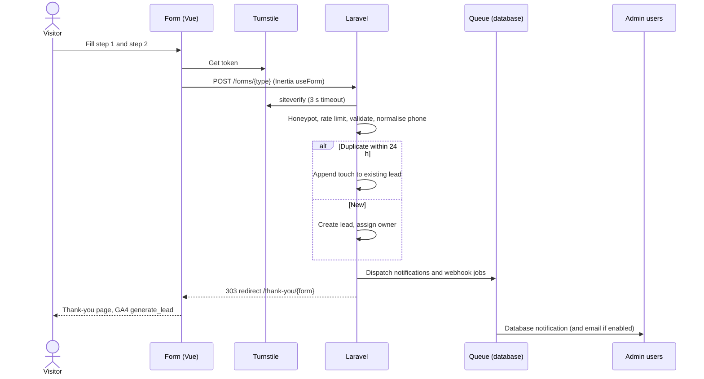
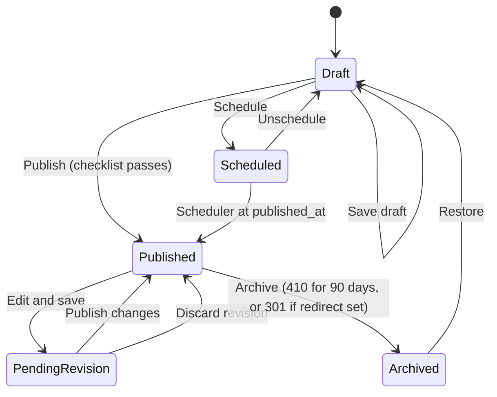
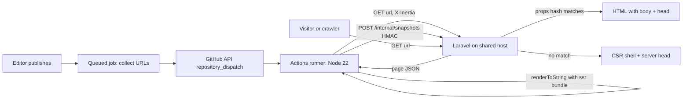
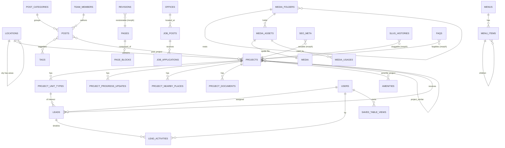

# REQUIREMENT.md — Gemcon City Limited Website

> Single source of truth for scope, behaviour, data and delivery. Visual and interaction specifications live in `DESIGN.md`; this document references them by ID (`CMP-*`, `LAY-*`, `MOT-*`, `TOK-*`).

---

## 1. Document control

| Field | Value |
|---|---|
| Document | REQUIREMENT.md |
| Version | 1.0.0 |
| Date | 25 Oct 2026 |
| Status | Approved for build (Phase 1 answers received 25 Oct 2026) |
| Owner | Gemcon City Limited (client) |
| Author | Product / architecture lead |
| Companion | `DESIGN.md` v1.0.0 |
| Change rule | Any change to an ID's meaning bumps the minor version and is logged in §17 |

### 1.1 Glossary

| Term | Meaning in this project |
|---|---|
| Project | A development (building, complex, plot scheme) sold by Gemcon City. The primary listing entity. Also called "property" on the public site. |
| Unit type | A configuration inside a project (e.g. "Type A, 1,850 sft, 3 bed"). No per-unit inventory is tracked. |
| Segment | Project category: Residential, Commercial, Mixed-use, Land/Plot. |
| Status | Project lifecycle: Upcoming, Ongoing (booking open), Ready, Handed over. |
| Location | Hierarchical place: City → Area (e.g. Dhaka → Bashundhara R/A). Drives location landing pages. |
| Lead | Any enquiry captured by a form (project enquiry, site visit, brochure, callback, contact, landowner, NRB). |
| sft | Square feet. Primary area unit. |
| katha | Land unit used in Bangladesh. 1 katha = 720 sft (Dhaka convention, used site-wide). |
| BDT | Bangladeshi Taka, the only currency. Formatted `৳ 1,25,00,000` (Indian/South-Asian grouping) or `Tk 1.25 crore` in compact form. |
| NRB | Non-Resident Bangladeshi buyer. |
| RAJUK | Rajdhani Unnayan Kartripakkha, Dhaka's development authority; its approval number is a trust signal. |
| Block | A reorderable, toggleable page-builder section (§8.1). |
| Snapshot | Pre-rendered HTML of a public page produced by the SSR bundle outside the web host (§9.1). |
| CSR | Client-side rendering. |
| LCP / INP / CLS | Core Web Vitals: Largest Contentful Paint, Interaction to Next Paint, Cumulative Layout Shift. |

### 1.2 ID scheme

| Prefix | Area | Prefix | Area |
|---|---|---|---|
| `BG` | Business goal | `CMS` | Content management |
| `KPI` | Success metric | `SEO` | Search / rendering / performance |
| `PG` | Public page | `ADM` | Admin dashboard |
| `HERO` | Hero section | `DM` | Data model entity |
| `FR-PROJ` | Projects & unit types | `ARC` | Architecture |
| `FR-SRCH` | Search & filters | `NFR` | Non-functional |
| `FR-LOC` | Locations | `QA` | Testing |
| `FR-LEAD` | Leads & forms | `DEP` | Deployment |
| `FR-NEWS` | News / blog | `M` | Milestone |
| `FR-SOC` | Testimonials, partners, FAQs, team | `DEC` | Decision (§17) |
| `FR-CAR` | Careers | `OPEN` | Open item (§18) |
| `FR-SHORT` | Shortlist & compare | | |

---

## 2. Project overview

### 2.1 Business goals

| ID | Goal |
|---|---|
| BG-01 | Generate qualified sales leads for residential, commercial and land projects, with source attribution per lead. |
| BG-02 | Rank on Google for project names, "flat for sale in {area}" and "commercial space in {area}" queries in Dhaka and other operating cities. |
| BG-03 | Build trust: show approvals (RAJUK), construction progress, handed-over projects and the Gemcon Group parent brand. |
| BG-04 | Acquire land through joint-venture (landowner) enquiries. |
| BG-05 | Let non-technical staff publish and edit every public element without a developer. |
| BG-06 | Run on the client's existing shared hosting with zero paid third-party APIs (DEC-01, DEC-07). |

### 2.2 Personas

| ID | Persona | Needs | Primary pages |
|---|---|---|---|
| P1 | Family buyer, Dhaka, 30–50 | Size, bedrooms, location, handover date, price indication, site visit | Home, Projects, Project detail, Location pages |
| P2 | NRB buyer (Gulf, UK, US, Malaysia) | Trust, remote process, progress photos, WhatsApp contact across time zones | NRB page, Project detail, Progress, Contact |
| P3 | Commercial buyer / tenant | Floor area, frontage, parking, road width, location | Commercial segment page, Project detail |
| P4 | Landowner | Partnership terms, track record, simple submission | Landowner page |
| P5 | Job seeker | Open roles, culture, apply with CV | Careers |
| P6 | Content editor (internal) | Fast publishing, previews, media reuse | Admin |
| P7 | Sales executive (internal) | Assigned leads, status pipeline, notes, export | Admin → Leads |

### 2.3 Success metrics

Baseline = first 30 days after launch, measured in GA4 and Google Search Console (GSC).

| ID | Metric | Target | Measured in |
|---|---|---|---|
| KPI-01 | Lead form submissions (all types, excluding spam) | +30% month-over-month for months 2–4, then ≥ baseline × 2 by month 6 | Admin Leads report, GA4 `generate_lead` |
| KPI-02 | Visit-to-lead conversion on project detail pages | ≥ 2.0% of sessions landing on `PG-04` | GA4 exploration |
| KPI-03 | Indexed pages | ≥ 95% of URLs in sitemaps indexed within 30 days of submission | GSC Pages report |
| KPI-04 | Organic sessions | +50% at month 6 versus baseline | GA4 |
| KPI-05 | Core Web Vitals | "Good" for ≥ 75% of mobile page loads on all URL groups | GSC CWV report (CrUX) |
| KPI-06 | Lead first-response time | Median ≤ 4 working hours from `new` to `contacted` | Admin lead status history |
| KPI-07 | Editor self-sufficiency | 0 developer tickets for content changes after month 1 | Ticket log |

---

## 3. Reference analysis summary

Full analysis: Phase 1 doc. Condensed findings and adoption:

| Source | What we adopt | What we avoid |
|---|---|---|
| rancondevelopments.com | Detail-page structure: sticky in-page tabs; "At a glance" facts (units, size, land katha, handover, RAJUK no., facing, road width, lifts, parking); unit-type plans with availability; architect credits; % construction progress with stage bar; nearby travel times; related projects; WhatsApp link with pre-filled project text; editorial restraint and large photography | Brand-only `<title>`s; empty gallery `alt`; no search on home |
| shantaholdings.com | Premium, image-led tone | Client-only rendering (raw HTML = a loader GIF; non-JS crawlers see nothing); generic meta description |
| btibd.com | Hero search widget (size band, bedrooms, location); filter by type/status/location; card stats (size, bed, bath, land); two-step qualifying lead form (timeline, purpose, contact time → contact details); gated brochure; sticky mobile Call/WhatsApp/Enquire bar; keyword-rich detail titles; Landowner, Construction status, NRB pages | Missing home H1; headings used for styling (H4/H6 card data); identical `alt` on every gallery image; testimonials as screenshots; intrusive popup; "18 min read" on home |
| polpharmabiologics.com | Motion language: split-line heading reveals, image mask reveals, counters, logo/team marquees, numbered process steps, tabbed pillars | Motion that blocks content or ignores reduced-motion preferences |
| Gemcon Group dashboard screenshots | Admin IA (grouped sidebar with counts, breadcrumbs, `/` command search, page header with description and actions, KPI cards, quick actions, reorderable lists, media folders, empty states, maintenance and activity screens) | Native selects and `mm/dd/yyyy` inputs; unlabeled icon actions; tables without column control or bulk actions; raw-zero KPIs; duplicate sign-in log rows |

We go beyond all references with: SSR-equivalent crawlable HTML on every public page (§9.1), complete JSON-LD (§9.4), indexable location and segment landing pages (`FR-LOC`), text testimonials, admin-enforced alt text, and measured Core Web Vitals budgets (§9.5).

---

## 4. Scope

### 4.1 In scope (v1.0)

- Public website, English only, all pages in §5.
- Projects with unit types, galleries, floor plans, videos, brochures, progress updates, nearby places, map.
- Search and filters with URL-synced state; indexable segment, status and location landing pages.
- Lead capture (7 lead types), spam protection, in-dashboard pipeline, CSV/XLSX export.
- Page builder with 28 block types (§8.1), global settings, menus, media library, redirects, robots, sitemaps.
- News/blog with categories and tags.
- Testimonials, partners, FAQs, team/leadership, careers with CV upload.
- Browser-only shortlist (favourites) and compare (up to 3 projects).
- Admin with 6 roles, 2FA, audit log, saved table views, dark mode.
- SEO rendering via pre-rendered snapshots on shared hosting (§9.1), JSON-LD, Core Web Vitals budgets.
- Free integrations only: GA4/GTM, GSC, Cloudflare Turnstile, Cloudflare CDN (free plan), OpenStreetMap tiles, Google Maps keyless embed, WhatsApp click-to-chat, hosting SMTP.

### 4.2 Out of scope (v1.0)

| Item | Reason |
|---|---|
| Visitor registration / login | Client decision (Q7) |
| Public agent profiles and agent accounts | Default accepted (Q6); leads go to the sales team |
| SMS, push, WhatsApp Business API, paid email APIs, paid maps | Client decision: no paid APIs (Q10) |
| Bangla language | English only (Q8); see future phases |
| Per-unit inventory, booking, online payment | Default accepted (Q3) |
| External CRM | Outbound webhook only (FR-LEAD-012) |
| Live Node SSR process | Not possible on shared hosting (DEC-01); upgrade path documented |
| Mortgage/EMI calculator | Not requested |

### 4.3 Future phases

| Phase | Item | Precondition |
|---|---|---|
| F1 | Move to VPS and switch to live Inertia SSR (`SEO-REN-07`) | Hosting budget |
| F2 | Bangla (`bn`) translations with hreflang | Translation budget; schema migration to translatable JSON columns |
| F3 | CRM integration through the webhook | CRM chosen |
| F4 | Customer portal (installments, documents) | Separate project |
| F5 | EMI calculator block | Bank partner data |

---

## 5. Sitemap & page inventory

### 5.1 Sitemap

```mermaid
flowchart TD
  H["/ Home PG-01"] --> P["/projects PG-02"]
  P --> PD["/projects/{slug} PG-04"]
  P --> PS["/projects/type/{segment} PG-03"]
  P --> PST["/projects/status/{status} PG-03"]
  H --> L["/locations PG-05"]
  L --> LD["/locations/{area} PG-06"]
  LD --> LDS["/locations/{area}/{segment} PG-06"]
  H --> A["/about PG-07"]
  A --> AL["/about/leadership PG-08"]
  H --> S["/services PG-09"]
  H --> LO["/landowner PG-10"]
  H --> N["/nrb PG-11"]
  H --> NW["/news PG-12"]
  NW --> NC["/news/category/{slug} PG-13"]
  NW --> NT["/news/tag/{slug} PG-13"]
  NW --> NA["/news/{slug} PG-14"]
  H --> C["/careers PG-15"]
  C --> CJ["/careers/{slug} PG-16"]
  H --> CO["/contact PG-17"]
  H --> F["/faq PG-18"]
  H --> SR["/search PG-19"]
  H --> SH["/shortlist PG-20"]
  H --> CM["/compare PG-21"]
  H --> TY["/thank-you/{form} PG-22"]
  H --> PP["/privacy-policy PG-23"]
  H --> T["/terms PG-24"]
  H --> CP["/{page-slug} PG-25 custom"]
  H --> E["404 / 500 / 503 PG-26"]
```



### 5.2 Page inventory

Every page's layout is specified in `DESIGN.md` §7 under the matching `LAY-*` ID. "Builder" = sections are page-builder blocks (§8.1) editable in admin; "Template" = fixed structure fed by entity data with editable copy fields.

| ID | URL | Purpose | Sections (top → bottom) | Data source | Index | Layout |
|---|---|---|---|---|---|---|
| PG-01 | `/` | Brand, search entry, featured projects, trust | Hero (HERO-*) with search widget; Intro statement; Featured projects carousel; Segments (4 tiles); Stats counters; Ongoing projects; Construction progress highlight; Testimonials; Partners marquee; Latest news (3); Landowner CTA band; Footer | Builder (page `home`) | index | LAY-HOME |
| PG-02 | `/projects` | Browse and filter all projects | Page header (H1 "Projects in Bangladesh"); Filter bar; Result count + sort; Grid/Map toggle; Project cards (12/page); Pagination; Location links block; CTA band | Template + `projects` | index (unfiltered page 1–n) | LAY-PROJ-LIST |
| PG-03 | `/projects/type/{segment}`, `/projects/status/{status}` | Indexable facet landing pages | Same as PG-02 with facet-specific H1, intro text (editable per facet), FAQ (optional) | Template + `facet_pages` | index | LAY-PROJ-LIST |
| PG-04 | `/projects/{slug}` | Convert interest into a lead | Gallery hero; Title block (name, status, segment, location, price-from if shown); Sticky tab bar (Overview, At a glance, Amenities, Plans, Gallery, Video, Progress, Location, Documents); Overview; At a glance; Amenities; Unit types & floor plans; Gallery; Video; Architect/consultants; Progress; Location (map + nearby); Brochure; Enquiry panel (sticky on desktop); Similar projects; Sticky mobile contact bar | Template + `projects` and relations | index | LAY-PROJ-DETAIL |
| PG-05 | `/locations` | Directory of areas | Header; City groups with area tiles + project counts | Template + `locations` | index | LAY-LOC-LIST |
| PG-06 | `/locations/{area}`, `/locations/{area}/{segment}` | Rank for "{segment} in {area}" | Area hero image; H1 "Flats and commercial spaces in {Area}"; Editable intro (≥ 150 words required to be indexable, FR-LOC-003); Projects in area; Area facts (editable list); Map of area projects; Nearby areas links; FAQ; CTA | Template + `locations` | index if ≥ 1 published project and intro ≥ 150 words, else `noindex,follow` | LAY-LOC-DETAIL |
| PG-07 | `/about` | Company story and trust | Builder: Hero (image); Story; Mission/Values; Milestones timeline; Stats; Gemcon Group parent; Awards; Certifications; CTA | Builder | index | LAY-ABOUT |
| PG-08 | `/about/leadership` | Leadership and team | Header; Leadership grid; Management grid; Team groups | `team_members` | index | LAY-TEAM |
| PG-09 | `/services` | What the company offers | Builder: Hero; Service cards (Residential, Commercial, Land/Plot, Joint venture, After-sales); Process steps; FAQ; CTA | Builder | index | LAY-SERVICES |
| PG-10 | `/landowner` | Acquire land via JV | Builder: Hero; Benefits; Process steps; Terms overview; Track record (handed-over projects); FAQ; Landowner form (FR-LEAD) | Builder + form | index | LAY-LANDOWNER |
| PG-11 | `/nrb` | Serve NRB buyers | Builder: Hero; Why buy; Remote process steps; Payment/legal notes; Testimonials (NRB-tagged); NRB form | Builder + form | index | LAY-NRB |
| PG-12 | `/news` | News and articles index | Header; Featured post; Category pills; Post grid (9/page); Pagination | `posts` | index | LAY-NEWS-LIST |
| PG-13 | `/news/category/{slug}`, `/news/tag/{slug}` | Topic archives | As PG-12 filtered; category intro text | `posts`, `post_categories`, `tags` | category: index; tag: index only if ≥ 3 published posts, else `noindex,follow` | LAY-NEWS-LIST |
| PG-14 | `/news/{slug}` | Article | Breadcrumb; Title; Meta (date, category, read time); Cover image; Body (rich text); Tags; Share; Related posts (3); Newsletter CTA | `posts` | index | LAY-NEWS-DETAIL |
| PG-15 | `/careers` | Employer brand and roles | Builder intro (culture, benefits); Open roles list with department/location/type filters; "No openings" state with CV drop | Builder + `job_posts` | index | LAY-CAREERS |
| PG-16 | `/careers/{slug}` | Job detail and application | Title, meta, description, requirements, benefits, deadline; Apply form | `job_posts` | index while open; 410 Gone 30 days after close (SEO-TEC-012) | LAY-CAREER-DETAIL |
| PG-17 | `/contact` | Contact and offices | Header; Contact form; Office cards (address, phone, email, hours, map); WhatsApp; Social | Settings + `offices` + form | index | LAY-CONTACT |
| PG-18 | `/faq` | Common questions | Header; Category tabs; Accordions; CTA | `faqs` | index | LAY-FAQ |
| PG-19 | `/search?q=` | Site-wide search results | Query box; Results grouped: Projects, News, Pages; Empty state | Scout (FR-SRCH-010) | `noindex,follow` | LAY-SEARCH |
| PG-20 | `/shortlist` | Saved projects (browser) | Header; Cards from localStorage IDs; Empty state; "Enquire about all" | `projects` by IDs | `noindex,nofollow` | LAY-SHORTLIST |
| PG-21 | `/compare?ids=` | Compare up to 3 projects | Comparison table of facts | `projects` by IDs | `noindex,nofollow` | LAY-COMPARE |
| PG-22 | `/thank-you/{form}` | Post-submit confirmation and conversion tracking | Confirmation message (per form, editable); Next steps; Related projects; WhatsApp | Settings per form | `noindex,nofollow` | LAY-THANKS |
| PG-23 | `/privacy-policy` | Legal | Rich text; last-updated date | Builder (legal page) | index | LAY-LEGAL |
| PG-24 | `/terms` | Legal | Rich text; last-updated date | Builder (legal page) | index | LAY-LEGAL |
| PG-25 | `/{page-slug}` | Any custom page | Builder blocks | Builder | per-page setting | LAY-CUSTOM |
| PG-26 | 404, 410, 419, 429, 500, 503 | Errors | Message; Search box (404); Popular projects (404); Home link | Settings (editable copy) | `noindex` | LAY-ERROR |

Reserved slugs that custom pages (PG-25) cannot use: `projects, locations, about, services, landowner, nrb, news, careers, contact, faq, search, shortlist, compare, thank-you, privacy-policy, terms, admin, login, api, internal, storage, build, sitemap, sitemaps, robots.txt, up`.

---

## 6. Hero section requirements

The hero appears on PG-01 (always) and optionally on builder pages via the `hero` block. Component spec: `DESIGN.md` CMP-HERO-01/02; motion: MOT-REVEAL, MOT-PARALLAX.

### 6.1 Modes

| ID | Requirement |
|---|---|
| HERO-001 | A hero has `mode` = `single` or `slider`. Default `single`. |
| HERO-002 | `single` supports `media_type` = `image` or `video`. |
| HERO-003 | `slider` supports 2–5 image slides only (no video). Autoplay is off by default; when enabled the interval is 7 s, it pauses on hover, focus and when the tab is hidden, and a visible pause/play button is always rendered (WCAG 2.2.2). |
| HERO-004 | Rationale (DEC-09): a single hero gives one stable LCP element and one message; sliders split attention and only slide 1 is ever LCP. Slider is retained for campaigns. |

### 6.2 Content fields (admin)

| Field | Type | Rules |
|---|---|---|
| eyebrow | string | ≤ 40 chars, optional |
| headline | string | Required, ≤ 80 chars. Rendered as the page H1 on PG-01; as H2 when the block is not first on a page |
| subheadline | string | ≤ 160 chars |
| primary_cta | link (label ≤ 24 chars + target: page / project / location / URL) | Optional |
| secondary_cta | link | Optional |
| overlay_opacity | integer 0–80, step 5 | Default 45. Enforced minimum 35 when headline is present (keeps white text ≥ 4.5:1 on any image, see DESIGN TOK contrast table) |
| overlay_style | enum `solid`, `gradient-bottom`, `gradient-left` | Default `gradient-bottom` |
| text_align | enum `left`, `center` | Default `left` |
| show_search | boolean | Default true on PG-01. Renders CMP-SEARCH-01 |
| height | enum `full` (100svh, min 560 px), `large` (80svh), `medium` (60svh) | Default `full` on PG-01 |

### 6.3 Image background

| ID | Requirement |
|---|---|
| HERO-010 | Source image required: JPEG/PNG/WebP/AVIF, ≥ 1920×1080 px, ≤ 12 MB. Upload rejected below 1920 px width. |
| HERO-011 | Conversions generated (queued) at widths 640, 960, 1280, 1600, 1920, 2560 in AVIF (when the server's GD supports `imageavif`), WebP and JPEG. Quality: AVIF 50, WebP 72, JPEG 78. |
| HERO-012 | Rendered as `<picture>` with AVIF and WebP `<source>`s, `sizes="100vw"`, explicit `width`/`height`, `fetchpriority="high"`, `decoding="async"`, **no** `loading="lazy"`. |
| HERO-013 | Focal point (x%, y%) set by clicking the image in admin; applied as `object-position`. Separate optional mobile crop image (portrait, ≥ 1080×1350) served via `<source media="(max-width: 767px)">`. |
| HERO-014 | `alt` required (≤ 125 chars) unless marked decorative; decorative images render `alt=""`. |

### 6.4 Video background

| ID | Requirement |
|---|---|
| HERO-020 | Sources: MP4 (H.264, required) and WebM (VP9, optional). No audio track. |
| HERO-021 | Poster image is mandatory and follows HERO-010…014; it is the LCP element. |
| HERO-022 | Limits enforced on upload: MP4 ≤ 6 MB, WebM ≤ 5 MB, ≤ 1920×1080, ≤ 20 s, ≤ 30 fps. Server reads duration/size from the file header with `getID3` (pure PHP; no ffmpeg needed on shared hosting). Rejected files show the exceeded limit. |
| HERO-023 | Compression guidance shown in the upload dialog: `ffmpeg -i in.mov -an -vf "scale=1920:-2,fps=25" -c:v libx264 -profile:v high -preset slow -crf 26 -maxrate 3.5M -bufsize 7M -movflags +faststart -pix_fmt yuv420p hero.mp4` and `ffmpeg -i in.mov -an -vf "scale=1920:-2,fps=25" -c:v libvpx-vp9 -b:v 0 -crf 36 -row-mt 1 hero.webm`. (Compression happens on the editor's machine; the host has no ffmpeg.) |
| HERO-024 | Attributes: `muted autoplay loop playsinline disablepictureinpicture preload="none"`, `aria-hidden="true"` (decorative), `tabindex="-1"`. |
| HERO-025 | **Video is loaded only when all are true**: viewport width ≥ 1024 px; `prefers-reduced-motion: no-preference`; `navigator.connection?.saveData !== true`; `navigator.connection?.effectiveType` not in `slow-2g`, `2g`, `3g`; document visible. Otherwise the poster image stays. Rationale (DEC-10): Bangladesh mobile data is metered and 4G throughput varies; a 6 MB video on mobile costs users money and competes with LCP. |
| HERO-026 | Loading sequence: (1) server HTML contains the poster `<picture>` only, no `<video>`; (2) after `window.load` + `requestIdleCallback` (timeout 2000 ms) and HERO-025 checks, a `<video>` is inserted under the poster with `src` set; (3) on `canplaythrough` it fades in over 600 ms (`MOT-HERO-VIDEO`); (4) an IntersectionObserver pauses the video when < 10% visible and resumes when visible. |
| HERO-027 | A visible pause/play toggle (CMP-HERO-02 control) is rendered whenever video plays; state persists in `sessionStorage` (`hero-video=paused`). Required by WCAG 2.2.2 for motion > 5 s. |
| HERO-028 | If the video errors, the poster remains and the error is logged once per session to the client error endpoint (`/internal/client-errors`, rate-limited). |

### 6.5 LCP protection

| ID | Requirement |
|---|---|
| HERO-030 | The root Blade template emits `<link rel="preload" as="image" imagesrcset="…" imagesizes="100vw" type="image/avif" fetchpriority="high">` for the hero image (or poster) of the current page, generated server-side from the page's `lcp_image` prop. Only one preload per page. |
| HERO-031 | When a separate mobile crop exists, two preloads are emitted with `media="(max-width: 767px)"` and `media="(min-width: 768px)"`. |
| HERO-032 | No hero text animation may hide the H1 at first paint: reveal animations on hero text start from `opacity: 1` on first load (they animate `clip-path`/`transform` only, MOT-REVEAL-HERO) so LCP is not delayed by opacity. |
| HERO-033 | Hero height is reserved by CSS (`min-height` per §6.2 `height`) so CLS from the hero = 0. |
| HERO-034 | Acceptance: on a Moto G Power–class Lighthouse mobile profile, PG-01 LCP ≤ 2.5 s with a video hero configured, and the LCP element is the poster ``. |

### 6.6 Embedded search widget

| ID | Requirement |
|---|---|
| HERO-040 | Fields: Segment (select), Location (combobox, areas grouped by city), Status (select), Size (select of bands from Settings, default: < 1,200 sft; 1,200–1,600; 1,600–2,000; 2,000–2,500; 2,500+), Bedrooms (1–5+). Submit button "Search projects". |
| HERO-041 | Submit performs a GET navigation to `/projects` with query parameters (FR-SRCH-002). If only one facet is chosen and it maps to a landing page (segment, status or location), navigate to that clean URL instead (e.g. Location = Bashundhara → `/locations/bashundhara-ra`). |
| HERO-042 | Works without JavaScript: it is a real `<form method="get" action="/projects">`. |
| HERO-043 | On < 768 px the widget collapses to a single "Search projects" button that opens a bottom sheet with the same fields (CMP-SEARCH-01 mobile). |

---

## 7. Functional requirements by module

Conventions: "Editor" = Content Editor role or higher; permission names refer to §10.2. Acceptance criteria use Given/When/Then. Validation is enforced server-side in Form Requests (ARC-004) and mirrored client-side for UX only.

### 7.1 Projects and unit types (`FR-PROJ`)

**Description.** A project is the listing entity. It carries facts, media, unit types, amenities, progress updates, nearby places, documents and SEO fields. Public pages: PG-02, PG-03, PG-04. Data: DM-PROJ, DM-UNIT, DM-AMEN, DM-PROG, DM-NEAR.

**Project types and statuses**

| Field | Values |
|---|---|
| Segment | `residential`, `commercial`, `mixed_use`, `land` |
| Status | `upcoming`, `ongoing`, `ready`, `handed_over` |
| Booking state (badge) | `booking_open`, `limited_units`, `sold_out`, `none` |

**User stories**

| ID | Story |
|---|---|
| FR-PROJ-001 | As a buyer, I can open a project page and see its key facts within the first screen (name, segment, status, location, size range, bedrooms range, handover date). |
| FR-PROJ-002 | As a buyer, I can view unit types with size, bedrooms, bathrooms, balconies, facing, floor plan image and availability, and see a price only when the company chose to show it. |
| FR-PROJ-003 | As a buyer, I can browse the gallery in a full-screen lightbox with keyboard and swipe navigation. |
| FR-PROJ-004 | As a buyer, I can download the brochure after giving my name and phone (when gating is on). |
| FR-PROJ-005 | As an NRB buyer, I can see dated construction progress with percentage and photos. |
| FR-PROJ-006 | As a buyer, I can see the location on a map and travel times to nearby landmarks, and open it in Google Maps. |
| FR-PROJ-007 | As a buyer, I can see up to 3 similar projects. |
| FR-PROJ-008 | As an editor, I can create, edit, duplicate, reorder (featured order), publish, schedule, unpublish and soft-delete projects. |
| FR-PROJ-009 | As an editor, I can choose per project and per unit type whether a price is shown. |
| FR-PROJ-010 | As an editor, I can mark a project featured; featured projects appear on PG-01 in manual order. |

**Fields (summary; full schema in DM-PROJ / DM-UNIT)**

- Identity: name, slug, tagline (≤ 120), segment, status, booking state, featured flag, featured order.
- Facts ("At a glance"): address line, location (area), latitude, longitude, land area (katha, decimal 2), storeys (e.g. "2B + G + 12"), total units, units per floor, lifts, car parks, basements, road width (ft), facing, orientation, handover date (month precision), launch date, RAJUK approval no., architect, structural engineer, contractor, custom facts (repeater of label/value, max 12).
- Content: overview (rich text, ≥ 120 words to publish), design narrative (rich text, optional), amenities (multi-select from DM-AMEN + order), feature highlights (repeater: image, title, text; max 8).
- Media: cover image (required), gallery (≥ 4 images to publish, max 60, each with alt + caption + category: exterior/interior/amenity/site/night), video (YouTube URL or uploaded MP4 ≤ 50 MB with WebVTT captions file required when the video has speech — `DESIGN.md` A11Y-D07), virtual tour URL (allowed hosts: `my.matterport.com`, `kuula.co`, `www.youtube.com`), brochure PDF (≤ 20 MB), additional documents (PDF, max 5, each public or gated).
- Pricing: `show_price` (bool, default false), `price_from_bdt` (computed from shown unit types, overridable), `price_note` (≤ 80, e.g. "Excluding registration").
- Unit types (repeater, 1–20): name, size sft (int), size range max (optional), bedrooms, bathrooms, balconies, facing, floor range text, floor plan image (required), plan description (≤ 300 chars, room sizes for screen-reader users — `DESIGN.md` A11Y-D11), 3D plan image, price BDT (optional), `show_price` (bool), availability (`available`, `limited`, `sold_out`), order.
- Progress updates (repeater): date (month), percent 0–100, stage (`foundation`, `structure`, `finishing`, `complete`), note (≤ 300), photos (max 12).
- Nearby places (repeater, max 10): name, category (`school`, `hospital`, `mall`, `mosque`, `transport`, `park`, `office`, `airport`), travel time minutes, mode (`drive`, `walk`).
- Relations: location (required), similar projects (manual, max 3; when empty, auto = same segment + same city, newest first).
- SEO: §9.3 fields via DM-SEO.
- Lead routing: default assignee (user with Sales role, optional), WhatsApp number override.

**Validation rules**

| Field | Rule |
|---|---|
| name | required, 3–90 chars, unique among non-deleted projects |
| slug | auto from name (`str()->slug()`), editable, `^[a-z0-9]+(?:-[a-z0-9]+)*$`, ≤ 80, unique; change creates a slug history row (SEO-TEC-003) |
| latitude / longitude | required to publish; lat 20.5–26.7, lng 88.0–92.7 (Bangladesh bounding box) |
| handover date | ≥ launch date when both set |
| percent (progress) | integer 0–100; a newer update cannot have a lower percent than an older one (warning, overridable with reason) |
| price_bdt | integer ≥ 100,000 and ≤ 10,000,000,000 when present |
| images | JPEG/PNG/WebP/AVIF, ≥ 1200 px wide (gallery), ≥ 1600 px (cover), ≤ 12 MB, alt required (≥ 5, ≤ 125 chars) |
| publish | blocked until: cover, ≥ 4 gallery images, overview ≥ 120 words, location, lat/lng, ≥ 1 unit type (except `land` segment), meta description present or auto-template resolvable |

**Acceptance criteria**

- **AC-PROJ-01** Given a published project with `show_price=false`, When any visitor or crawler loads PG-04, Then no price string appears in HTML, JSON-LD or the Inertia page props.
- **AC-PROJ-02** Given unit types where only "Type B" has `show_price=true` at ৳ 1,45,00,000, When PG-04 renders, Then "Type B" shows "৳ 1.45 crore" and the title block shows "From ৳ 1.45 crore" only if the project's `show_price=true`.
- **AC-PROJ-03** Given a draft project missing a cover image, When the editor clicks Publish, Then publishing is refused and a checklist lists each unmet rule with a link to the field.
- **AC-PROJ-04** Given a project scheduled for 01 Dec 2026 09:00 Asia/Dhaka, When the scheduler runs at or after that minute, Then status becomes published, sitemaps regenerate and a snapshot render is requested (SEO-REN-04).
- **AC-PROJ-05** Given gating is on, When a visitor submits name and a valid phone in the brochure dialog, Then a `brochure_download` lead is stored and the PDF download starts via a signed URL valid 10 minutes.
- **AC-PROJ-06** Given a project is soft-deleted, When its URL is requested, Then the response is 410 Gone for 90 days, then 404; if an editor set a redirect target, 301 to it instead.
- **AC-PROJ-07** Given a project with no manual similar projects, When PG-04 renders, Then up to 3 published projects of the same segment and city appear, excluding itself.

**Edge cases**

- Project with zero unit types (land segment): "Plans" tab hidden; plot sizes come from custom facts.
- Handed-over project: enquiry panel heading switches to "Interested in a resale or a similar project?" and lead type stays `project_inquiry`.
- Gallery image deleted from library while used: blocked by media usage check (CMS-MED-008).
- YouTube video ID invalid: validation calls nothing external; regex on URL shape only (`youtube.com/watch?v=`, `youtu.be/`, `youtube.com/shorts/`).

**Permissions:** `projects.view`, `projects.create`, `projects.update`, `projects.publish`, `projects.delete`. Content Editor cannot delete.

### 7.2 Search and filters (`FR-SRCH`)

| ID | Requirement |
|---|---|
| FR-SRCH-001 | Filters on PG-02/03/06: keyword (`q`), segment, status, location (area, multi), size band or min/max sft, bedrooms (min), price range (min/max BDT), booking state, featured only. Sort: `featured` (default), `newest`, `handover_asc`, `size_asc`, `size_desc`, `price_asc`, `price_desc`. |
| FR-SRCH-002 | All filter state lives in the URL query string: `?q=&segment=&status=&area[]=&size_min=&size_max=&beds=&price_min=&price_max=&sort=&page=`. Empty values are omitted. Parameter order is normalised (alphabetical) so equal filters produce one URL. |
| FR-SRCH-003 | Changing a filter triggers an Inertia partial reload (`only: ['projects','facets','meta']`) with `preserveScroll: true`, `preserveState: true`, `replace: true` for typing inputs (debounced 350 ms) and `replace: false` for discrete selections so Back undoes them. |
| FR-SRCH-004 | Facet counts are returned with results and shown next to each option; options with 0 results are disabled (not hidden). |
| FR-SRCH-005 | Price filter is shown only when at least `settings.search.price_filter_min_projects` (default 5) published projects have `show_price=true`. Price sorts are hidden under the same condition. Projects without visible price sort last in price sorts. |
| FR-SRCH-006 | Grid/map toggle: map view shows the same result set as markers (FR-LOC-006 map spec). State in URL `view=map`. |
| FR-SRCH-007 | Pagination: 12 per page, numbered links (`?page=n`) rendered as real `<a href>`; no infinite scroll on public listings. |
| FR-SRCH-008 | Clean-URL redirection: a request whose only active filter is one segment, one status or one area is 301-redirected to its landing page (`/projects/type/residential`, `/projects/status/ongoing`, `/locations/{area}`). |
| FR-SRCH-009 | SEO handling of filter URLs is defined in SEO-TEC-020…024. |
| FR-SRCH-010 | Site search (PG-19) uses Laravel Scout with the `database` engine over projects (name, tagline, location names, overview), posts (title, excerpt, body) and pages (title, meta description); MySQL FULLTEXT indexes on those columns. Minimum query length 2; results grouped by type, max 10 per group. |
| FR-SRCH-011 | Keyword search on PG-02 matches project name, tagline and location names (FULLTEXT, natural language mode), falling back to `LIKE %q%` on name for queries shorter than 4 chars. |

**Acceptance criteria**

- **AC-SRCH-01** Given `/projects?beds=3&segment=residential`, When the page loads directly (no JS), Then the server returns the filtered list in HTML (snapshot or CSR) with filters pre-selected, and `<meta name="robots" content="noindex,follow">` plus canonical `/projects/type/residential`.
- **AC-SRCH-02** Given the user selects Area = Uttara and Bedrooms = 4, When results update, Then the URL equals `/projects?area[]=uttara&beds=4`, the Back button restores the previous result set, and focus stays on the changed control.
- **AC-SRCH-03** Given `/projects?segment=commercial`, When requested, Then the server responds 301 to `/projects/type/commercial`.
- **AC-SRCH-04** Given a filter combination with no results, When rendered, Then an empty state shows "No projects match these filters", a "Clear filters" link and the 3 newest projects.

**Validation:** unknown parameters are dropped; numeric params cast and clamped (`size_min` 0–20,000; `beds` 1–6; `page` 1–max); invalid enum values ignored; `q` trimmed to 80 chars, stripped of tags.

**Edge cases:** page beyond last → 404 (not redirect); `area[]` with > 5 values truncated to 5; conflicting `size_min > size_max` → swapped.

**Permissions:** public.

### 7.3 Locations and area landing pages (`FR-LOC`)

| ID | Requirement |
|---|---|
| FR-LOC-001 | Locations are a two-level tree: City (e.g. Dhaka, Chattogram, Gazipur, Narayanganj) → Area (e.g. Bashundhara R/A, Uttara, Gulshan, Purbachal). Projects link to an Area. |
| FR-LOC-002 | Each Area has: name, slug, city, hero image, intro (rich text), facts repeater (label/value, max 8), latitude/longitude (centre), zoom (11–16), FAQ items (max 8), nearby areas (manual, max 6), SEO fields. |
| FR-LOC-003 | An Area page is indexable only when it has ≥ 1 published project and an intro of ≥ 150 words; otherwise it renders with `noindex,follow` and is excluded from sitemaps. The admin shows the reason. |
| FR-LOC-004 | `/locations/{area}/{segment}` exists only when the area has ≥ 2 published projects in that segment; otherwise 404. Its intro is optional; when absent, a template sentence plus the area intro is used and the page is `noindex,follow`. |
| FR-LOC-005 | PG-05 lists cities with their areas and published project counts, alphabetical. |
| FR-LOC-006 | Maps: area and listing maps use Leaflet 1.9.4 with OpenStreetMap standard tiles and required attribution; marker clustering via `leaflet.markercluster`; the map loads only when its container enters the viewport or when the user picks map view. Tiles never load on initial page view of PG-04. |
| FR-LOC-007 | Project detail location uses a static facade (a brand-styled SVG map-pattern placeholder, `DESIGN.md` CMP-MAP-02, showing the address and area name; no tile requests) with a "Show interactive map" button that loads a keyless Google Maps embed iframe (`https://maps.google.com/maps?q={lat},{lng}&z=16&output=embed`) and an "Open in Google Maps" link (`https://www.google.com/maps/search/?api=1&query={lat},{lng}`). |

**Acceptance criteria**

- **AC-LOC-01** Given area "Purbachal" with 0 published projects, When `/locations/purbachal` is requested, Then it returns 200 with `noindex,follow` and it is absent from `sitemap-locations.xml`.
- **AC-LOC-02** Given an area with 3 residential projects, When `/locations/uttara/residential` is requested, Then it returns 200 listing exactly those 3, and the breadcrumb is Home › Locations › Uttara › Residential.

**Permissions:** `locations.*` (Editor).

### 7.4 Leads and inquiries (`FR-LEAD`)

**Lead types and forms**

| Type | Form location | Fields (required *) |
|---|---|---|
| `project_inquiry` | PG-04 enquiry panel; PG-20 "enquire about all" | Step 1: Purchase timeline (Immediately / 1–3 months / 3–6 months / 6+ months), Purpose (Own residence / Investment / Business use), Preferred contact time (Morning 9–11:30 / Afternoon 12–4 / Evening 4–7). Step 2: Name*, Phone*, WhatsApp (checkbox "same as phone"), Email, Message, Unit type of interest, Consent* |
| `site_visit` | PG-04 "Book a site visit" | Name*, Phone*, Preferred date* (tomorrow … +60 days, Fridays allowed), Preferred time slot*, Visitors count (1–10), Message, Consent* |
| `brochure_download` | PG-04 brochure dialog | Name*, Phone*, Email, Consent* |
| `callback` | Sticky bar "Call me back", footer | Name*, Phone*, Preferred time*, Consent* |
| `contact` | PG-17 | Name*, Phone*, Email, Subject* (General / Sales / After-sales / Media / Other), Message* (20–2000), Consent* |
| `landowner` | PG-10 | Name*, Phone*, Email, Land location (area or free text)*, Land size (katha)*, Road width (ft), Plot facing, Ownership (Single / Joint / Other), Documents (up to 3 files: PDF/JPG/PNG, ≤ 5 MB each, private), Message, Consent* |
| `nrb` | PG-11 | Name*, Country of residence*, Phone with country code*, WhatsApp, Email*, Preferred contact time in Bangladesh time*, Budget band, Message, Consent* |
| Newsletter | Footer, PG-14 | Email*, Consent* (separate entity DM-SUBS, double opt-in by email when SMTP enabled; single opt-in otherwise, recorded) |
| Job application | PG-16 | See FR-CAR |

**Requirements**

| ID | Requirement |
|---|---|
| FR-LEAD-001 | Every lead stores: type, source page URL, project (nullable), unit type (nullable), UTM parameters (source, medium, campaign, term, content) captured from the landing URL into `sessionStorage` and submitted as hidden fields, referrer host, GA client ID (from `_ga` cookie when consent granted), IP (hashed after 90 days, NFR-PRIV-04), user agent, submitted_at. |
| FR-LEAD-002 | Phone validation: Bangladesh mobile `^(?:\+?88)?01[3-9]\d{8}$`; normalised to E.164 `+8801XXXXXXXXX`. NRB and when the country selector ≠ BD: E.164 `^\+[1-9]\d{7,14}$`. |
| FR-LEAD-003 | Spam protection, all free: (a) Cloudflare Turnstile (managed mode) verified server-side via `https://challenges.cloudflare.com/turnstile/v0/siteverify`; (b) honeypot field + minimum fill time 3 s (`spatie/laravel-honeypot`); (c) rate limit 5 submissions per 10 minutes per IP per form and 20 per day per phone; (d) content rules: > 3 URLs in message or non-Bengali/Latin script-only messages flag as `spam` status instead of rejecting. If Turnstile is unreachable (timeout 3 s), the submission is accepted and flagged `needs_review`. |
| FR-LEAD-004 | Duplicate handling: same normalised phone + same project within 24 h appends a "touch" (activity entry) to the existing lead instead of creating a new one; the visitor sees a normal success. |
| FR-LEAD-005 | After success, redirect to `/thank-you/{form}` (PG-22) which fires GA4 `generate_lead` with `lead_type`, `project_slug`, `form_location` via `dataLayer` (SEO-ANA-004). The brochure form instead stays on page and starts the download. |
| FR-LEAD-006 | Status pipeline: `new` → `contacted` → `site_visit_scheduled` → `site_visit_done` → `negotiation` → `won` / `lost`; plus `spam` and `needs_review`. Any status can move to `lost` or `spam`. `won` and `lost` require a reason (select + note). Every change is recorded in DM-LEADH with user and timestamp. |
| FR-LEAD-007 | Assignment: on creation, assign to the project's default assignee; otherwise to the round-robin pool of active users with role Sales Executive (by least open leads); otherwise unassigned. Sales Manager can reassign. |
| FR-LEAD-008 | Notifications (no paid APIs, DEC-07): (a) in-dashboard database notifications with an unread count on the top-bar inbox and Leads nav badge, polled every 60 s while the admin tab is visible; (b) optional email via the hosting SMTP account (`settings.notifications.email_enabled`, default **off**) to the assignee and a configurable list of addresses; (c) optional visitor autoresponder email (default **off**). No SMS, push or WhatsApp API. |
| FR-LEAD-009 | Leads admin: list (advanced table ADM-TBL), kanban board by status (drag to change status, keyboard accessible alternative via status menu), detail drawer with timeline (submissions, touches, notes, status changes, assignments), notes (rich text, internal), follow-up date with overdue highlighting, click-to-call (`tel:`) and WhatsApp (`https://wa.me/{number}?text=`) links. |
| FR-LEAD-010 | Export CSV/XLSX of current filtered view (ADM-TBL-012). Phone numbers exported as text to keep the leading `+`. |
| FR-LEAD-011 | Landowner and job uploads are stored on the private disk (`storage/app/private`), served only through an authorised controller, virus-scan not available on shared hosting → files are never executed or rendered inline; served as `Content-Disposition: attachment` with `X-Content-Type-Options: nosniff`. |
| FR-LEAD-012 | Outbound webhook (free, for future CRM): optional URL + secret in settings; on lead create/update, a queued POST with JSON body and `X-Signature: sha256=HMAC(body, secret)`; 3 retries with 1/5/15-minute backoff; delivery log kept 30 days. |
| FR-LEAD-013 | WhatsApp click-to-chat on PG-04 uses `https://wa.me/{e164-without-plus}?text={urlencoded "Hi, I'm interested in {Project}. {url}"}`; clicking fires GA4 `whatsapp_click` and creates **no** lead (no data captured). |
| FR-LEAD-014 | Consent checkbox text and the privacy link are editable in Settings → Forms; the exact text shown is stored with each lead. |

**Lead capture workflow**



**Acceptance criteria**

- **AC-LEAD-01** Given a valid project enquiry, When submitted, Then a lead exists with status `new`, the UTM values from the landing URL, an assignee per FR-LEAD-007, and the browser lands on `/thank-you/project-inquiry`.
- **AC-LEAD-02** Given the honeypot field is filled, When submitted, Then HTTP 422 is not returned (to avoid teaching bots); the response mimics success and no lead is stored.
- **AC-LEAD-03** Given 6 submissions from one IP within 10 minutes, When the 6th is posted, Then HTTP 429 with a friendly message and a `Retry-After` header.
- **AC-LEAD-04** Given phone `01712-345678`, When saved, Then it is stored as `+8801712345678`.
- **AC-LEAD-05** Given a Sales Executive, When they open Leads, Then they see only leads assigned to them.

**Permissions:** `leads.view_all` (Admin, Sales Manager), `leads.view_assigned` (Sales Executive), `leads.update`, `leads.assign`, `leads.export`, `leads.delete` (Admin only; soft delete).

### 7.5 News / blog (`FR-NEWS`)

| ID | Requirement |
|---|---|
| FR-NEWS-001 | Posts: title (≤ 110), slug, excerpt (≤ 200, used as default meta description), cover image (required, ≥ 1600 px, alt), body (Tiptap rich text: H2–H4, paragraph, bold, italic, link, bullet/ordered list, blockquote, image from media library with caption, YouTube embed, table, horizontal rule), category (exactly 1), tags (0–10), author (team member or user), published_at, featured flag, related projects (0–3), SEO fields. |
| FR-NEWS-002 | Categories: name, slug, description (shown on PG-13), order. Default categories seeded: News, Press releases, Buying guides, Construction updates, Events. |
| FR-NEWS-003 | Tags: free entry with autocomplete; merged when names match case-insensitively. |
| FR-NEWS-004 | Read time = ceil(words / 200) minutes, shown on PG-14 only (never on home). |
| FR-NEWS-005 | Body H1 is not allowed in the editor; the post title is the only H1. Headings inside body start at H2 and cannot skip levels (editor blocks H4 directly after H2). |
| FR-NEWS-006 | Images inserted in the body must come from the media library and inherit alt text; editor can override per insertion. |
| FR-NEWS-007 | Related posts: 3 newest published in the same category excluding self; fallback newest overall. |
| FR-NEWS-008 | RSS feed at `/news/feed.xml` (RSS 2.0, 20 latest). |

- **AC-NEWS-01** Given a post scheduled for the future, When requested publicly before that time, Then 404; When previewed through a signed preview URL by an editor, Then it renders with a "Preview" ribbon and `noindex`.
- **AC-NEWS-02** Given a post body with an image lacking alt, When saving, Then save is blocked with "Image 2 needs alt text or must be marked decorative".

**Permissions:** `posts.*`; Content Editor full except delete-forever.

### 7.6 Testimonials, partners, FAQs, team (`FR-SOC`)

| ID | Requirement |
|---|---|
| FR-SOC-001 | Testimonials: quote (40–600 chars, plain text), person name, designation/location, related project (optional), photo (optional, square ≥ 400 px), tag `nrb` (bool), rating omitted (no review markup, SEO-SD-011), order, published. Rendered as text, never images. |
| FR-SOC-002 | Partners: name, logo (SVG or PNG ≥ 300 px wide, transparent), URL (optional, `rel="noopener"` and `nofollow`), category (`bank`, `supplier`, `consultant`, `group_company`), order. Used by the marquee block. |
| FR-SOC-003 | FAQs: question (≤ 160), answer (rich text, limited: paragraph, bold, link, list), category (`buying`, `payment`, `legal`, `nrb`, `landowner`, `after_sales`, `general`), order, show_on (multi: faq page, project detail, location, landowner, nrb). Project-specific FAQs attachable to a project. |
| FR-SOC-004 | Team members: name, slug, role title, group (`leadership`, `management`, `team`), photo (portrait 4:5, ≥ 800 px), short bio (≤ 400), LinkedIn URL, email (optional, shown only if `show_email`), order, published. |
| FR-SOC-005 | Offices: name, address, city, phone(s), email, opening hours (structured: day ranges + times), lat/lng, is_head_office. Used in PG-17, footer and `LocalBusiness` JSON-LD. |
| FR-SOC-006 | Awards and certifications are page-builder `awards` block data (image, title, issuer, year) — not a separate entity. |

- **AC-SOC-01** Given 12 partners, When the marquee renders, Then logos appear once in the DOM for assistive technology (duplicate track is `aria-hidden="true"`), and the marquee pauses on hover and on focus within.

**Permissions:** `content.*` (Editor).

### 7.7 Careers (`FR-CAR`)

| ID | Requirement |
|---|---|
| FR-CAR-001 | Job posts: title, slug, department, location (office), employment type (`full_time`, `part_time`, `contract`, `internship`), experience (text), salary (optional text; shown only if set), description, responsibilities, requirements, benefits (rich text), deadline (date), status (`draft`, `open`, `closed`), SEO. |
| FR-CAR-002 | Apply form: name*, phone*, email*, current position, years of experience (0–50), expected salary, LinkedIn URL, CV* (PDF/DOC/DOCX ≤ 5 MB, private disk), cover letter (≤ 3000), consent*. Same spam rules as FR-LEAD-003. |
| FR-CAR-003 | Closing: job auto-closes after its deadline (scheduler, 00:05 Asia/Dhaka); closed jobs show "Applications closed" for 30 days, then return 410 Gone. |
| FR-CAR-004 | General CV drop on PG-15 when no roles are open (job_post_id null). |
| FR-CAR-005 | Applications admin: table, status (`new`, `shortlisted`, `interview`, `rejected`, `hired`), notes, CV download (authorised), export. |

- **AC-CAR-01** Given a CV of 6 MB, When submitted, Then the form shows "CV must be 5 MB or smaller" next to the file field and nothing is stored.

**Permissions:** `careers.*` (Admin, HR via custom role created by Super Admin).

### 7.8 Shortlist and compare (`FR-SHORT`)

Confirmed in Phase 1 as browser-only (no accounts).

| ID | Requirement |
|---|---|
| FR-SHORT-001 | Heart button on project cards and PG-04 toggles the project ID in `localStorage['gc.shortlist']` (max 20). Count badge in the header. |
| FR-SHORT-002 | PG-20 fetches cards for stored IDs via `GET /shortlist?ids=` (Inertia visit); unknown or unpublished IDs are dropped from storage. |
| FR-SHORT-003 | Compare: checkbox "Compare" on cards; max 3; a floating compare bar appears with selected names and "Compare" button → `/compare?ids=a,b,c`. Rows: segment, status, location, land area, storeys, units, size range, bedrooms, bathrooms, handover, parking, lifts, amenities (✓/–), price-from (only if shown). |
| FR-SHORT-004 | "Enquire about all" on PG-20 opens the project enquiry form with a multi-select prefilled; one lead per project is created (FR-LEAD-004 applies). |
| FR-SHORT-005 | When `localStorage` is unavailable (private mode errors), hearts are hidden and no error is thrown. |

- **AC-SHORT-01** Given 3 projects in compare, When the user ticks a 4th, Then the checkbox is refused with a toast "You can compare up to 3 projects".

### 7.9 Multilingual and multi-currency

Not in scope (Phase 1 Q8: English only; currency BDT only). Data model keeps all user-facing strings in plain columns; F2 migration path recorded in DEC-15.

---

## 8. Dynamic content management (`CMS`)

Rule CMS-000: every visible string, image, link and section on public pages is editable in the admin, except the structural chrome listed in CMS-000a. Acceptance: a content audit (QA-CMS-01) of every page in §5.2 finds no hard-coded copy outside CMS-000a.

CMS-000a (fixed in code, translatable later through `lang/en/*.php`): form field labels and validation messages, filter labels, button labels inside components ("Load more", "Close"), ARIA labels, error page technical text.

### 8.1 Page builder

| ID | Requirement |
|---|---|
| CMS-PB-001 | Builder pages (PG-01, 07, 09, 10, 11, 15 intro, 23, 24, 25) are an ordered list of blocks stored in DM-BLOCK. Each block has `type`, `data` (JSON validated per type), `is_visible` (toggle), `anchor_id` (optional, `^[a-z][a-z0-9-]{1,40}$`, unique per page), `background` (`default`, `muted`, `brand`, `dark`, `gradient`), `spacing` (`none`, `sm`, `md`, `lg`), `animate` (bool, default true). |
| CMS-PB-002 | Admin: block list (left), block form (right drawer), live preview (iframe, desktop/tablet/mobile widths 1280/834/390) refreshing 600 ms after the last edit. Drag-and-drop reorder (vue-draggable-plus) with keyboard alternative (Move up / Move down buttons, `Alt+↑/↓`). Duplicate, hide, delete (with undo toast 8 s). |
| CMS-PB-003 | Block data is validated server-side by a per-type `BlockSchema` class (Laravel validation rules) on save; invalid blocks are saved as draft-only and flagged red; publishing is blocked until fixed. |
| CMS-PB-004 | The first visible block's heading is the page H1 (hero `headline` or `page_header.title`); all other block headings render as H2 with internal H3s. A page without an H1-capable first block is blocked from publishing. |
| CMS-PB-005 | Max 30 blocks per page. |

**Block catalogue (28 types).** Component specs in `DESIGN.md` §6 (`CMP-BLK-*`).

| # | Type | Fields (required *) | Validation |
|---|---|---|---|
| 1 | `hero` | See §6.2–6.4 | §6 |
| 2 | `page_header` | title*, intro, background image, breadcrumb (bool) | title ≤ 80 |
| 3 | `intro_statement` | eyebrow, heading*, body (rich, ≤ 120 words), CTA, side image | — |
| 4 | `featured_projects` | heading*, source* (`featured`, `manual`, `segment`, `status`), manual IDs (≤ 12), segment, status, limit (3–12), layout (`carousel`, `grid`) | manual source needs ≥ 1 ID |
| 5 | `project_grid` | heading, preset filters (segment/status/area), limit (3–24), show "View all" link | — |
| 6 | `segment_tiles` | heading, tiles (2–4): segment*, image*, label, description | images ≥ 1200 px |
| 7 | `stats_counters` | heading, items (2–6): value* (number), suffix (≤ 4, e.g. "+", "M sft"), label* (≤ 40), decimals (0–1) | value ≤ 10^9 |
| 8 | `progress_highlight` | heading*, projects (1–3, must have progress updates) | — |
| 9 | `testimonials` | heading, source (`all`, `nrb`, `project`, `manual`), IDs, layout (`carousel`, `grid`), limit (3–12) | — |
| 10 | `partners_marquee` | heading, category filter, speed (`slow` 60 s, `normal` 40 s per loop), direction (`left`, `right`) | ≥ 4 partners |
| 11 | `latest_news` | heading, category (optional), limit (3, 6) | — |
| 12 | `cta_band` | heading*, text, primary CTA*, secondary CTA, style (`brand`, `gradient`, `image`), image | heading ≤ 70 |
| 13 | `rich_text` | body* (rich), width (`narrow` 68ch, `wide`) | — |
| 14 | `image_text` | heading*, body*, image*, image side (`left`, `right`), CTA, image reveal (`mask`, `none`) | — |
| 15 | `feature_cards` | heading, items (2–12): icon (Lucide name from allowlist) or image, title*, text, link; columns (2, 3, 4); tilt (bool) | — |
| 16 | `process_steps` | heading*, steps (2–8): title*, text* | — |
| 17 | `timeline` | heading*, items (2–30): year*, title*, text, image | year 1950–2100 |
| 18 | `tabbed_pillars` | heading, tabs (2–5): label*, title*, text*, image | — |
| 19 | `team_grid` | heading, group* (`leadership`, `management`, `team`) | — |
| 20 | `faq` | heading, source (`category`, `manual`), category, IDs | ≥ 1 FAQ |
| 21 | `gallery` | heading, images (2–40 from media), layout (`grid`, `masonry`) | alt required |
| 22 | `video` | heading, source* (`youtube`, `upload`), URL or media, poster*, captions file (WebVTT), caption | upload MP4 ≤ 50 MB; captions required for uploads with speech |
| 23 | `awards` | heading, items (1–24): image*, title*, issuer, year | — |
| 24 | `locations_grid` | heading, city filter, limit | — |
| 25 | `offices` | heading, office IDs (empty = all) | — |
| 26 | `form` | heading*, intro, form type* (`contact`, `callback`, `landowner`, `nrb`), side content (rich) | — |
| 27 | `quote` | quote* (≤ 400), person*, role, photo | — |
| 28 | `parallax_band` | image*, heading, text, height (`md` 60vh, `lg` 80vh), parallax (bool) | image ≥ 1920 px |

Plus `job_openings` is rendered by PG-15's template (not a block) to keep careers data in FR-CAR.

### 8.2 Global settings

Stored in DM-SET (key/value JSON, grouped). Cached forever; cache key busted on save (CMS-CACHE-002). Admin screen: Settings with tabs per group.

| Group | Keys |
|---|---|
| General | site_name, tagline, logo_light (SVG/PNG), logo_dark, logo_mark (square), favicon (PNG ≥ 512, ICO/apple-touch generated), default_og_image (1200×630), parent_company_name ("Gemcon Group"), parent_company_url |
| Contact | hotline, phones (list), emails (list), whatsapp_number (E.164), office_hours_text |
| Social | facebook, instagram, linkedin, youtube, x (each URL, validated host) |
| Header | sticky (bool), transparent_on_hero (bool), CTA label + link, show_shortlist (bool), show_phone (bool) |
| Footer | about text (≤ 300), newsletter enabled, column menus (FK menus), copyright text with `{year}` token, show_parent_company (bool) |
| Legal & cookies | cookie banner enabled, banner text, categories (necessary always on; analytics; marketing), policy link, consent version (int; bump re-prompts) |
| Forms | consent text per form, thank-you title/body per form, Turnstile site key + secret, honeypot min seconds (default 3), brochure gating default |
| Notifications | email_enabled (default false), recipients per lead type, autoresponder_enabled (default false), autoresponder subject/body (with `{name}`, `{project}` tokens) |
| SEO | title template (default `{title} | Gemcon City`), meta description templates per page type (§9.3), robots.txt body, GSC verification token, Bing verification token, noindex whole site (bool, forced true on non-production) |
| Analytics | GTM container ID (`^GTM-[A-Z0-9]{6,8}$`), GA4 measurement ID (`^G-[A-Z0-9]{8,12}$`) — GTM preferred; if both set, GA4 loads through GTM only |
| Scripts | head HTML, body-end HTML (Super Admin only; sanitised to allow `<script src>` from an allowlist of hosts and `<noscript>`; CSP updated automatically) |
| Search | size bands (list of label + min + max), price_filter_min_projects (default 5), results per page (12) |
| Motion | animations enabled (bool, default true), smooth scroll enabled (bool, default true), hero video allowed on mobile (bool, default false — HERO-025) |
| Webhook | URL, secret, enabled |
| Maintenance | maintenance message, allowed IPs |

### 8.3 Navigation menus

| ID | Requirement |
|---|---|
| CMS-NAV-001 | Menus: `header`, `footer_1` … `footer_4`, `legal`, `mobile_extra`. |
| CMS-NAV-002 | Items: label (≤ 30), link type (`page`, `project`, `location`, `post`, `category`, `url`, `anchor`), target, open in new tab (adds `rel="noopener"`), icon (optional), description (≤ 80, used in mega menu), children (header: 2 levels; footers: 1 level). |
| CMS-NAV-003 | Mega menu: a header item with `mega=true` renders CMP-NAV-02 with up to 4 columns; a column may be `auto:segments`, `auto:locations` (top 8 areas by project count) or `auto:featured_projects` (3 cards). |
| CMS-NAV-004 | Links to entities store the entity ID; URLs resolve at render time so slug changes never break menus. Links to unpublished entities are hidden publicly and flagged in admin. |
| CMS-NAV-005 | Drag-and-drop tree editor with keyboard alternative (indent/outdent/move). |

### 8.4 Media library

| ID | Requirement |
|---|---|
| CMS-MED-001 | Library built on `spatie/laravel-medialibrary` 11.x: each library item is a `MediaAsset` model owning one media file; entities reference assets through DM-MUSE (usage pivot), so one upload can be reused anywhere. |
| CMS-MED-002 | Folders (DM-MFOLD): nested up to 3 levels, rename, move, delete (only when empty). "Unfiled" virtual folder. |
| CMS-MED-003 | Upload: drag-and-drop or picker, multiple files, per-file progress, max sizes: image 12 MB, video 50 MB (hero 6 MB, HERO-022), PDF 20 MB, SVG 1 MB. Allowed MIME (checked by content, not extension): image/jpeg, image/png, image/webp, image/avif, image/svg+xml (sanitised with `enshrined/svg-sanitize`), video/mp4, video/webm, application/pdf. |
| CMS-MED-004 | Metadata: alt text (required for images unless "decorative"), caption, credit, title, focal point (x%, y%), tags. Dimensions, size, MIME, duration (video) read automatically. |
| CMS-MED-005 | Conversions (queued): `thumb` 400 px WebP, `card` 800 px, `md` 1280 px, `lg` 1920 px, `xl` 2560 px (only when source ≥ 2560), each AVIF (when `imageavif` exists) + WebP + JPEG fallback for `lg` only; `og` 1200×630 crop around focal point. Responsive `srcset` generated from conversions. The average colour of `thumb` is stored as `dominant_color` for placeholders. |
| CMS-MED-006 | Image processing driver GD (available on shared hosting); Imagick used automatically if present. Max processing memory 512 MB; sources > 40 megapixels rejected. |
| CMS-MED-007 | Usage tracking: asset detail shows every entity/field using it with links. |
| CMS-MED-008 | Safe deletion: an asset with usages cannot be deleted; the dialog offers "Replace everywhere" (pick another asset, updates all usages in one transaction) or cancel. Unused assets delete to trash (soft delete, purged after 30 days). |
| CMS-MED-009 | Search by filename, alt, caption, tags; filter by type, folder, date range, "missing alt"; sort newest/oldest/name/size; grid and list views; 24/48/96 per page. |
| CMS-MED-010 | Picker dialog reused by every media field with "Upload new" inline. |
| CMS-MED-011 | Original files stored under `storage/app/public/media/{id}/`; conversions alongside; public URLs served through `/storage` symlink with `Cache-Control: public, max-age=31536000, immutable` (filenames include a content hash). |

### 8.5 SEO fields per entity

Every publishable entity (project, location, page, post, category, tag, job post, facet page) has a DM-SEO record: meta title, meta description, canonical override, robots (`index,follow` default; `noindex,follow`; `noindex,nofollow`), OG title, OG description, OG image, Twitter card type, focus keyword (admin hint only), JSON-LD toggle per type. Templates and fallbacks: §9.3.

### 8.6 Draft, publish, schedule, revisions, preview

| ID | Requirement |
|---|---|
| CMS-PUB-001 | Publishable entities have `status` (`draft`, `scheduled`, `published`, `archived`) and `published_at`. |
| CMS-PUB-002 | Editing a published entity saves to a **pending revision** (DM-REV, JSON of the full form payload); the live version is untouched until "Publish changes". "Save draft" and "Publish" are separate buttons. |
| CMS-PUB-003 | Scheduling: choose date/time (Asia/Dhaka); the scheduler (every minute) publishes due items and due pending revisions. |
| CMS-PUB-004 | Revisions: each publish stores a revision; keep last 30 per entity; diff view (field-level, rich text as HTML diff); restore creates a new pending revision. |
| CMS-PUB-005 | Preview: signed URL `/preview/{type}/{id}?revision={rev}&signature=…` valid 60 minutes, renders the public template from the pending revision with a fixed "Preview — not published" ribbon, `noindex,nofollow`, and no analytics. Shareable to non-logged-in reviewers. |
| CMS-PUB-006 | Concurrent editing: optimistic locking with `lock_version`; a stale save shows "Changed by {user} at {time}" with options Reload or Overwrite (Admin only). |

**Content publishing workflow**



On every transition into or out of Published: (1) bust entity cache keys, (2) regenerate affected sitemaps, (3) request snapshot re-render for the entity URL and its listing/landing pages (SEO-REN-04), (4) write an audit log entry.

### 8.7 Caching and invalidation

| ID | Requirement |
|---|---|
| CMS-CACHE-001 | Cache store: `database` (shared hosting has no Redis; the `cache` table is on the same MySQL). Session store: `database`. |
| CMS-CACHE-002 | Versioned keys: each entity type has a version counter (`cachever:projects`, …) stored in cache; keys embed it (`projects:list:{hash(filters)}:v{n}`); a publish increments the relevant counters. Settings and menus use `settings:v{n}`, `menu:{key}:v{n}`. |
| CMS-CACHE-003 | Public page props for PG-04, PG-06, PG-14 cached 24 h (busted on change); listing queries cached 10 min. |
| CMS-CACHE-004 | HTTP: public HTML `Cache-Control: public, max-age=0, s-maxage=300, stale-while-revalidate=600` when no session cookie is set and the visitor has not submitted a form; Cloudflare (free plan) caches HTML via a Cache Rule limited to paths in §5.2 for anonymous requests; admin and form endpoints `private, no-store`. A publish purges affected Cloudflare URLs through the free Cloudflare API (token in settings; optional). |
| CMS-CACHE-005 | Admin Maintenance screen (ADM-MAINT) offers: clear application cache, rebuild config/route/view/event caches, regenerate sitemaps, request full snapshot rebuild, purge Cloudflare. |

---

## 9. SEO requirements (highest priority)

### 9.1 Rendering on shared hosting (`SEO-REN`)

Constraint: the host is shared hosting (Phase 1 Q1). Inertia v3 production SSR needs a long-running Node ≥ 22 process (`php artisan inertia:start-ssr` under a process monitor); shared hosting cannot keep one alive. Inertia falls back to client-side rendering when SSR is unavailable. The design below gives crawlers full HTML without a Node process on the host, at zero cost.

| ID | Requirement |
|---|---|
| SEO-REN-01 | **Server-rendered head (always on).** The root Blade view (`resources/views/app.blade.php`) renders from the `seo` prop: `<title>`, meta description, robots, canonical, OG and Twitter tags, JSON-LD `<script type="application/ld+json">`, LCP preload (HERO-030), favicon set. Each tag carries the `inertia` attribute so Inertia's client head manager (`<Head>`) replaces rather than duplicates them on client navigation. This works with or without SSR. |
| SEO-REN-02 | **Pre-rendered body snapshots.** The same Vue SSR bundle used for live SSR (`resources/js/ssr.ts`, built by `vite build --ssr`) is executed outside the host in a free GitHub Actions workflow (`.github/workflows/snapshots.yml`, Node 22). For each URL it requests the Inertia page object (`GET {url}` with headers `X-Inertia: true`, `X-Inertia-Version: {manifest hash}`, `X-Snapshot-Token: {secret}`), renders `{ head, body }` with `renderToString`, and uploads the body HTML to `POST /internal/snapshots` signed with HMAC-SHA256. |
| SEO-REN-03 | **Snapshot gateway.** Laravel binds a custom implementation of Inertia's SSR `Gateway` interface (`App\Support\Ssr\SnapshotGateway`). On a full-page (non-XHR) request it computes `propsHash = sha256(json(page.props without volatile keys) + asset version)` and returns the stored body only when the stored hash matches; otherwise it returns `null` and Inertia renders the CSR shell. Volatile keys excluded from the hash and never rendered into public markup: `errors`, `flash`, `csrf`, `auth`, `ziggy.location`, `ui.consent`. Vue then hydrates (`createSSRApp`) the matching markup. A hash match guarantees the snapshot is never stale. |
| SEO-REN-04 | **Triggers.** (a) On publish/unpublish/archive of any entity, a queued job collects affected URLs (the entity URL, its listing and landing pages, home if the entity is featured, location pages of its area) and calls the GitHub REST API `POST /repos/{owner}/{repo}/dispatches` (event `render-snapshots`, payload of up to 100 URLs). (b) A nightly scheduled workflow at 02:30 Asia/Dhaka renders every URL in the sitemaps. (c) A deploy workflow renders all URLs after each production deploy (asset version changes invalidate all hashes). |
| SEO-REN-05 | **Storage and limits.** Snapshots stored in table `ssr_snapshots` (url_hash, url, props_hash, asset_version, body MEDIUMTEXT, rendered_at); rows older than 7 days with a non-current asset version purged nightly. Upload endpoint accepts ≤ 2 MB per body, ≤ 120 requests/minute, only with a valid HMAC and timestamp within 300 s. |
| SEO-REN-06 | **Fallback.** If no matching snapshot exists, the page is served as CSR with the full server-rendered head (SEO-REN-01). A `SnapshotMiss` event is counted per URL; the Maintenance screen lists URLs with misses in the last 24 h and a "Render now" button (dispatches the SEO-REN-04 (a) trigger for that URL). Googlebot renders JavaScript, so a miss degrades only non-JS crawlers and social previews (which read only the head and are fully served). |
| SEO-REN-07 | **Upgrade path (F1).** On a VPS, set `INERTIA_SSR_ENABLED=true`, bind Inertia's default HTTP gateway instead of `SnapshotGateway`, and run `php artisan inertia:start-ssr` under Supervisor; no Vue code changes. Admin routes are excluded from SSR in both modes (`Inertia::withoutSsr(['admin/*'])`). |
| SEO-REN-08 | **SSR-safe code rule.** Public components must not touch `window`, `document`, `localStorage` or `matchMedia` during setup or render; such access happens in `onMounted` or in client-only components wrapped by `<ClientOnly>`. ESLint rule and a CI render of every page type enforce it (QA-SEO-03). |
| SEO-REN-09 | **Health.** Daily scheduled check: count of published URLs with a current, hash-matching snapshot ÷ total published URLs ≥ 95%; otherwise an in-dashboard alert on the Dashboard and Maintenance screens. |
| SEO-REN-10 | **Prerequisite.** The codebase lives in a GitHub repository (free plan). Private repos get 2,000 Actions minutes/month on the free plan; a full render of 500 URLs is budgeted at ≤ 6 minutes (concurrency 8). |

**Acceptance criteria**

- **AC-REN-01** Given a published project with a current snapshot, When `curl -A "bingbot" https://{domain}/projects/{slug}` is run, Then the HTML contains the H1 project name, the "At a glance" facts and the JSON-LD block.
- **AC-REN-02** Given an editor changes the project name and publishes, When the same curl runs within 10 minutes, Then the HTML contains the new name; and When it runs before the snapshot is re-rendered, Then the HTML contains the new name in `<title>` and JSON-LD, the body is the CSR shell, and no stale body is served.
- **AC-REN-03** Given the snapshot upload endpoint receives a request with an invalid signature, Then it responds 401 and stores nothing.

**SSR/snapshot flow**



### 9.2 Technical SEO (`SEO-TEC`)

| ID | Requirement |
|---|---|
| SEO-TEC-001 | URL scheme as in §5.2: lowercase, hyphenated ASCII slugs, no file extensions, no IDs, no query strings for indexable content. |
| SEO-TEC-002 | Trailing slash policy: **no trailing slash**. Requests with a trailing slash (except `/`) 301 to the slash-less URL; uppercase paths 301 to lowercase; `index.php` and duplicate slashes normalised. |
| SEO-TEC-003 | Slug history: every slug change writes DM-SLUGH (entity, old slug); requests to old slugs 301 to the current URL. Chains are collapsed (old → current, never old → older → current). |
| SEO-TEC-004 | Canonical tag on every indexable page = its absolute clean URL (https, no query). Paginated pages canonicalise to themselves (`/news?page=2` canonical `/news?page=2`), not to page 1. |
| SEO-TEC-005 | Pagination: `?page=n` links are crawlable `<a href>`; page 1 is reached without `?page=1` (`?page=1` 301 → base). No `rel=prev/next` (ignored by Google) but kept harmless: not emitted. Pages beyond the last return 404. |
| SEO-TEC-006 | HTTPS enforced (301 from http), HSTS `max-age=31536000; includeSubDomains` after a 2-week trial at `max-age=86400`; `preload` not set in v1. `www` → apex 301 (or the reverse, per DEC-17 once the domain is confirmed). |
| SEO-TEC-007 | Status codes: 200 live; 301 permanent moves; 302 only for temporary admin redirects; 404 unknown; 410 archived/deleted content for 90 days (jobs 30 days); 503 with `Retry-After: 3600` during maintenance; 429 rate limits; 500 never cached. |
| SEO-TEC-008 | Redirect manager (admin, DM-REDIR): source path (exact or prefix `/*`), target (path or absolute URL), code (301/302/410), active, hit count, last hit. Loops and chains detected on save; max 2,000 rules; evaluated before routing; CSV import/export. |
| SEO-TEC-009 | 404 monitor (DM-404): path, referrer, hits, first/last seen; ignore list (regex); "Create redirect" action; top 404s widget on Dashboard; entries older than 90 days purged. |
| SEO-TEC-010 | robots.txt served dynamically from Settings → SEO; default body: `User-agent: *` / `Disallow: /admin` / `Disallow: /search` / `Disallow: /shortlist` / `Disallow: /compare` / `Disallow: /thank-you/` / `Disallow: /preview/` / `Disallow: /internal/` / `Sitemap: https://{domain}/sitemap.xml`. On non-production environments the response is always `Disallow: /` and every page sends `X-Robots-Tag: noindex, nofollow`. |
| SEO-TEC-011 | XML sitemaps via `spatie/laravel-sitemap`: index `/sitemap.xml` → `sitemaps/pages.xml`, `projects.xml`, `locations.xml` (areas + area×segment that are indexable), `facets.xml` (segment/status landing pages), `news.xml`, `careers.xml`. Each `<url>` has `<loc>` and `<lastmod>`; project and post entries include `<image:image>` for cover + up to 10 gallery images. Only indexable, published, canonical URLs. Regenerated on publish events (debounced 2 min) and nightly at 02:00; written as static files to `public/sitemaps/`. |
| SEO-TEC-012 | Closed jobs and archived entities leave sitemaps immediately. |
| SEO-TEC-013 | hreflang: not emitted (single language, §7.9). |
| SEO-TEC-020 | **Faceted URL indexing rules.** Indexable: `/projects`, `/projects/type/{segment}`, `/projects/status/{status}`, `/locations/{area}` (FR-LOC-003), `/locations/{area}/{segment}` (FR-LOC-004). |
| SEO-TEC-021 | Any `/projects?…` URL with ≥ 1 filter parameter, a sort other than default, or `view=map` → `noindex,follow`, canonical to the closest indexable page (single segment → its type page; single area → its location page; otherwise `/projects`). |
| SEO-TEC-022 | Single-facet query URLs redirect per FR-SRCH-008. |
| SEO-TEC-023 | Filter links inside the filter UI are rendered as `<a href>` for single-facet options (crawl paths to landing pages) and as `<button>` for multi-facet combinations (no crawl path to noindex URLs). |
| SEO-TEC-024 | `/search`, `/shortlist`, `/compare`, `/thank-you/*`, `/preview/*` are `noindex` and disallowed in robots.txt. |

### 9.3 On-page SEO (`SEO-ONP`)

| ID | Requirement |
|---|---|
| SEO-ONP-001 | Meta title: per-entity override, else template. Templates (editable in Settings → SEO): Project `{name} – {bedrooms_range} Bed {segment_label} in {area}, {city} | Gemcon City` (e.g. "Gemcon Orchid – 3–4 Bed Apartments in Bashundhara R/A, Dhaka \| Gemcon City"); Location `Flats & Commercial Spaces in {area}, {city} | Gemcon City`; Location×segment `{segment_label} in {area}, {city} | Gemcon City`; Facet `{status_label or segment_label} Projects in Bangladesh | Gemcon City`; Post `{title} | Gemcon City`; Page `{title} | Gemcon City`; Home: from settings (default `Gemcon City Limited – Real Estate Developer in Bangladesh`). Length check in admin: warn > 60 chars or < 30. |
| SEO-ONP-002 | Meta description: override, else template — Project: `{name} by Gemcon City: {size_range} sft {segment_label_lower} in {area}, {city}. {status_label}, handover {handover}. Book a site visit.`; Post: excerpt; Location: first 155 chars of intro; Page: page intro. Warn > 160 or < 70 chars. |
| SEO-ONP-003 | Exactly one H1 per page (CMS-PB-004, FR-NEWS-005); heading levels never skip; card titles use H3 inside H2 sections; facts/stat values are not headings (styled `<p>`/`<dl>`). Enforced by QA-SEO-05 automated check. |
| SEO-ONP-004 | Alt text: required for every non-decorative image at upload (CMS-MED-004); gallery images get unique alt (admin warns on duplicates within a project); generated fallback never used silently — publish checklist lists missing alts. |
| SEO-ONP-005 | Internal linking: breadcrumbs on all pages except home (CMP-BREAD-01) with `BreadcrumbList` JSON-LD; project pages link to their area page, segment page and 3 similar projects; area pages link to nearby areas; posts link to related projects (FR-NEWS-001); footer links to top 8 areas. |
| SEO-ONP-006 | Open Graph: `og:type` (`website` / `article`), `og:title`, `og:description`, `og:url`, `og:image` (1200×630, the entity's `og` conversion of its cover, else default OG image), `og:image:alt`, `og:site_name`, `og:locale=en_US`; Twitter `summary_large_image`. |
| SEO-ONP-007 | Auto-generated OG images: when an entity has no cover, a branded fallback is generated at publish time with GD (brand gradient background, logo, entity title in Manrope 700 TTF, ≤ 2 lines) and stored as a media asset. |
| SEO-ONP-008 | Images: descriptive file names on upload are preserved slugified (`gemcon-orchid-front-elevation.webp`). |

### 9.4 Structured data (`SEO-SD`)

Built with `spatie/schema-org` 3.x (typed builders) into one `@graph` per page. Validation: QA-SEO-06.

| ID | Page type | Types and key properties |
|---|---|---|
| SEO-SD-001 | All pages | `Organization` (`@id` `{site}/#organization`): name, legalName "Gemcon City Limited", url, logo (ImageObject), sameAs (social URLs), parentOrganization (`Organization` "Gemcon Group" with url), contactPoint (telephone, contactType "sales", areaServed "BD", availableLanguage ["en","bn"]) |
| SEO-SD-002 | All pages | `WebSite` (`@id` `{site}/#website`): name, url, publisher → organization, potentialAction `SearchAction` target `{site}/search?q={search_term_string}`, query-input `required name=search_term_string`. (Google retired the sitelinks search box display in 2024; the markup stays as valid site metadata.) |
| SEO-SD-003 | Home, Contact | `RealEstateAgent` (a `LocalBusiness` subtype, the closest schema.org type for a developer's sales office) per office: name, address (`PostalAddress`, addressCountry "BD"), geo, telephone, openingHoursSpecification, url, image, priceRange "৳৳৳", parentOrganization → organization |
| SEO-SD-004 | All except home | `BreadcrumbList` matching CMP-BREAD-01 |
| SEO-SD-005 | Project detail | `RealEstateListing` (the page) with name, url, datePosted (first publish), dateModified, image, `mainEntity` → the property node. Property node: residential and mixed-use = `ApartmentComplex`; commercial = `Place`; land = `Place`. Properties: name, description, address, geo, numberOfAccommodationUnits (residential), amenityFeature (`LocationFeatureSpecification` name + value true), photo, `additionalProperty` (`PropertyValue`) for land area (unitText "katha"), storeys, RAJUK approval no. and handover date; containsPlace → one node per unit type: residential = `Apartment` (name, floorSize `QuantitativeValue` value + unitCode "FTK", numberOfBedrooms, numberOfBathroomsTotal, numberOfRooms); commercial = `Accommodation` with `accommodationCategory` "Office" or "Retail" and floorSize; land = none. |
| SEO-SD-006 | Project detail with visible price | Separate `Offer` node per priced unit type: itemOffered → that `Apartment` `@id`, price (number), priceCurrency "BDT", availability (`InStock` = available/limited, `SoldOut`), seller → organization. Emitted only when the price is visible on the page (AC-PROJ-01). |
| SEO-SD-007 | Why not Product/Offer for the listing | Google's Product/merchant rich results expect purchasable goods with prices and reviews; most projects hide prices, which would produce invalid or misleading Product markup. `RealEstateListing` + residence types describe the page truthfully; no rich result is promised (documented in DEC-12). |
| SEO-SD-008 | Location pages | `CollectionPage` with `about` → `Place` (area name, geo, containedInPlace → city `City`), `mainEntity` → `ItemList` of project `RealEstateListing` URLs (position, url, name) |
| SEO-SD-009 | Project listing / facet pages | `CollectionPage` + `ItemList` of the current page's projects |
| SEO-SD-010 | News article | `BlogPosting` (or `NewsArticle` when category = News/Press releases): headline, description, image (≥ 1200 px, 16:9 and 1:1 conversions), datePublished, dateModified, author (`Person` with url to team page, or organization), publisher → organization, mainEntityOfPage |
| SEO-SD-011 | Testimonials | No `Review`/`AggregateRating` markup (self-serving reviews of the site's own organization are ineligible for review snippets) |
| SEO-SD-012 | FAQ page and FAQ blocks | `FAQPage` with `Question`/`acceptedAnswer` `Answer`. Google shows FAQ rich results only for government and health sites since 2023; markup kept for semantic clarity, no rich result expected |
| SEO-SD-013 | Leadership page | `Person` per leader (name, jobTitle, image, worksFor → organization, sameAs LinkedIn) inside an `ItemList` |
| SEO-SD-014 | Careers detail | `JobPosting`: title, description (HTML), datePosted, validThrough (deadline 23:59 Asia/Dhaka), employmentType (FULL_TIME/PART_TIME/CONTRACTOR/INTERN), hiringOrganization, jobLocation (`Place` with `PostalAddress`), baseSalary only if salary given as a number range, directApply true |
| SEO-SD-015 | Video block / project video | `VideoObject`: name, description, thumbnailUrl, uploadDate, contentUrl (upload) or embedUrl (YouTube), duration (ISO 8601 when known) |

**JSON-LD examples**

Home (abridged `@graph`):

```json
{
  "@context": "https://schema.org",
  "@graph": [
    {
      "@type": "Organization",
      "@id": "https://www.gemconcity.com/#organization",
      "name": "Gemcon City Limited",
      "legalName": "Gemcon City Limited",
      "url": "https://www.gemconcity.com/",
      "logo": { "@type": "ImageObject", "url": "https://www.gemconcity.com/storage/media/1/logo-gemcon-city.png", "width": 600, "height": 138 },
      "sameAs": ["https://www.facebook.com/gemconcity", "https://www.linkedin.com/company/gemconcity"],
      "parentOrganization": { "@type": "Organization", "name": "Gemcon Group", "url": "https://web.gemcon.org/" },
      "contactPoint": [{ "@type": "ContactPoint", "telephone": "+8809600000000", "contactType": "sales", "areaServed": "BD", "availableLanguage": ["en", "bn"] }]
    },
    {
      "@type": "WebSite",
      "@id": "https://www.gemconcity.com/#website",
      "url": "https://www.gemconcity.com/",
      "name": "Gemcon City",
      "publisher": { "@id": "https://www.gemconcity.com/#organization" },
      "potentialAction": {
        "@type": "SearchAction",
        "target": { "@type": "EntryPoint", "urlTemplate": "https://www.gemconcity.com/search?q={search_term_string}" },
        "query-input": "required name=search_term_string"
      }
    },
    {
      "@type": "RealEstateAgent",
      "@id": "https://www.gemconcity.com/#office-dhaka",
      "name": "Gemcon City Limited – Head Office",
      "image": "https://www.gemconcity.com/storage/media/12/head-office.jpg",
      "telephone": "+8809600000000",
      "priceRange": "৳৳৳",
      "address": { "@type": "PostalAddress", "streetAddress": "House 00, Road 00", "addressLocality": "Dhaka", "postalCode": "1212", "addressCountry": "BD" },
      "geo": { "@type": "GeoCoordinates", "latitude": 23.7925, "longitude": 90.4078 },
      "openingHoursSpecification": [{ "@type": "OpeningHoursSpecification", "dayOfWeek": ["Saturday","Sunday","Monday","Tuesday","Wednesday","Thursday"], "opens": "09:30", "closes": "18:30" }],
      "parentOrganization": { "@id": "https://www.gemconcity.com/#organization" }
    }
  ]
}
```

Project detail (residential, one priced unit type):

```json
{
  "@context": "https://schema.org",
  "@graph": [
    {
      "@type": "RealEstateListing",
      "@id": "https://www.gemconcity.com/projects/gemcon-orchid#listing",
      "url": "https://www.gemconcity.com/projects/gemcon-orchid",
      "name": "Gemcon Orchid – 3–4 Bed Apartments in Bashundhara R/A",
      "datePosted": "2026-11-02",
      "dateModified": "2026-11-20",
      "image": ["https://www.gemconcity.com/storage/media/40/gemcon-orchid-front-elevation-1920.webp"],
      "mainEntity": { "@id": "https://www.gemconcity.com/projects/gemcon-orchid#property" },
      "breadcrumb": { "@id": "https://www.gemconcity.com/projects/gemcon-orchid#breadcrumb" }
    },
    {
      "@type": "ApartmentComplex",
      "@id": "https://www.gemconcity.com/projects/gemcon-orchid#property",
      "name": "Gemcon Orchid",
      "description": "A 2B+G+9 residential building of 36 apartments in Block D, Bashundhara R/A.",
      "address": { "@type": "PostalAddress", "streetAddress": "Plot 00, Road 00, Block D", "addressLocality": "Bashundhara R/A, Dhaka", "addressCountry": "BD" },
      "geo": { "@type": "GeoCoordinates", "latitude": 23.8191, "longitude": 90.4320 },
      "numberOfAccommodationUnits": 36,
      "amenityFeature": [
        { "@type": "LocationFeatureSpecification", "name": "Rooftop garden", "value": true },
        { "@type": "LocationFeatureSpecification", "name": "Gymnasium", "value": true }
      ],
      "containsPlace": [
        {
          "@type": "Apartment",
          "@id": "https://www.gemconcity.com/projects/gemcon-orchid#unit-type-a",
          "name": "Type A",
          "floorSize": { "@type": "QuantitativeValue", "value": 1850, "unitCode": "FTK" },
          "numberOfBedrooms": 3,
          "numberOfBathroomsTotal": 3,
          "numberOfRooms": 5
        }
      ]
    },
    {
      "@type": "Offer",
      "itemOffered": { "@id": "https://www.gemconcity.com/projects/gemcon-orchid#unit-type-a" },
      "price": 14500000,
      "priceCurrency": "BDT",
      "availability": "https://schema.org/InStock",
      "seller": { "@id": "https://www.gemconcity.com/#organization" }
    },
    {
      "@type": "BreadcrumbList",
      "@id": "https://www.gemconcity.com/projects/gemcon-orchid#breadcrumb",
      "itemListElement": [
        { "@type": "ListItem", "position": 1, "name": "Home", "item": "https://www.gemconcity.com/" },
        { "@type": "ListItem", "position": 2, "name": "Projects", "item": "https://www.gemconcity.com/projects" },
        { "@type": "ListItem", "position": 3, "name": "Gemcon Orchid" }
      ]
    }
  ]
}
```

Location page:

```json
{
  "@context": "https://schema.org",
  "@graph": [
    {
      "@type": "CollectionPage",
      "url": "https://www.gemconcity.com/locations/bashundhara-ra",
      "name": "Flats & Commercial Spaces in Bashundhara R/A, Dhaka",
      "about": { "@type": "Place", "name": "Bashundhara R/A", "geo": { "@type": "GeoCoordinates", "latitude": 23.8193, "longitude": 90.4526 }, "containedInPlace": { "@type": "City", "name": "Dhaka" } },
      "mainEntity": {
        "@type": "ItemList",
        "itemListElement": [
          { "@type": "ListItem", "position": 1, "url": "https://www.gemconcity.com/projects/gemcon-orchid", "name": "Gemcon Orchid" }
        ]
      }
    }
  ]
}
```

Project listing / facet page (`/projects/status/ongoing`, page 1):

```json
{
  "@context": "https://schema.org",
  "@graph": [
    {
      "@type": "CollectionPage",
      "url": "https://www.gemconcity.com/projects/status/ongoing",
      "name": "Ongoing Projects in Bangladesh",
      "mainEntity": {
        "@type": "ItemList",
        "numberOfItems": 12,
        "itemListElement": [
          { "@type": "ListItem", "position": 1, "url": "https://www.gemconcity.com/projects/gemcon-orchid", "name": "Gemcon Orchid" },
          { "@type": "ListItem", "position": 2, "url": "https://www.gemconcity.com/projects/gemcon-tower", "name": "Gemcon Tower" }
        ]
      }
    },
    {
      "@type": "BreadcrumbList",
      "itemListElement": [
        { "@type": "ListItem", "position": 1, "name": "Home", "item": "https://www.gemconcity.com/" },
        { "@type": "ListItem", "position": 2, "name": "Projects", "item": "https://www.gemconcity.com/projects" },
        { "@type": "ListItem", "position": 3, "name": "Ongoing" }
      ]
    }
  ]
}
```

Project video (added to the project `@graph` when a video exists):

```json
{
  "@type": "VideoObject",
  "name": "Gemcon Orchid – project walkthrough",
  "description": "Exterior and amenity walkthrough of Gemcon Orchid, Bashundhara R/A.",
  "thumbnailUrl": "https://www.gemconcity.com/storage/media/41/gemcon-orchid-video-poster-1280.webp",
  "uploadDate": "2026-11-02T10:00:00+06:00",
  "embedUrl": "https://www.youtube-nocookie.com/embed/VIDEO_ID",
  "duration": "PT2M14S"
}
```

Contact page: the Organization and `RealEstateAgent` nodes from the home example (one `RealEstateAgent` per office) plus `BreadcrumbList`.

News article:

```json
{
  "@context": "https://schema.org",
  "@type": "BlogPosting",
  "headline": "What to check before buying a flat in Dhaka",
  "description": "A checklist of approvals, documents and site checks for first-time buyers.",
  "image": ["https://www.gemconcity.com/storage/media/88/buying-checklist-1200x675.webp", "https://www.gemconcity.com/storage/media/88/buying-checklist-1200x1200.webp"],
  "datePublished": "2026-11-10T10:00:00+06:00",
  "dateModified": "2026-11-12T09:00:00+06:00",
  "author": { "@type": "Person", "name": "Author Name", "url": "https://www.gemconcity.com/about/leadership#author-name" },
  "publisher": { "@id": "https://www.gemconcity.com/#organization" },
  "mainEntityOfPage": "https://www.gemconcity.com/news/what-to-check-before-buying-a-flat-in-dhaka"
}
```

FAQ page:

```json
{
  "@context": "https://schema.org",
  "@type": "FAQPage",
  "mainEntity": [
    { "@type": "Question", "name": "Is the project approved by RAJUK?", "acceptedAnswer": { "@type": "Answer", "text": "Yes. The approval number is listed on each project page under At a glance." } }
  ]
}
```

Leadership:

```json
{
  "@context": "https://schema.org",
  "@type": "ItemList",
  "itemListElement": [
    { "@type": "ListItem", "position": 1, "item": { "@type": "Person", "name": "Leader Name", "jobTitle": "Managing Director", "image": "https://www.gemconcity.com/storage/media/5/leader.webp", "worksFor": { "@id": "https://www.gemconcity.com/#organization" }, "sameAs": ["https://www.linkedin.com/in/example"] } }
  ]
}
```

Job posting:

```json
{
  "@context": "https://schema.org",
  "@type": "JobPosting",
  "title": "Senior Sales Executive",
  "description": "<p>Manage enquiries for residential projects…</p>",
  "datePosted": "2026-11-01",
  "validThrough": "2026-11-30T23:59:00+06:00",
  "employmentType": "FULL_TIME",
  "hiringOrganization": { "@id": "https://www.gemconcity.com/#organization" },
  "jobLocation": { "@type": "Place", "address": { "@type": "PostalAddress", "addressLocality": "Dhaka", "addressCountry": "BD" } },
  "directApply": true
}
```

**Validation steps (QA-SEO-06):** (1) CI: a Pest test renders the `seo.jsonLd` prop for one fixture of every page type, parses JSON, and asserts required properties per table above; (2) pre-launch: run every page type through Google Rich Results Test and the Schema Markup Validator (validator.schema.org), zero errors; (3) post-launch: GSC Enhancements reports reviewed weekly for 4 weeks.

### 9.5 Performance and Core Web Vitals (`SEO-PERF`)

| ID | Requirement | Target / rule |
|---|---|---|
| SEO-PERF-001 | Field CWV (p75 mobile, CrUX/GSC) | LCP ≤ 2.5 s, INP ≤ 200 ms, CLS ≤ 0.1 |
| SEO-PERF-002 | Lab (Lighthouse 12 mobile, simulated Slow 4G, on PG-01, 02, 04, 06, 14 with snapshot present) | Performance ≥ 90, Accessibility ≥ 95, Best Practices ≥ 95, SEO = 100; LCP ≤ 2.5 s; TBT ≤ 200 ms; CLS ≤ 0.05 |
| SEO-PERF-003 | Lab on CSR fallback (no snapshot) | Performance ≥ 75 (documented degradation, SEO-REN-06) |
| SEO-PERF-004 | JS budget (public, gzip) | Initial route ≤ 130 KB (Vue + Inertia + app shell + page chunk); GSAP + ScrollTrigger + Lenis ≤ 45 KB loaded after first paint (SEO-PERF-012); admin bundle never loaded on public routes |
| SEO-PERF-005 | CSS budget | ≤ 45 KB gzip total public CSS (Tailwind v4 tree-shaken) |
| SEO-PERF-006 | Images | AVIF/WebP via `<picture>` (CMS-MED-005); every `` has `width`/`height` or an aspect-ratio box; below-the-fold `loading="lazy" decoding="async"`; above-the-fold one `fetchpriority="high"` image only; `sizes` attribute exact per component (DESIGN §5 table) |
| SEO-PERF-007 | Fonts | Self-hosted WOFF2 variable fonts (Manrope, Inter), Latin subset only, `font-display: swap`, preload only Manrope 700 latin and Inter 400 latin; metric-adjusted fallback faces via `fontaine` (Vite plugin) to keep CLS ≈ 0 |
| SEO-PERF-008 | Code splitting | One chunk per Inertia page (`import.meta.glob` lazy), shared vendor chunk; Leaflet, PhotoSwipe, Embla, Tiptap loaded only by components that need them |
| SEO-PERF-009 | Critical CSS | Not inlined in v1 (single CSS file ≤ 45 KB with `preload`); revisit if LCP target missed. Reason: inlining duplicates bytes on every HTML response and fights CDN caching |
| SEO-PERF-010 | Caching headers | Hashed assets (`/build/*`, `/storage/media/*`) `public, max-age=31536000, immutable`; HTML per CMS-CACHE-004; Brotli/gzip by Cloudflare |
| SEO-PERF-011 | CDN | Cloudflare free plan in front of the host: DNS proxied, HTTP/3, Brotli, Early Hints on, Rocket Loader **off** (breaks hydration), Auto Minify off (Vite already minifies) |
| SEO-PERF-012 | Animation loading | Motion runtime (GSAP core + ScrollTrigger + SplitText + Lenis) is dynamically imported after `requestIdleCallback` (timeout 1500 ms) following first paint, only when motion is enabled and `prefers-reduced-motion: no-preference`. Content is fully visible without it (progressive enhancement: elements are visible by default; the reveal "from" state is applied by JS just before animating only for elements below the fold). |
| SEO-PERF-013 | Third parties | GTM loads after consent (Consent Mode v2 defaults to denied) and after `load`; Turnstile script loads only when a form enters the viewport; YouTube via facade (thumbnail + play button; iframe from `youtube-nocookie.com` on click) |
| SEO-PERF-014 | Server | TTFB ≤ 600 ms p75 for cached HTML (Cloudflare edge), ≤ 1,200 ms uncached on shared host; DB queries per public page ≤ 25 (asserted in tests) |

### 9.6 Analytics and monitoring (`SEO-ANA`)

| ID | Requirement |
|---|---|
| SEO-ANA-001 | GTM container (preferred) or GA4 tag ID configured in Settings → Analytics; nothing hard-coded. |
| SEO-ANA-002 | Google Consent Mode v2: default `analytics_storage`, `ad_storage`, `ad_user_data`, `ad_personalization` = `denied`; updated from the cookie banner choice. |
| SEO-ANA-003 | Inertia navigations push a virtual `page_view` to `dataLayer` (`page_location`, `page_title`) on `router.on('navigate')`; GA4 enhanced-measurement history events disabled to avoid double counting. |
| SEO-ANA-004 | Events: `generate_lead` (lead_type, project_slug, form_location), `brochure_download` (project_slug), `whatsapp_click` (project_slug, location), `phone_click`, `site_visit_request`, `search` (search_term, filters count), `filter_apply` (filter names), `shortlist_add`, `compare_open`, `video_play` (project_slug), `gallery_open`, `map_open`. All pushed to `dataLayer` with consistent snake_case names. |
| SEO-ANA-005 | GSC verification via meta token in Settings (or DNS TXT); Bing Webmaster token likewise. Sitemap index submitted at launch (DEP checklist). |
| SEO-ANA-006 | Error monitoring (free): Laravel log channel `daily` (14 days) + an admin "Errors" view of the last 200 exceptions grouped by message; client JS errors posted to `/internal/client-errors` (rate-limited 10/min/IP) and shown in the same view. |
| SEO-ANA-007 | Uptime: free UptimeRobot monitor (5-minute interval) on `/up` (Laravel health route) and `/` configured at launch; alert email to the client's IT address. |

### 9.7 Accessibility (`SEO-A11Y`)

| ID | Requirement |
|---|---|
| SEO-A11Y-001 | WCAG 2.2 AA conformance for public site and admin. |
| SEO-A11Y-002 | Contrast per DESIGN TOK contrast table; no text below 4.5:1 (3:1 for ≥ 24 px or ≥ 18.66 px bold). |
| SEO-A11Y-003 | Keyboard: every interactive element reachable and operable; visible focus (DESIGN §11); skip link "Skip to content" first in DOM; focus moved to the page H1 container (`tabindex="-1"`) after each Inertia navigation and announced via an `aria-live="polite"` region ("Navigated to {title}"). |
| SEO-A11Y-004 | Target size ≥ 24×24 CSS px (WCAG 2.5.8); primary touch targets 44×44. |
| SEO-A11Y-005 | Motion: `prefers-reduced-motion: reduce` disables smooth scroll, parallax, marquee movement, tilt, magnetic effects, counters (show final values) and video autoplay. A site-level "Reduce motion" toggle in the footer stores the choice in `localStorage`. |
| SEO-A11Y-006 | Forms: labels bound to inputs, errors linked with `aria-describedby`, error summary focused on submit failure, no placeholder-only labels. |
| SEO-A11Y-007 | Automated: axe-core run in E2E on every page type with zero serious/critical violations (QA-A11Y-01); manual NVDA + Chrome and VoiceOver + Safari pass on PG-01, 02, 04, 17 before launch. |

---

## 10. Admin dashboard requirements (`ADM`)

Layout and visual spec: `DESIGN.md` §12 (derived from the Gemcon Group dashboard screenshots). Admin lives at `/admin`, is excluded from SSR and snapshots, sends `X-Robots-Tag: noindex, nofollow`, and loads its own Vite entry (`resources/js/admin.ts`).

### 10.1 Authentication

| ID | Requirement |
|---|---|
| ADM-AUTH-001 | Login with email + password via Laravel Fortify (headless; Inertia pages). Throttle 5 attempts/minute per email+IP, then 15-minute lockout logged to the activity log. |
| ADM-AUTH-002 | 2FA: TOTP (RFC 6238, 6 digits, 30 s) with QR setup, confirmation step, 8 single-use recovery codes, regenerate codes. Optional per user; **required** for Super Admin and Admin (they are redirected to setup until confirmed). |
| ADM-AUTH-003 | Password policy: ≥ 12 chars, mixed case, number, not in a breach list (`Password::uncompromised()` — uses the free HIBP k-anonymity range API; if unreachable, the check is skipped and logged). |
| ADM-AUTH-004 | Password reset by email via hosting SMTP (required configuration even when lead notification emails are off). Reset link valid 60 minutes. |
| ADM-AUTH-005 | Sessions: idle timeout 120 minutes; "Sign out other sessions" on profile; sessions stored in `database`. |
| ADM-AUTH-006 | No public registration route. Users are invited by Admin+ (invite email with set-password link valid 72 h). |
| ADM-AUTH-007 | Deactivated users cannot log in; their assigned open leads are reassigned per FR-LEAD-007 on deactivation (confirmation dialog lists count). |

### 10.2 Roles and permission matrix

Implemented with `spatie/laravel-permission` 7.x (Laravel 12/13, PHP ≥ 8.3). Permissions are seeded; Super Admin can create custom roles from these permissions (e.g. "HR").

| Permission group | Super Admin | Admin | Content Editor | Sales Manager | Sales Executive | Viewer |
|---|---|---|---|---|---|---|
| Dashboard view | ✓ | ✓ | ✓ | ✓ | ✓ (own KPIs) | ✓ |
| Projects: view | ✓ | ✓ | ✓ | ✓ | ✓ | ✓ |
| Projects: create/update | ✓ | ✓ | ✓ | – | – | – |
| Projects: publish/schedule | ✓ | ✓ | ✓ | – | – | – |
| Projects: delete/restore | ✓ | ✓ | – | – | – | – |
| Locations, facets, amenities | ✓ | ✓ | ✓ | – | – | view |
| Pages & blocks (incl. home) | ✓ | ✓ | ✓ | – | – | view |
| Legal pages | ✓ | ✓ | – | – | – | view |
| Menus | ✓ | ✓ | ✓ | – | – | view |
| News, categories, tags | ✓ | ✓ | ✓ | – | – | view |
| Testimonials, partners, FAQs, team, offices | ✓ | ✓ | ✓ | – | – | view |
| Media: upload/edit | ✓ | ✓ | ✓ | upload only | – | view |
| Media: delete | ✓ | ✓ | ✓ (unused only) | – | – | – |
| Leads: view all | ✓ | ✓ | – | ✓ | – | ✓ (no phone/email: masked) |
| Leads: view assigned | ✓ | ✓ | – | ✓ | ✓ | – |
| Leads: update status/notes | ✓ | ✓ | – | ✓ | ✓ (assigned) | – |
| Leads: assign | ✓ | ✓ | – | ✓ | – | – |
| Leads: export | ✓ | ✓ | – | ✓ | – | – |
| Leads: delete | ✓ | ✓ | – | – | – | – |
| Subscribers: view/export | ✓ | ✓ | ✓ | ✓ | – | – |
| Careers: jobs | ✓ | ✓ | ✓ | – | – | view |
| Careers: applications | ✓ | ✓ | – | – | – | – |
| SEO: redirects, 404s, robots, sitemaps, snapshots | ✓ | ✓ | ✓ (redirects, 404s) | – | – | view |
| Settings: general/contact/social/header/footer/forms/search/motion | ✓ | ✓ | – | – | – | – |
| Settings: analytics, scripts, webhook, notifications | ✓ | – | – | – | – | – |
| Users & roles | ✓ | users only (cannot assign Super Admin) | – | – | – | – |
| Activity log | ✓ | ✓ | own actions | own actions | own actions | – |
| Maintenance | ✓ | ✓ (caches only) | – | – | – | – |
| Import | ✓ | ✓ | ✓ (content) | ✓ (leads) | – | – |

Every controller action is authorised by a Policy (ARC-005); menu items and buttons are hidden when not permitted, and server responses are 403 regardless of UI.

### 10.3 Dashboard home (`ADM-DASH`)

| Widget | Content | Visible to |
|---|---|---|
| KPI cards (8) | Unread leads (with Δ vs previous 7 days); Leads this month (Δ vs last month); Site visits scheduled (next 7 days); Conversion: won ÷ closed (90 days); Published projects; Articles published (30 days); Open roles / new applications; Snapshot coverage % (SEO-REN-09) | Per permission |
| Leads trend | Line chart, 90 days, by lead type (toggle) | Lead viewers |
| Pipeline | Horizontal bar by status (current counts) | Lead viewers |
| Leads by project | Top 8 projects by leads (30 days) | Lead viewers |
| Lead sources | Bar by UTM source/medium (30 days) | Lead viewers |
| My follow-ups | Leads with follow-up date ≤ today (assigned to me) | Sales roles |
| Recent activity | Last 10 audit entries | Admin+ |
| Quick actions | New project, Write an article, Upload media, Edit homepage, Post a role, Settings | Per permission |
| SEO health | Top 404s (7 days), pages missing meta descriptions, images missing alt, snapshot misses | Editor+ |
| Unread enquiries | 5 newest `new` leads with "Open" | Lead viewers |

KPI zero-state shows "—" with a helper line (e.g. "No leads yet this month") instead of a bare "0" (screenshot improvement).

### 10.4 Management screens (`ADM-SCR`)

| ID | Screen | Key features |
|---|---|---|
| ADM-SCR-01 | Projects | Advanced table (thumbnail, name, segment, lifecycle, booking, area, publish status, featured, leads 30d, updated); editor with tabs: Basics, Facts, Content, Media, Unit types, Amenities, Progress, Nearby, Documents, Pricing, Lead routing, SEO, Revisions; publish checklist panel; preview button |
| ADM-SCR-02 | Featured order | Drag list of featured projects (like the Businesses screen) |
| ADM-SCR-03 | Amenities | Table + inline create; icon picker |
| ADM-SCR-04 | Locations | Tree (cities → areas) with drag order; area editor with indexability status badge (FR-LOC-003) |
| ADM-SCR-05 | Facet pages | One row per segment/status: intro, FAQ, SEO |
| ADM-SCR-06 | Pages | Table; page builder (CMS-PB-002) |
| ADM-SCR-07 | Menus | Tree editor (CMS-NAV-005) |
| ADM-SCR-08 | News | Posts table; editor (Tiptap) with SEO sidebar; categories; tags (merge, rename) |
| ADM-SCR-09 | Testimonials / Partners / FAQs / Team / Offices | Tables with drag order and publish toggles |
| ADM-SCR-10 | Careers | Jobs table + editor; Applications table + detail drawer with CV download |
| ADM-SCR-11 | Leads | Table view, Board view, detail drawer (FR-LEAD-009), saved views ("My open leads", "Overdue follow-ups", "NRB this month") |
| ADM-SCR-12 | Subscribers | Table, export, unsubscribe, delete (GDPR erase) |
| ADM-SCR-13 | Media | Library (CMS-MED-*) with folders panel, grid/list toggle, detail drawer |
| ADM-SCR-14 | SEO | Tabs: Redirects, 404 monitor, Sitemaps (last generated, URL counts, regenerate), Robots.txt editor with live preview, Snapshots (coverage, misses, render now) |
| ADM-SCR-15 | Settings | Tabs per §8.2 group |
| ADM-SCR-16 | Users & roles | Users table (invite, deactivate, reset 2FA), roles with permission checkboxes |
| ADM-SCR-17 | Activity log | Advanced table: when, who, action, subject, changes (expandable diff), IP; filters; export |
| ADM-SCR-18 | Maintenance | Caches (CMS-CACHE-005), application info (environment, debug, Laravel, PHP, DB, migrations, queue backlog, last scheduler run, disk usage), maintenance mode toggle with message and bypass secret |
| ADM-SCR-19 | Errors | Server and client errors (SEO-ANA-006) |
| ADM-SCR-20 | Profile | Name, avatar, password, 2FA, sessions, theme (light/dark/system), table density preference |
| ADM-SCR-21 | Notifications | Inbox list, mark read/all read, filters by type |
| ADM-SCR-22 | Command palette | `/` or `Ctrl/⌘+K` opens search across projects, leads (by name/phone), posts, pages, settings sections and actions |

### 10.5 Advanced data tables (`ADM-TBL`)

Engine: `@tanstack/vue-table` 8.21.3 in manual (server-side) mode, rendered with shadcn-vue `Table` primitives (CMP-ADM-TABLE). Server: `spatie/laravel-query-builder` allowlisted filters/sorts; responses via API Resources; Inertia partial reloads (`only: ['rows','meta']`).

| ID | Feature | Requirement |
|---|---|---|
| ADM-TBL-001 | Server-side pagination | `page`, `per_page` ∈ {10, 25, 50, 100}; total count; first/prev/next/last + page input |
| ADM-TBL-002 | Sorting | Click header cycles asc → desc → none; Shift+click multi-sort (max 3); allowlisted columns only |
| ADM-TBL-003 | Filtering | Per-column filters by type: text (contains), enum (multi-select with counts), date range (Calendar, `DD MMM YYYY`), number range, boolean, relation (async combobox) |
| ADM-TBL-004 | Global search | Debounced 300 ms across allowlisted columns; highlights matches |
| ADM-TBL-005 | Column visibility | Column menu with checkboxes; required columns locked |
| ADM-TBL-006 | Column reordering | Drag header handles; keyboard: column menu "Move left/right" |
| ADM-TBL-007 | Column resizing | Drag handle on header edge (min 80 px, max 600 px); double-click auto-fits; keyboard: column menu "Width" stepper |
| ADM-TBL-008 | Row selection | Checkbox column; select page; "Select all {n} matching" banner (server-side selection by filter) |
| ADM-TBL-009 | Bulk actions | Sticky bulk bar when ≥ 1 selected: per table (publish, unpublish, archive, delete, assign, change status, move folder, export selected, add tag); destructive actions confirm with count; run as queued batch when > 200 rows with progress toast |
| ADM-TBL-010 | Saved views | Save current state (filters, sort, columns, order, widths, per_page, density) as a named view; personal or shared (Admin+); set default; URL `?view={id}`; stored in DM-VIEW |
| ADM-TBL-011 | URL state | Full table state mirrored in the query string so links are shareable |
| ADM-TBL-012 | Export | CSV or XLSX of the current filtered/sorted view (visible columns, in order) via `spatie/simple-excel` streaming; > 5,000 rows → queued, notification with signed download link (24 h) |
| ADM-TBL-013 | Density | Comfortable (row 56 px) / Compact (40 px); remembered per user |
| ADM-TBL-014 | Empty / loading / error | Skeleton rows (5) during first load; inline spinner on refetch keeps rows (no layout jump); empty state with message and action; error row with retry |
| ADM-TBL-015 | Accessibility | Semantic `<table>`, `aria-sort` on headers, row checkbox labels "Select {row name}", focusable cells via roving tabindex optional (not required), keyboard operable menus |
| ADM-TBL-016 | Performance | Server response ≤ 500 ms p95 for 10,000 rows with indexes; virtualisation not needed at ≤ 100 rows/page |

### 10.6 Import / export

| ID | Requirement |
|---|---|
| ADM-IO-001 | Import (CSV/XLSX, ≤ 10 MB, ≤ 20,000 rows) for: leads (e.g. Facebook Lead Ads export), subscribers, redirects, locations, FAQs. Steps: upload → column mapping (auto-match by header) → preview first 20 rows with validation → confirm → queued import → report (created/updated/skipped/failed) + downloadable error CSV. |
| ADM-IO-002 | Export available on every table (ADM-TBL-012); exports are logged in the activity log with row count and filters. |

### 10.7 Activity / audit log

| ID | Requirement |
|---|---|
| ADM-LOG-001 | `spatie/laravel-activitylog` logs create/update/delete/restore/publish of every admin-managed model with changed attributes (old → new, rich text truncated to 500 chars), causer, IP, user agent. |
| ADM-LOG-002 | Auth events: login success (once per session — fixes the duplicate rows seen in the reference screenshot), login failure, lockout, logout, 2FA enabled/disabled, password changed. |
| ADM-LOG-003 | Settings changes log key-level diffs; secrets (Turnstile secret, webhook secret, Cloudflare token) logged as "changed" without values. |
| ADM-LOG-004 | Retention 365 days (pruned nightly). Read-only; no one can delete entries in the UI. |

### 10.8 Notifications (admin)

Database notifications (Laravel), listed in ADM-SCR-21, badge on the top-bar inbox, toast on arrival while the admin is open (poll 60 s). Types: new lead, lead assigned to you, follow-up due today (daily 09:00), new job application, scheduled publish succeeded/failed, import finished, export ready, snapshot coverage < 95%, failed jobs > 0. Email copies only when `notifications.email_enabled` (FR-LEAD-008).

---

## 11. Data model (`DM`)

Conventions: MySQL 8.0+ / MariaDB 10.11+, InnoDB, `utf8mb4_unicode_ci`; `id` BIGINT unsigned auto-increment; `timestamps()` on all tables unless noted; money in BDT as BIGINT unsigned (whole taka); coordinates `DECIMAL(10,7)`; enums as `VARCHAR(30)` backed by PHP enums (portable across MySQL/MariaDB); JSON columns validated by schema classes. No translatable fields (§7.9). Soft deletes where marked (SD).

### 11.1 ERD (core)



Polymorphic relations (morph map aliases, ARC-006): `seo_meta.seoable`, `revisions.revisionable`, `media_usages.usable`, `taggables.taggable`, `faqables.faqable`, `slug_histories.sluggable`, `activity_log.subject`. Morph map: `project, unit_type, location, facet_page, page, page_block, post, post_category, tag, testimonial, partner, faq, team_member, office, job_post, progress_update, setting`.

### 11.2 Entities

**DM-USER `users`** (SD)

| Column | Type | Null | Notes |
|---|---|---|---|
| name | varchar(120) | no | |
| email | varchar(190) | no | unique |
| password | varchar(255) | no | bcrypt cost 12 |
| phone | varchar(20) | yes | E.164 |
| avatar_asset_id | FK media_assets | yes | |
| is_active | bool | no | default true |
| two_factor_secret, two_factor_recovery_codes | text | yes | encrypted (Fortify) |
| two_factor_confirmed_at | timestamp | yes | |
| theme | varchar(10) | no | `system` |
| table_density | varchar(12) | no | `comfortable` |
| last_login_at | timestamp | yes | |
| remember_token | varchar(100) | yes | |

Roles/permissions: spatie tables `roles`, `permissions`, `model_has_roles`, `model_has_permissions`, `role_has_permissions`.

**DM-LOC `locations`** (SD)

| Column | Type | Null | Notes |
|---|---|---|---|
| parent_id | FK locations | yes | null = city |
| type | varchar(10) | no | `city` / `area` |
| name | varchar(100) | no | |
| slug | varchar(100) | no | unique (areas and cities share namespace) |
| intro | longtext | yes | sanitised HTML |
| facts | json | yes | `[{label,value}]` ≤ 8 |
| hero_asset_id | FK media_assets | yes | |
| latitude, longitude | decimal(10,7) | yes | |
| zoom | tinyint | no | default 14 |
| publish_status | varchar(12) | no | |
| published_at | timestamp | yes | |
| sort_order | int | no | |

Indexes: (type, publish_status), parent_id. Pivot `location_nearby` (location_id, nearby_id, sort_order) PK (location_id, nearby_id).

**DM-PROJ `projects`** (SD)

| Column | Type | Null | Notes |
|---|---|---|---|
| name | varchar(90) | no | unique among non-deleted (app-level) |
| slug | varchar(80) | no | unique |
| tagline | varchar(120) | yes | |
| segment | varchar(20) | no | enum |
| lifecycle | varchar(20) | no | `upcoming`, `ongoing`, `ready`, `handed_over` |
| booking_state | varchar(20) | no | default `none` |
| location_id | FK locations (area) | no | |
| address | varchar(255) | yes | |
| latitude, longitude | decimal(10,7) | yes | required to publish |
| land_area_katha | decimal(8,2) | yes | |
| storeys | varchar(40) | yes | e.g. "2B + G + 12" |
| total_units, car_parks | smallint unsigned | yes | |
| units_per_floor, lifts, basements | tinyint unsigned | yes | |
| road_width_ft | smallint unsigned | yes | |
| facing, orientation | varchar(40) | yes | |
| launch_date, handover_date | date | yes | day stored as 1 when month precision |
| rajuk_approval_no | varchar(80) | yes | |
| architect, structural_engineer, contractor | varchar(150) | yes | |
| custom_facts | json | yes | ≤ 12 |
| overview, design_narrative | longtext | yes | sanitised HTML |
| highlights | json | yes | `[{asset_id,title,text}]` ≤ 8 |
| cover_asset_id | FK media_assets | yes | required to publish |
| video_type | varchar(10) | no | `none` / `youtube` / `upload` |
| video_url | varchar(255) | yes | |
| video_asset_id, video_poster_asset_id, video_captions_asset_id | FK media_assets | yes | captions = WebVTT file |
| virtual_tour_url | varchar(255) | yes | host allowlist |
| show_price | bool | no | false |
| price_from_bdt | bigint unsigned | yes | computed on save; overridable flag `price_from_manual` bool |
| price_note | varchar(80) | yes | |
| is_featured | bool | no | false |
| featured_order | smallint | yes | |
| brochure_gated | bool | no | true |
| default_assignee_id | FK users | yes | |
| whatsapp_override | varchar(20) | yes | E.164 |
| size_min_sft, size_max_sft | int unsigned | yes | denormalised from unit types |
| beds_min, beds_max, baths_min, baths_max | tinyint unsigned | yes | denormalised |
| publish_status | varchar(12) | no | |
| published_at | timestamp | yes | |
| pending_revision_id | FK revisions | yes | |
| lock_version | int unsigned | no | 0 |
| archived_redirect_to | varchar(255) | yes | AC-PROJ-06 |

Indexes: (publish_status, segment, lifecycle), (location_id, publish_status), (is_featured, featured_order), size_min_sft, beds_min, price_from_bdt, FULLTEXT(name, tagline), FULLTEXT(overview).

**DM-UNIT `project_unit_types`**: project_id FK (cascade), name varchar(60), size_sft int unsigned, size_sft_max int unsigned null, bedrooms tinyint null, bathrooms tinyint null, balconies tinyint null, facing varchar(40) null, floor_range varchar(60) null, floor_plan_asset_id FK, plan_description varchar(300) null, plan_3d_asset_id FK null, price_bdt bigint unsigned null, show_price bool default false, availability varchar(12) default `available`, sort_order int. Index (project_id, sort_order).

**DM-AMEN `amenities`**: name varchar(80) unique, slug, icon varchar(40) (Lucide allowlist), category varchar(20) (`building`, `security`, `lifestyle`, `utility`). Pivot `amenity_project` (project_id, amenity_id, sort_order) PK (project_id, amenity_id).

**DM-PROG `project_progress_updates`**: project_id FK, reported_on date, percent tinyint unsigned (0–100), stage varchar(12), note varchar(300) null; photos via media_usages (field `photos`). Index (project_id, reported_on desc).

**DM-NEAR `project_nearby_places`**: project_id FK, name varchar(100), category varchar(20), minutes smallint unsigned, mode varchar(5), sort_order.

**DM-PDOC `project_documents`**: project_id FK, media_asset_id FK, title varchar(100), kind varchar(20) (`brochure`, `price_list`, `specification`, `other`), is_gated bool, sort_order.

**DM-SIMILAR `project_similar`**: project_id, similar_id, sort_order; PK pair.

**DM-FACET `facet_pages`**: kind varchar(10) (`segment` / `status`), value varchar(20), title varchar(80), intro longtext null, sort_order. Unique (kind, value).

**DM-PAGE `pages`** (SD): title varchar(120), slug varchar(80) unique (reserved list, §5.2), template varchar(12) (`builder`, `legal`), is_system bool (home/about/services/landowner/nrb/careers/privacy/terms — cannot be deleted or re-slugged), publish_status, published_at, pending_revision_id, lock_version, last_reviewed_at (legal pages show "Last updated").

**DM-BLOCK `page_blocks`**: page_id FK (cascade), type varchar(30), data json, is_visible bool, anchor_id varchar(42) null, background varchar(10), spacing varchar(4), animate bool, sort_order int. Index (page_id, sort_order). Media inside `data` also recorded in media_usages (field `blocks.{block_id}.{path}`).

**DM-REV `revisions`**: revisionable_type, revisionable_id, kind varchar(10) (`pending`, `published`), payload json, note varchar(200) null, created_by FK users, created_at. Index (revisionable_type, revisionable_id, created_at).

**DM-POST `posts`** (SD): title varchar(110), slug varchar(110) unique, excerpt varchar(200), body longtext, cover_asset_id FK, category_id FK post_categories, author_team_member_id FK null, author_user_id FK null, is_featured bool, read_minutes tinyint, publish_status, published_at, pending_revision_id, lock_version. Indexes: (publish_status, published_at), category_id, FULLTEXT(title, excerpt), FULLTEXT(body). Pivot `post_project` (post_id, project_id).

**DM-PCAT `post_categories`**: name, slug unique, description text null, sort_order. **DM-TAG `tags`**: name varchar(50) unique (case-insensitive collation), slug unique; `taggables` (tag_id, taggable_type, taggable_id) PK triple.

**DM-TEST `testimonials`**: quote text, person_name varchar(100), designation varchar(120) null, project_id FK null, photo_asset_id FK null, is_nrb bool, sort_order, is_published bool.

**DM-PART `partners`**: name, logo_asset_id FK, url null, category varchar(20), sort_order, is_published.

**DM-FAQ `faqs`**: question varchar(160), answer text, category varchar(20), show_on json (list), sort_order, is_published. Pivot `faqables` (faq_id, faqable_type, faqable_id, sort_order).

**DM-TEAM `team_members`** (SD): name, slug unique, role_title varchar(100), group varchar(12), photo_asset_id FK, bio varchar(400) null, linkedin_url null, email null, show_email bool, sort_order, is_published.

**DM-OFF `offices`**: name, address varchar(255), city varchar(60), postal_code varchar(10) null, phones json, email null, hours json (`[{days:["Sat",…],opens:"09:30",closes:"18:30"}]`), latitude, longitude, is_head_office bool, sort_order.

**DM-JOB `job_posts`** (SD): title, slug unique, department varchar(60), office_id FK null, employment_type varchar(12), experience varchar(80) null, salary_text varchar(80) null, salary_min_bdt, salary_max_bdt bigint null, description, responsibilities, requirements, benefits (longtext), deadline date, status varchar(8), closed_at timestamp null, published_at.

**DM-APP `job_applications`** (SD): job_post_id FK null, name, phone, email, current_position null, years_experience tinyint null, expected_salary varchar(40) null, linkedin_url null, cv_path varchar(255) (private disk), cover_letter text null, status varchar(12), notes text null, consent_text text, ip_hash, created_at.

**DM-LEAD `leads`** (SD)

| Column | Type | Null | Notes |
|---|---|---|---|
| type | varchar(20) | no | §7.4 |
| status | varchar(24) | no | `new` |
| name | varchar(120) | no | |
| phone | varchar(20) | no | E.164 |
| whatsapp | varchar(20) | yes | |
| email | varchar(190) | yes | |
| country | char(2) | yes | ISO 3166-1 |
| project_id | FK projects | yes | |
| unit_type_id | FK project_unit_types | yes | |
| assigned_to | FK users | yes | |
| answers | json | yes | type-specific fields (timeline, purpose, contact time, land details, visit date…) |
| message | text | yes | |
| attachments | json | yes | private paths |
| source_url | varchar(500) | no | |
| utm_source … utm_content | varchar(100) ×5 | yes | |
| referrer_host | varchar(190) | yes | |
| ga_client_id | varchar(60) | yes | |
| consent_text | text | no | FR-LEAD-014 |
| ip | varchar(45) | yes | hashed after 90 days (`ip_hash`) |
| ip_hash | char(64) | yes | |
| user_agent | varchar(255) | yes | |
| follow_up_at | datetime | yes | |
| lost_reason, won_note | varchar(200) | yes | |
| touches_count | int unsigned | no | 0 |
| last_touched_at | timestamp | yes | |

Indexes: (status, created_at), (assigned_to, status), (project_id, created_at), (phone, project_id, created_at) for duplicate check, type, utm_source.

**DM-LEADH `lead_activities`**: lead_id FK, user_id FK null, kind varchar(16) (`submission`, `touch`, `status`, `assignment`, `note`, `follow_up`, `email`), payload json, created_at. Index (lead_id, created_at).

**DM-SUBS `newsletter_subscribers`** (SD): email unique, status (`pending`, `active`, `unsubscribed`), token char(40), confirmed_at, source_url, consent_text, ip_hash.

**DM-MENU `menus`** (key unique, name) and **`menu_items`**: menu_id, parent_id null, label varchar(30), link_type varchar(12), linkable_type/linkable_id null, url varchar(500) null, anchor varchar(42) null, new_tab bool, icon varchar(40) null, description varchar(80) null, is_mega bool, mega_columns json null, sort_order.

**DM-SET `settings`**: group varchar(30), key varchar(60), value json, is_secret bool (encrypted cast). Unique (group, key).

**DM-MASSET `media_assets`** (SD): folder_id FK null, title varchar(150), alt varchar(125) null, caption varchar(255) null, credit varchar(120) null, is_decorative bool, focal_x, focal_y tinyint (0–100, default 50), dominant_color char(7) null (computed from the `thumb` conversion, used as image placeholder — `DESIGN.md` §5.4), tags json, width, height int null, duration_s smallint null, uploaded_by FK users. Spatie `media` table holds the file (model_type `media_asset`). Index folder_id, FULLTEXT(title, alt, caption).

**DM-MFOLD `media_folders`**: parent_id null, name varchar(60), sort_order. Unique (parent_id, name).

**DM-MUSE `media_usages`**: media_asset_id FK, usable_type, usable_id, field varchar(80), position smallint. Unique (media_asset_id, usable_type, usable_id, field, position); index (usable_type, usable_id).

**DM-SEO `seo_meta`**: seoable_type, seoable_id (unique pair), meta_title varchar(70) null, meta_description varchar(170) null, canonical_url varchar(500) null, robots varchar(20) default `index,follow`, og_title, og_description null, og_image_asset_id FK null, twitter_card varchar(20) default `summary_large_image`, focus_keyword varchar(80) null, schema_enabled bool default true.

**DM-SLUGH `slug_histories`**: sluggable_type, sluggable_id, slug, created_at. Unique (sluggable_type, slug).

**DM-REDIR `redirects`**: source varchar(500) (normalised, unique), is_prefix bool, target varchar(500) null, code smallint (301/302/410), is_active bool, hits int unsigned, last_hit_at, created_by.

**DM-404 `not_found_logs`**: path varchar(500) unique (hash index), referrer varchar(500) null, hits int unsigned, first_seen_at, last_seen_at, is_ignored bool.

**DM-SNAP `ssr_snapshots`**: url_hash char(64) unique, url varchar(500), props_hash char(64), asset_version varchar(40), body mediumtext, rendered_at.

**DM-VIEW `saved_table_views`**: user_id FK, table_key varchar(40), name varchar(60), state json, is_shared bool, is_default bool. Index (table_key, user_id).

**DM-WEBH `webhook_deliveries`**: event varchar(30), lead_id FK, status_code smallint null, attempts tinyint, response_excerpt varchar(500) null, delivered_at null, created_at. Pruned after 30 days.

Framework tables: `sessions`, `cache`, `cache_locks`, `jobs`, `job_batches`, `failed_jobs`, `password_reset_tokens`, `notifications`, `activity_log`, `media` (spatie).

Soft deletes: users, locations, projects, pages, posts, team_members, job_posts, job_applications, leads, newsletter_subscribers, media_assets. Purge: soft-deleted leads and applications permanently deleted after 365 days; media after 30 days (CMS-MED-008).

---

## 12. Architecture and implementation expectations (`ARC`)

### 12.1 Pinned stack (verified 25 Oct 2026)

npm versions were read from the npm registry on 25 Oct 2026. PHP versions were read from Packagist/package docs; packages marked "lock" were not verifiable from this environment and are pinned to the stated major, with the exact patch fixed by `composer.lock` at scaffold (M0) and recorded back into this table.

| Layer | Package | Pin | Notes / compatibility |
|---|---|---|---|
| Runtime | PHP | 8.4.x | Host currently runs 8.4.26; Laravel 13 supports 8.3–8.5 |
| Runtime | MySQL / MariaDB | MySQL 8.0+ or MariaDB 10.11+ | FULLTEXT InnoDB, JSON columns |
| Runtime | Node (build + snapshot runner only) | 22.x LTS | Inertia SSR requires Node ≥ 22; not needed on the host |
| Backend | `laravel/framework` | 13.38.0 | Latest stable on 20 Oct 2026 |
| Backend | `inertiajs/inertia-laravel` | 3.5.2 | Supports Laravel 11.35+/12/13, PHP ≥ 8.2 |
| Backend | `laravel/fortify` | 1.x (lock) | Headless auth + TOTP 2FA |
| Backend | `spatie/laravel-permission` | 7.x (lock) | Requires Laravel 12/13, PHP ≥ 8.3 |
| Backend | `spatie/laravel-medialibrary` | 11.23.10 | Laravel 12/13, PHP 8.2–8.5 |
| Backend | `spatie/laravel-sitemap` | 7.x (lock) | |
| Backend | `spatie/laravel-activitylog` | 4.x (lock) | |
| Backend | `spatie/laravel-backup` | 9.x (lock) | |
| Backend | `spatie/laravel-honeypot` | 4.x (lock) | |
| Backend | `spatie/laravel-query-builder` | 6.x (lock) | Table filters/sorts allowlists |
| Backend | `spatie/schema-org` | 3.x (lock) | JSON-LD builders |
| Backend | `spatie/simple-excel` | 3.x (lock) | Streaming CSV/XLSX import/export |
| Backend | `laravel/scout` | 11.x (lock) | `database` engine |
| Backend | `tightenco/ziggy` | 2.x (lock) | Named routes in Vue; JS side `ziggy-js` 2.6.5 |
| Backend | `stevebauman/purify` | 6.x (lock) | HTMLPurifier allowlist for rich text |
| Backend | `enshrined/svg-sanitize` | 0.x (lock) | SVG upload sanitising |
| Backend | `james-heinrich/getid3` | 1.9.x (lock) | Video duration/dimensions without ffmpeg |
| Frontend | `vue` | 3.5.44 | 3.6 is a release candidate (Vapor); excluded |
| Frontend | `@inertiajs/vue3` | 3.9.1 | |
| Frontend | `@inertiajs/vite` | 3.9.1 | SSR build entry detection |
| Frontend | `vite` | 8.3.5 | `laravel-vite-plugin` 3.2.0 peers `vite ^8` |
| Frontend | `laravel-vite-plugin` | 3.2.0 | Optional peer `fontaine ^0.8.0` → pin `fontaine` 0.8.x |
| Frontend | `@vitejs/plugin-vue` | 6.0.10 | |
| Frontend | `typescript` | 6.0.3 | TS 7.0.2 (native compiler) is latest, but `vue-tsc` relies on the TS JS API; DEC-16 |
| Frontend | `vue-tsc` | 3.3.13 | peers `typescript >=5` |
| Styling | `tailwindcss`, `@tailwindcss/vite` | 4.3.3 | CSS-first `@theme`; no `tailwind.config.js` |
| Styling | `tw-animate-css` | 1.4.0 | shadcn-vue v4 animation utilities |
| UI | `shadcn-vue` (CLI) | 2.8.2 | `new-york` style, Tailwind v4, OKLCH tokens; components copied into `resources/js/components/ui` |
| UI | `reka-ui` | 2.11.0 | Headless primitives used by shadcn-vue |
| UI | `class-variance-authority` 0.7.1, `tailwind-merge` 3.7.0, `clsx` 2.1.1 | — | shadcn-vue utilities |
| UI | `@lucide/vue` | 1.61.0 | `lucide-vue-next` is deprecated in favour of this package; shadcn-vue component imports rewritten accordingly |
| UI | `vue-sonner` | 2.0.9 | Toasts (shadcn-vue `Sonner`) |
| Tables | `@tanstack/vue-table` | 8.21.3 | v9.3.1 exists; DEC-11 |
| Motion | `gsap` | 3.15.0 | Core + ScrollTrigger + SplitText (all free) |
| Motion | `lenis` | 1.3.27 | Smooth scroll |
| Media UI | `photoswipe` 5.4.4, `embla-carousel-vue` 8.6.0 | — | Lightbox, carousels |
| Maps | `leaflet` 1.9.4, `leaflet.markercluster` 1.5.3 | — | OSM tiles |
| Editor | `@tiptap/vue-3` | 3.32.0 | Plus starter-kit, link, image, table, youtube extensions (same major) |
| DnD | `vue-draggable-plus` | 0.6.1 | Block list, menus, ordering |
| Utils | `@vueuse/core` | 15.0.0 | |
| Validation (client) | `zod` | 4.6.7 | Mirrors lead-form rules for instant feedback |
| Testing | `@playwright/test` 1.64.1, `@axe-core/playwright` 4.14.0, `vitest` 5.0.5, `@vue/test-utils` 2.5.1, Pest 3.x (lock) | — | |
| Lint | `eslint` 10.13.0, `@vue/eslint-config-typescript` 14.9.0, `prettier` 3.9.10, `prettier-plugin-tailwindcss` 0.8.1 | — | |

Compatibility constraints: shadcn-vue with Tailwind v4 uses `@theme inline` and `data-slot` attributes, and its `toast` is replaced by `sonner`; tokens therefore live in CSS (`resources/css/app.css`, DESIGN §13), not a JS config. Inertia 3 removed Axios; admin data fetches use Inertia's built-in client (`useHttp`) for JSON endpoints.

### 12.2 Library decisions (2–3 options each)

| Need | Options evaluated | Choice | Reason |
|---|---|---|---|
| Animation | GSAP 3 + ScrollTrigger; Motion One (`motion`); CSS scroll-driven animations only | GSAP | Free including SplitText and ScrollTrigger; precise timelines and cleanup (`gsap.context().revert()`) for Inertia navigation; CSS scroll-driven animations lack Safari support for all needed effects |
| Smooth scroll | Lenis; Locomotive Scroll v5 (wraps Lenis); none | Lenis | 4 KB, native scroll position (keeps sticky, anchors, ScrollTrigger working), easy `stop()/start()` for modals |
| Data table | TanStack Table v8; AG Grid Community; PrimeVue DataTable | TanStack v8 | Headless (matches shadcn-vue styling), server-side mode, column order/size/visibility state; AG Grid/PrimeVue bring their own design systems |
| Media handling | spatie/laravel-medialibrary; Glide on-the-fly; custom | medialibrary | Queued conversions, responsive images, GD support on shared host; on-the-fly Glide costs CPU per request on shared hosting |
| Permissions | spatie/laravel-permission; Laravel Gates only; Bouncer | spatie | Role/permission tables with UI-editable roles; Gates alone can't be edited by admins |
| Sitemap | spatie/laravel-sitemap; hand-rolled XML; Laravel SEO packages | spatie | Index + image extension support, static file output |
| SEO meta / JSON-LD | Own `SeoData` + spatie/schema-org; artesaos/seotools; ralphjsmit/laravel-seo | Own + schema-org | Head must render in Blade **and** Vue from one prop (SEO-REN-01); typed schema builders avoid invalid JSON-LD |
| Image optimisation | medialibrary conversions with GD (AVIF when `imageavif` exists, WebP otherwise); Cloudflare Polish (paid); external CDN transforms (paid) | GD conversions | Free and offline; AVIF auto-enabled when supported |
| Rich text | Tiptap 3; CKEditor 5; Quill 2 | Tiptap | MIT, Vue 3 native, schema control (block H1, heading order); CKEditor 5 is GPL/commercial |
| Search | Scout database engine (FULLTEXT); Meilisearch; Algolia | Scout database | Meilisearch needs a server process; Algolia is paid |
| Spam | Cloudflare Turnstile + honeypot; Google reCAPTCHA v3; hCaptcha | Turnstile + honeypot | Free, privacy-friendly, no puzzles for users |
| Maps | Leaflet + OSM; Google Maps JS API; MapLibre + vector tiles | Leaflet + OSM (+ keyless Google embed on demand) | Free, no key; Google JS API requires billing |
| Carousel | Embla; Swiper 12; Splide | Embla | 7 KB, headless, accessible patterns; Swiper ships heavy CSS |
| Lightbox | PhotoSwipe 5; GLightbox; custom Dialog | PhotoSwipe | Pinch-zoom, swipe, keyboard, focus management |
| Toasts | vue-sonner (shadcn-vue Sonner); Reka Toast; custom | vue-sonner | shadcn-vue v4 default |
| Import/export | spatie/simple-excel; maatwebsite/excel; League CSV | simple-excel | Streams rows (low memory on shared hosting) and handles XLSX |
| 2FA/auth | Fortify; Breeze/starter kit; custom | Fortify | Headless backend with TOTP and recovery codes; Inertia pages are ours |
| SSR on shared host | Snapshot pipeline (GitHub Actions); CSR + Blade head only; Blade-rendered duplicate public site | Snapshot pipeline + Blade head | Free, keeps a single Vue codebase, upgrade-compatible with live SSR (DEC-01) |

### 12.3 Folder structure

```
app/
  Actions/                # single-purpose domain actions (PublishProject, AssignLead, ApplyRevision…)
  Enums/                  # Segment, Lifecycle, PublishStatus, LeadType, LeadStatus…
  Events/ Listeners/      # EntityPublished → BustCache, RegenerateSitemaps, RequestSnapshots, LogActivity
  Http/
    Controllers/Site/     # public controllers (thin, return Inertia::render)
    Controllers/Admin/    # admin controllers
    Controllers/Internal/ # snapshots upload, client errors
    Middleware/           # HandleInertiaRequests, NormalizeUrl, ApplyRedirects, SecurityHeaders, TrackNotFound
    Requests/Site|Admin/  # Form Requests (all validation)
    Resources/            # API Resources shaping Inertia props (ProjectCardResource, ProjectDetailResource…)
  Jobs/                   # GenerateConversions, DispatchSnapshotRender, SendWebhook, RunImport, BuildExport
  Models/                 # Eloquent models + traits HasSeo, HasRevisions, HasSlugHistory, UsesMedia, Publishable
  Notifications/
  Policies/
  Queries/                # QueryBuilder classes per admin table (allowlisted filters/sorts)
  Services/
    Seo/                  # SeoData, MetaResolver, JsonLd builders per page type
    Ssr/                  # SnapshotGateway, PropsHasher, SnapshotStore
    Blocks/               # BlockSchema per block type, BlockRenderer data loaders
    Search/               # FacetCounter, ProjectSearch
config/ database/{migrations,seeders,factories}/
resources/
  css/app.css             # Tailwind v4 + tokens (DESIGN §13)
  views/app.blade.php     # public root (server head)
  views/admin.blade.php   # admin root
  js/
    app.ts  ssr.ts  admin.ts
    pages/Site/…          # Inertia pages (Home.vue, Projects/Index.vue, Projects/Show.vue…)
    pages/Admin/…
    layouts/SiteLayout.vue  layouts/AdminLayout.vue
    components/ui/        # shadcn-vue generated (owned code)
    components/site/      # public components (CMP-*)
    components/blocks/    # one component per block type
    components/admin/     # admin components (DataTable, MediaPicker, BlockEditor…)
    composables/          # useFilters, useShortlist, useMotion, useConsent, useHeroVideo…
    motion/               # GSAP/Lenis setup, directives v-reveal, v-magnetic, v-tilt, v-parallax
    lib/                  # utils (cn, formatBdt, formatArea), analytics dataLayer helpers
    types/                # generated TS types from Resources (spatie/typescript-transformer, lock 2.x)
routes/web.php  routes/admin.php  routes/internal.php  routes/console.php
tests/Feature  tests/Unit  tests/Browser (Playwright)
.github/workflows/{ci.yml,deploy.yml,snapshots.yml}
```

### 12.4 Conventions

| ID | Convention |
|---|---|
| ARC-001 | Controllers are thin: authorise → validate (Form Request) → call Action/Query → return `Inertia::render('Site/Projects/Show', [...Resources])`. |
| ARC-002 | Props are shaped by API Resources only; models are never passed raw to Inertia (prevents leaking hidden fields such as unit prices when `show_price=false`). |
| ARC-003 | Shared props (`HandleInertiaRequests::share`): `site` (name, logos, contact, social — cached), `menus` (header, footer, legal — cached), `seo` (per page, from controller), `flash`, `errors`, `auth.user` (admin only), `ui.motion` (settings), `ui.consent`, `ziggy`. Large shared data uses `Inertia::once()` so it is not resent on every visit. |
| ARC-004 | Validation exclusively in Form Requests; client-side checks mirror rules for UX (zod) but never replace them. |
| ARC-005 | Every admin route uses a Policy; `Gate::before` grants Super Admin. |
| ARC-006 | `Relation::enforceMorphMap()` with aliases (§11.1). |
| ARC-007 | Route names: `site.projects.index`, `site.projects.show`, `site.locations.show`, `site.forms.store` (`{type}`), `admin.projects.index|create|store|edit|update|destroy|publish|preview`, `admin.leads.board`, `internal.snapshots.store`. URLs generated via Ziggy `route()` in Vue. |
| ARC-008 | Vue: `<script setup lang="ts">`, Composition API, strict TS; props typed from generated types; no Pinia (state lives in Inertia props, URL and small composables); `useRemember` for in-page UI state that should survive back/forward. |
| ARC-009 | Components: `components/ui` = shadcn-vue primitives (owned, themed via tokens); `components/site` and `components/admin` compose them; blocks are 1:1 with block types and receive validated `data` props. |
| ARC-010 | Layouts: persistent layouts (`defineOptions({ layout: SiteLayout })`) so header/footer state and Lenis instance survive navigation. |
| ARC-011 | Queues: `database` driver; queues `default`, `media` (conversions), `notifications`, `snapshots`, `exports`. Jobs idempotent, `tries=3`, backoff `[60, 300, 900]`. |
| ARC-012 | Scheduler (`routes/console.php`): every minute → publish due items, run queue worker (`queue:work --stop-when-empty --max-time=50 --queue=default,notifications,media,snapshots,exports`, `withoutOverlapping`); 00:05 → close expired jobs; 02:00 → sitemaps; 02:15 → prune (404 logs, webhooks, snapshots, activity log, soft-deleted purge, IP hashing); 02:30 → nightly snapshot dispatch; 03:00 → backup (NFR-BAK); 09:00 → follow-up reminders; hourly → snapshot coverage check. |
| ARC-013 | Caching per CMS-CACHE-*; `php artisan optimize` on deploy. |
| ARC-014 | Storage: `local` (private: CVs, landowner docs, exports) and `public` (media) disks on the host; S3-compatible disk (Cloudflare R2 free tier 10 GB) supported by config switch without code change (future). |
| ARC-015 | Mail: SMTP of the hosting account (free); queued mailables; `MAIL_FROM` = `noreply@{domain}` with SPF/DKIM records set at DNS (DEP checklist). |
| ARC-016 | Dates stored UTC; displayed Asia/Dhaka; format `DD MMM YYYY` (e.g. 25 Oct 2026), times 24 h in admin, 12 h in public copy. |
| ARC-017 | Numbers: BDT formatted with South-Asian grouping (`৳ 1,45,00,000`) and compact form (`৳ 1.45 crore`, `৳ 85 lakh`); areas `1,850 sft`; land `5 katha`. |

---

## 13. Non-functional requirements (`NFR`)

| ID | Area | Requirement |
|---|---|---|
| NFR-PERF-01 | Performance | SEO-PERF-001…014 |
| NFR-PERF-02 | Admin | Admin table pages respond ≤ 800 ms p95 server time; editor save ≤ 1.5 s |
| NFR-SEC-01 | OWASP A01 access control | Policies on every admin action; IDOR tests per resource (QA-SEC-02) |
| NFR-SEC-02 | A02 crypto | HTTPS only; secrets in `.env` and encrypted settings; `APP_KEY` rotated only with re-encryption plan |
| NFR-SEC-03 | A03 injection | Eloquent/query builder only; no raw SQL with input; rich text sanitised by HTMLPurifier allowlist; Vue escapes by default, `v-html` only for sanitised server HTML |
| NFR-SEC-04 | A04/A05 config | `APP_DEBUG=false` in production (screenshot showed debug On in local — production deploy check fails if true); directory listing off; `.env` not web-accessible (document root = `public/`) |
| NFR-SEC-05 | A06 components | `composer audit` and `npm audit --omit=dev` in CI; fail on high/critical |
| NFR-SEC-06 | A07 auth | ADM-AUTH-001…007 |
| NFR-SEC-07 | A08 integrity | Snapshot uploads HMAC-signed (SEO-REN-05); webhook signed |
| NFR-SEC-08 | A09 logging | Activity log + Laravel logs (SEO-ANA-006) |
| NFR-SEC-09 | A10 SSRF | No server-side fetching of user-supplied URLs (video/tour URLs are validated by pattern only) |
| NFR-SEC-10 | Rate limiting | Forms (FR-LEAD-003); login (ADM-AUTH-001); `/search` 60/min/IP; `/internal/*` 120/min; global 300/min/IP |
| NFR-SEC-11 | CSRF | Laravel CSRF on all state-changing routes (Inertia sends `X-XSRF-TOKEN`); `/internal/snapshots` exempt but HMAC-protected |
| NFR-SEC-12 | Uploads | MIME sniffed by content (`finfo`), extension allowlist, size limits (CMS-MED-003), SVG sanitised, images re-encoded on conversion, private files never served inline, random storage names |
| NFR-SEC-13 | Headers | `Content-Security-Policy` with nonces for inline scripts (JSON-LD and Inertia page data use `type` attributes that are non-executable; GTM via nonce); allowlists: `script-src 'self' 'nonce-…' https://www.googletagmanager.com https://challenges.cloudflare.com`; `frame-src https://www.youtube-nocookie.com https://maps.google.com https://www.google.com https://challenges.cloudflare.com https://my.matterport.com https://kuula.co`; `img-src 'self' data: https://*.tile.openstreetmap.org https://i.ytimg.com https://www.googletagmanager.com`; `connect-src 'self' https://www.google-analytics.com https://*.analytics.google.com`; plus `X-Content-Type-Options: nosniff`, `Referrer-Policy: strict-origin-when-cross-origin`, `Permissions-Policy: camera=(), microphone=(), geolocation=()`, `X-Frame-Options: SAMEORIGIN`. CSP first ships in Report-Only for 7 days (reports to `/internal/csp-report`) |
| NFR-SCAL-01 | Scale | Designed for ≤ 300 projects, ≤ 2,000 posts, ≤ 100,000 leads, ≤ 20,000 media assets, ≤ 50,000 page views/day on shared hosting behind Cloudflare; beyond that, F1 VPS |
| NFR-AVL-01 | Availability | 99.5% monthly (host SLA dependent); maintenance mode serves a branded 503 page with `Retry-After` |
| NFR-BAK-01 | Backups | `spatie/laravel-backup` nightly 03:00: database dump + `storage/app` (excluding conversions, regenerable); retain 7 daily, 4 weekly, 3 monthly; stored on the host **and** copied off-site for free: the GitHub Actions workflow `backup-pull.yml` (daily 03:30) pulls the newest archive over SFTP and stores it as an encrypted (GPG, passphrase in GitHub secrets) workflow artifact with 30-day retention; database-only archives are expected to stay well under the free plan's 500 MB artifact storage, so media archives are pulled weekly only. Restore drill before launch (QA-OPS-01) |
| NFR-LOG-01 | Logging | `daily` channel, 14-day retention; level `warning` in production; snapshot misses and SSR events counted, not logged per request |
| NFR-PRIV-01 | Privacy (Bangladesh + GDPR-aligned for NRB in EU/UK) | Consent banner with granular categories; no analytics/marketing cookies before consent; consent stored 12 months |
| NFR-PRIV-02 | Data minimisation | Lead forms collect only listed fields |
| NFR-PRIV-03 | Rights | Admin can export a person's data (all leads/applications/subscriptions by phone or email) and erase it (hard delete + activity entry without PII) |
| NFR-PRIV-04 | Retention | Lead IPs hashed (SHA-256 with app key salt) after 90 days; leads soft-deleted are purged after 365 days; CVs deleted 12 months after the application's last update |
| NFR-BRW-01 | Browser support | Public and admin: last 2 versions of Chrome, Edge, Firefox, Safari (macOS + iOS 16.4+), Samsung Internet; Android Chrome on Android 10+. Tailwind v4 requires Safari 16.4+, Chrome 111+, Firefox 128+; older browsers receive readable, unstyled-degraded content (no blocking) |
| NFR-DEV-01 | Devices | Tested widths: 360, 390, 414 (phones), 768, 834, 1024 (tablets), 1280, 1440, 1920 (desktops) |
| NFR-I18N-01 | Locale | `en`, timezone Asia/Dhaka; strings in `lang/en` for F2 |

---

## 14. Testing and QA (`QA`)

| ID | Type | Scope / tool | Gate |
|---|---|---|---|
| QA-UNIT-01 | Unit | Pest: enums, formatters (BDT, sft), phone normaliser, props hasher, block schemas, meta resolvers | CI must pass |
| QA-FEAT-01 | Feature | Pest + Laravel HTTP tests: every public route (status, Inertia component, props shape, robots/canonical), filters → redirects/noindex rules (SEO-TEC-020…024), forms (validation, spam, duplicates, assignment), publishing flow, revisions, policies per role (matrix §10.2), import/export, snapshot gateway (match/miss) | CI must pass; ≥ 80% line coverage on `app/Actions`, `app/Services` |
| QA-SEC-02 | Security | Pest tests per resource for IDOR (Sales Executive cannot read another's lead), CSRF, upload rejection (polyglot files, SVG with script), rate limits | CI |
| QA-E2E-01 | Browser | Playwright (Chromium, WebKit, Firefox; mobile emulation Pixel 7, iPhone 14): search → detail → enquiry → thank-you; site visit; brochure gating; shortlist/compare; admin login + 2FA; create & publish project; page builder reorder + preview; lead status change via board and keyboard | CI on PR (Chromium), nightly all browsers |
| QA-A11Y-01 | Accessibility | `@axe-core/playwright` on every page type (light + dark admin): 0 serious/critical; keyboard-only E2E for header, mega menu, filters, gallery, forms, modals; manual screen reader pass before launch | CI + pre-launch |
| QA-SEO-01 | SEO checklist | Every page type: 1 H1; heading order; title 30–60 chars; description 70–160; canonical correct; robots correct; OG tags + image 1200×630; JSON-LD valid; images have alt; no broken internal links (crawler in CI over seeded site, `spatie/crawler` lock); sitemap only contains 200 indexable canonical URLs; robots.txt correct per environment | CI (automated parts) + pre-launch manual |
| QA-SEO-03 | SSR safety | CI builds the SSR bundle and renders one fixture page of every page type with Node; fails on any `window/document` access during render or hydration mismatch warning | CI |
| QA-SEO-05 | Heading audit | Playwright script asserts heading levels per page type | CI |
| QA-SEO-06 | Structured data | §9.4 validation steps | CI + pre-launch |
| QA-PERF-01 | Performance budget | Lighthouse CI (`@lhci/cli`) on PG-01, 02, 04, 06, 14 against staging: thresholds SEO-PERF-002; bundle size check (`size-limit`) for SEO-PERF-004/005 | PR blocks on budget regressions > 5% |
| QA-CMS-01 | Content audit | Checklist walk-through: every visible element on every page traced to an admin field | Pre-launch sign-off by client |
| QA-OPS-01 | Ops | Backup restore drill on staging; snapshot pipeline end-to-end; scheduler/queue cron verification | Pre-launch |
| QA-UAT-01 | UAT | Client editors and sales team run scripted tasks (create project, publish, handle 5 leads, export) | Sign-off for M7 |

---

## 15. Deployment and environments (`DEP`)

| ID | Item | Requirement |
|---|---|---|
| DEP-ENV-01 | Local | Laravel Herd or Sail (Docker) with MySQL 8, Node 22; `composer run dev` runs server, queue, Vite (Inertia v3 SSR works in Vite dev without a separate process) |
| DEP-ENV-02 | Staging | Subdomain on the same shared hosting account (`staging.{domain}`), separate database, HTTP basic auth, `noindex` forced (SEO-TEC-010), snapshot pipeline pointed at staging |
| DEP-ENV-03 | Production | Shared hosting, PHP 8.4, document root → `public/` (symlink `public_html` → `{app}/public`), Cloudflare proxied |
| DEP-CI-01 | CI (GitHub Actions, free) | On PR: install, lint (ESLint, Prettier, Pint), type-check (`vue-tsc`), Pest, build (client + SSR), SSR fixture render, Playwright (Chromium), Lighthouse CI on preview build, `composer audit`, `npm audit` |
| DEP-CD-01 | Deploy | On tag `v*` to `main`: build assets + `composer install --no-dev --optimize-autoloader` in CI; upload release over SSH/rsync to `releases/{timestamp}`; run `php artisan migrate --force`, `optimize`, `storage:link` (first time); switch `current` symlink atomically; `php artisan queue:restart`; trigger full snapshot render; purge Cloudflare cache. Keep 5 releases; `rollback` workflow re-points the symlink. Requires SSH access on the hosting plan (OPEN-02) |
| DEP-CRON-01 | Cron | Single host cron entry: `* * * * * cd {app}/current && php artisan schedule:run >> /dev/null 2>&1` (queue processing runs inside the scheduler, ARC-012) |
| DEP-SSR-01 | SSR | No Node on host; snapshot workflow per SEO-REN-02…10; secrets in GitHub: `SNAPSHOT_HMAC_SECRET`, `SNAPSHOT_TOKEN`, `SITE_URL` |
| DEP-PHP-01 | PHP settings | `upload_max_filesize=64M`, `post_max_size=70M`, `memory_limit=512M`, `max_execution_time=120`, extensions: gd (with webp, avif if available), intl, mbstring, pdo_mysql, fileinfo, zip, exif, bcmath |
| DEP-VAR-01 | Environment variables | `APP_ENV`, `APP_KEY`, `APP_URL`, `APP_DEBUG=false`, `DB_*`, `CACHE_STORE=database`, `SESSION_DRIVER=database`, `QUEUE_CONNECTION=database`, `FILESYSTEM_DISK=public`, `MAIL_*` (host SMTP), `INERTIA_SSR_ENABLED=false`, `SSR_MODE=snapshot`, `SNAPSHOT_HMAC_SECRET`, `SNAPSHOT_TOKEN`, `GITHUB_DISPATCH_TOKEN` (fine-grained PAT, `contents:write` on the repo only), `GITHUB_REPO`, `TURNSTILE_SITE_KEY`, `TURNSTILE_SECRET`, `CLOUDFLARE_ZONE_ID`, `CLOUDFLARE_API_TOKEN` (cache purge only), `BACKUP_*` |
| DEP-LAUNCH-01 | Launch checklist | DNS to Cloudflare; SSL full (strict); SPF/DKIM/DMARC for mail; redirects from any old site URLs imported; GSC + Bing verified; sitemap submitted; GA4/GTM consent tested; UptimeRobot on; backups verified; `APP_DEBUG=false`; robots allow; snapshot coverage ≥ 95%; Lighthouse budgets met |

---

## 16. Delivery plan

| Milestone | Scope | Definition of done |
|---|---|---|
| M0 Foundation (week 1) | Repo, CI, Laravel 13 + Inertia 3 + Vue 3.5 + Tailwind 4 + shadcn-vue scaffold, tokens from DESIGN §13, auth + 2FA, roles seed, admin layout shell, deploy to staging | CI green; staging reachable with basic auth; admin login with 2FA works; versions table §12.1 updated with lock values |
| M1 Media, settings, menus (week 2) | Media library, folders, picker, conversions; settings; menus; SEO base (SeoData, Blade head, robots, redirects, 404 log) | Upload → conversions → picker → usage tracking demo; settings change visible on site; redirect manager passes QA-FEAT tests |
| M2 Projects & locations (weeks 3–4) | Projects CRUD with all tabs, unit types, progress, nearby, documents, locations, facets, revisions/preview/scheduling; public PG-02…06 | Publish checklist enforced; PG-04 matches DESIGN LAY-PROJ-DETAIL at 3 breakpoints; AC-PROJ-*, AC-SRCH-*, AC-LOC-* pass |
| M3 Leads (week 5) | All forms, Turnstile, honeypot, duplicates, assignment, pipeline table + board, notifications, export, webhook | AC-LEAD-* pass; E2E enquiry flow green; GA4 events visible in DebugView |
| M4 Page builder & content (weeks 6–7) | 28 blocks, home/about/services/landowner/NRB/legal pages, news, testimonials, partners, FAQs, team, offices, careers | Every block renders and validates; QA-CMS-01 audit on these pages passes |
| M5 Motion & polish (week 8) | Motion system (DESIGN §8), page transitions, skeletons, toasts, shortlist/compare, dark admin | Reduced-motion and touch rules verified; no CLS regression; INP ≤ 200 ms in lab interaction tests |
| M6 SEO hardening (week 9) | Snapshot pipeline, JSON-LD all types, sitemaps, Lighthouse/axe/SEO CI gates, security headers + CSP | SEO-REN AC pass; QA-SEO-* pass; Lighthouse budgets met on staging; CSP report-only clean for 7 days |
| M7 UAT & launch (week 10) | Content entry support, UAT, training (2 sessions), launch checklist | QA-UAT-01 signed; DEP-LAUNCH-01 complete; 2-week hypercare starts |

---

## 17. Assumptions and Decisions Log

Q-numbers refer to the Phase 1 questions (25 Oct 2026). "Client" = answered by the client; "Default" = recommended default accepted.

| ID | Decision | Source | Rationale | Alternatives considered |
|---|---|---|---|---|
| DEC-01 | Shared hosting; SSR via GitHub-Actions-rendered snapshots + server-rendered head; live SSR when on VPS | Client (Q1) | Inertia SSR needs a persistent Node ≥ 22 process unavailable on shared hosting; snapshots are free, correct (hash-gated) and reuse the same SSR bundle | (a) VPS with live SSR — best, costs money; (b) CSR + Blade head only — simpler, weaker for non-JS crawlers and LCP; (c) Blade-rendered public site — breaks the fixed stack |
| DEC-02 | The Gemcon Group dashboard is a visual/IA reference only; this is a standalone app | Client (Q2) | Client clarified it is an example | Module inside the group codebase |
| DEC-03 | Project is the listing entity with unit types; no per-unit inventory | Default (Q3) | Matches all reference sites and BD sales practice | Unit-level inventory with availability per flat |
| DEC-04 | Segments: Residential, Commercial, Mixed-use, Land/Plot | Default (Q4) | Covers "sales, developer, commercial" brief and the "City" name | Residential + commercial only |
| DEC-05 | Price shown only when chosen per project and per unit type | Client (Q5) | Client wants per-post control | Global price toggle; always "Price on request" |
| DEC-06 | No public agent profiles; leads route to sales users | Default (Q6) | Developer sells through an in-house team | Agent directory with Person pages |
| DEC-07 | No visitor accounts; shortlist/compare in localStorage | Client (Q7) + Default | No login wanted; local lists add value at no backend cost | Accounts with saved searches |
| DEC-08 | No paid APIs: no SMS/push; in-dashboard notifications; optional email via hosting SMTP, default off | Client (Q10) | "Only free" — hosting SMTP is included in the plan; off by default to honour "no alerts" | SMS gateway (SSL Wireless), WhatsApp Business API |
| DEC-09 | Single hero by default; slider optional (images only) | Analysis | One LCP element, clearer message | Slider default |
| DEC-10 | Hero video only on ≥ 1024 px, good connections, no reduced motion; poster elsewhere | Analysis | Mobile data cost in BD; LCP protection | Video on all devices |
| DEC-11 | TanStack Table v8.21.3 instead of v9 | Analysis | shadcn-vue's DataTable recipe and column order/resize patterns target v8 APIs; v9 is a new major released in 2026 — re-evaluate at M5 | v9.3.1; AG Grid |
| DEC-12 | `RealEstateListing` + residence types instead of Product/Offer | Analysis | Truthful markup; avoids invalid merchant markup when prices are hidden | Product + Offer |
| DEC-13 | English only; plain columns | Default (Q8) | Faster build | Translatable JSON columns now |
| DEC-14 | Leaflet + OSM for listing/area maps; keyless Google embed on demand for project location | Default (Q9) | Free, no billing account | Google Maps JS API, MapTiler |
| DEC-15 | F2 Bangla path: migrate translatable columns to JSON via `spatie/laravel-translatable`, add `/bn` prefix and hreflang | Analysis | Keeps v1 simple with a known upgrade | Separate Bangla site |
| DEC-16 | TypeScript 6.0.3 (not 7.0.2) | Analysis | `vue-tsc` depends on the TypeScript JS API; TS 7's native compiler changes that API; revisit when Vue tooling declares TS 7 support | TS 7.0.2 |
| DEC-17 | Domain shown in examples as `www.gemconcity.com` (placeholder) with `www` canonical | Assumption | Domain not supplied | Apex canonical |
| DEC-18 | Brochure gating on by default, per project switch | Default (Q12) | Lead capture, bti practice | Always open |
| DEC-19 | Roles: Super Admin, Admin, Content Editor, Sales Manager, Sales Executive, Viewer | Default (Q13) | Matches content + sales split | Fewer roles |
| DEC-20 | Brand colours from the logo JPEG (`#027685`, `#EC6B51`, `#635C5B`) until vector files arrive | Default (Q14) | Only a 200×46 JPEG supplied | Wait for vectors |
| DEC-21 | Strict TypeScript | Default (Q15) | Safer refactors | JS |
| DEC-22 | Developer-specific pages: Landowner, construction progress, handed-over archive (status page), NRB, Careers; no referral programme | Default (Q11) | Reference-site parity and BG-04 | Referral programme page |
| DEC-23 | Database cache/session/queue; queue processed by scheduler every minute | Analysis (DEC-01) | No Redis or Supervisor on shared hosting | Redis (unavailable) |
| DEC-24 | Cloudflare free plan in front of the host | Analysis | Free CDN/HTTP3/Brotli and HTML edge caching | No CDN |
| DEC-25 | katha = 720 sft for conversions shown on site | Assumption | Dhaka convention | 1 katha = 1,440 sft (other regions) — editable constant if client disagrees |

---

## 18. Open items

| ID | Item | Why open | Who decides | Impact if unresolved by M2 |
|---|---|---|---|---|
| OPEN-01 | Production domain and `www` vs apex | Not provided | Client | Placeholder kept in examples; canonical config set at launch |
| OPEN-02 | Confirm the hosting plan allows SSH and PHP 8.4 with GD WebP (and AVIF) | Plan tier unknown | Client IT | Without SSH, deploy falls back to uploading a built zip via the hosting file manager + web-based migration route protected by a one-time token |
| OPEN-03 | Vector logo (SVG/AI) and official brand colours | Only JPEG supplied | Client | Colours stay as sampled (DEC-20) |
| OPEN-04 | GitHub account/organisation to host the repository and run Actions | Required by DEC-01 | Client + developer | Snapshots unavailable → CSR fallback only (SEO-REN-06) |
