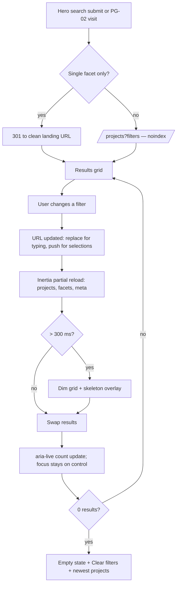

# Interaction/UX patterns, responsive behaviour, accessibility rules (DESIGN §9–11)

> Verbatim from DESIGN.md v1.0.0 (25 Oct 2026). IDs and wording unchanged. `§` references to REQUIREMENT/DESIGN resolve through the section map in `CLAUDE.md`.

## 9. Interaction and UX patterns

| ID | Pattern | Specification |
|---|---|---|
| UX-01 | Hover | Pointer-fine only (`@media (hover: hover)`); lift/zoom on cards; colour shifts 180 ms; never reveal essential info only on hover |
| UX-02 | Focus | `:focus-visible` ring 2 px `--ring` + 2 px offset matching surface; inside dark scopes ring = coral-400; cards use `:focus-within` outline on the card |
| UX-03 | Form validation | §6.1 CMP-FORM-01: blur-then-change validation, error summary on submit, server errors mapped, phone formatting as you type, never clear user input on error |
| UX-04 | Success feedback | Lead forms → thank-you page (PG-22); inline forms (newsletter, brochure) → inline success state replacing the form + toast; admin saves → toast "Saved" (4 s) + "Last saved 10:42" in rail |
| UX-05 | Empty states | CMP-EMPTY-01 with a single action; filters empty state lists newest projects (AC-SRCH-04) |
| UX-06 | Error states | Field errors inline; request failures → toast error with "Retry"; page errors → LAY-ERROR; offline (navigator.onLine false) → banner "You're offline — changes will not be sent" on admin forms |
| UX-07 | Loading states | Buttons show spinner (CMP-BTN-01); partial reloads keep old content dimmed + skeleton overlay after 300 ms (MOT-SKELETON); Inertia progress bar after 150 ms |
| UX-08 | Search/filter flow | See flow below |
| UX-09 | Destructive actions | Confirm dialog naming the object/count; undo toast for reversible deletes (8 s) |
| UX-10 | Long forms (admin) | Section nav at top (tabs), sticky save rail, unsaved-changes guard, autosave of pending revision every 60 s (draft only, never publishes) |
| UX-11 | External links | Open in same tab except PDFs (new tab with "(opens PDF in new tab)" visually hidden text) and the "View site" admin button |
| UX-12 | Phone/WhatsApp | `tel:` links on all phone numbers; WhatsApp links prefilled with project text (FR-LEAD-013) |

**Search and filter interaction flow (UX-08)**

---

## 10. Responsive behaviour

| Breakpoint | Rules |
|---|---|
| < 360 | Supported down to 320 px: gutters 16 px, hero H1 min 34 px, cards 1 col, facts 1 col |
| 360–639 (`base`) | 4-col grid; header 64 px with menu button; sticky contact bar; filters as bottom sheet; carousels 1.15 per view with peek; tables in content (compare) scroll horizontally with pinned first column; images use mobile crops |
| 640–767 (`sm`) | Cards 2 cols; footer columns 2 per row |
| 768–1023 (`md`) | 8-col grid; search widget 2 rows; detail enquiry panel inline + sticky bottom bar; mega menu replaced by mobile menu |
| 1024–1279 (`lg`) | 12-col grid; desktop header with nav (≤ 6 items + Enquire); mega menu on; hero video allowed (HERO-025); sticky enquiry panel on detail; hover effects on |
| ≥ 1280 (`xl`) | Header shows hotline; containers 1280; 3-col card grids, featured 2-col span |
| ≥ 1536 (`2xl`) | Wide containers 1440 for galleries/maps; 4-col grids on wide sections |

Touch adaptations: targets ≥ 44 px; swipe on galleries/carousels/bottom sheets; no hover-dependent content; magnetic/tilt off; parallax halved; `syncTouch` off; long-press not used; inputs `font-size ≥ 16px` (prevents iOS zoom); `inputmode="tel"` for phones, `inputmode="numeric"` for sizes; safe-area insets for fixed bars.

---

## 11. Accessibility design rules

| ID | Rule |
|---|---|
| A11Y-D01 | Focus ring: 2 px solid `--ring`, 2 px offset in the surface colour, ≥ 3:1 against adjacent colours (TOK-C35/36); never removed; admin same |
| A11Y-D02 | Skip link: first focusable element, visually hidden until focused, then a primary button top-left (z `--z-skip-link`) jumping to `<main id="content" tabindex="-1">` |
| A11Y-D03 | Keyboard: logical DOM order equals visual order; mega menu, menus, tabs, accordions, dialogs, combobox, slider and carousel follow WAI-ARIA APG patterns (provided by Reka UI); galleries ←/→; Esc closes overlays; no keyboard traps except intentional modal traps |
| A11Y-D04 | Target sizes: ≥ 44×44 public primary controls; ≥ 24×24 minimum anywhere (WCAG 2.5.8), including admin icon buttons (36 px) and table checkboxes (hit area 32 px) |
| A11Y-D05 | Landmarks: `header`, `nav` (labelled), `main`, `footer`, `aside` (enquiry panel); one H1 per page |
| A11Y-D06 | Route change: after each Inertia navigation focus moves to `<main>` heading container and a polite live region announces "{page title}" (REQUIREMENT SEO-A11Y-003) |
| A11Y-D07 | Hero video: decorative (`aria-hidden`), muted, no audio so captions are not required; visible pause/play control (CMP-HERO-02); respects reduced motion and auto-pauses off-screen. Project videos with speech: uploaded videos require a WebVTT captions file (admin field) before publish; YouTube videos rely on YouTube captions and the admin is prompted to confirm captions exist |
| A11Y-D08 | Carousels/marquees: pause controls; slides announced "n of N"; duplicates hidden from AT |
| A11Y-D09 | Colour independence: status by text + colour; links in prose underlined; charts (admin) have patterns/labels and data tables toggle |
| A11Y-D10 | Forms: visible labels, required indicated in text, errors in text with icon, `autocomplete` attributes (`name`, `tel`, `email`, `country`) |
| A11Y-D11 | Images: alt rules per REQUIREMENT CMS-MED-004; floor plans have long descriptions via caption (sizes per room optional field) |
| A11Y-D12 | Zoom/reflow: content reflows at 320 px width and 400% zoom without horizontal scroll (except data tables with their own scroll) |
| A11Y-D13 | Language: `<html lang="en">`; Bengali proper nouns marked `lang="bn"` when written in Bengali script |
