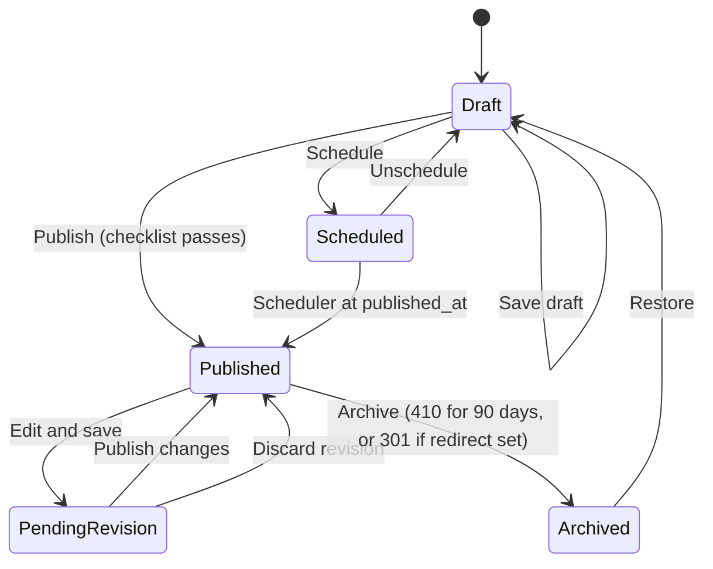

# Settings, menus, SEO fields, publishing, caching (REQUIREMENT §8.2–8.3, §8.5–8.7, DM-SET, DM-MENU, DM-REV, DM-SEO, DM-SLUGH)

> Verbatim from REQUIREMENT.md v1.0.0 (25 Oct 2026). IDs and wording unchanged. `§` references to REQUIREMENT/DESIGN resolve through the section map in `CLAUDE.md`.

### 8.2 Global settings

Stored in DM-SET (key/value JSON, grouped). Cached forever; cache key busted on save (CMS-CACHE-002). Admin screen: Settings with tabs per group.

| Group | Keys |
|---|---|
| General | site_name, tagline, logo_light (SVG/PNG), logo_dark, logo_mark (square), favicon (PNG ≥ 512, ICO/apple-touch generated), default_og_image (1200×630), parent_company_name ("Gemcon Group"), parent_company_url |
| Contact | hotline, phones (list), emails (list), whatsapp_number (E.164), office_hours_text |
| Social | facebook, instagram, linkedin, youtube, x (each URL, validated host) |
| Header | sticky (bool), transparent_on_hero (bool), CTA label + link, show_shortlist (bool), show_phone (bool) |
| Footer | about text (≤ 300), newsletter enabled, column menus (FK menus), copyright text with `{year}` token, show_parent_company (bool) |
| Legal & cookies | cookie banner enabled, banner text, categories (necessary always on; analytics; marketing), policy link, consent version (int; bump re-prompts) |
| Forms | consent text per form, thank-you title/body per form, Turnstile site key + secret, honeypot min seconds (default 3), brochure gating default |
| Notifications | email_enabled (default false), recipients per lead type, autoresponder_enabled (default false), autoresponder subject/body (with `{name}`, `{project}` tokens) |
| SEO | title template (default `{title} | Gemcon City`), meta description templates per page type (§9.3), robots.txt body, GSC verification token, Bing verification token, noindex whole site (bool, forced true on non-production) |
| Analytics | GTM container ID (`^GTM-[A-Z0-9]{6,8}$`), GA4 measurement ID (`^G-[A-Z0-9]{8,12}$`) — GTM preferred; if both set, GA4 loads through GTM only |
| Scripts | head HTML, body-end HTML (Super Admin only; sanitised to allow `<script src>` from an allowlist of hosts and `<noscript>`; CSP updated automatically) |
| Search | size bands (list of label + min + max), price_filter_min_projects (default 5), results per page (12) |
| Motion | animations enabled (bool, default true), smooth scroll enabled (bool, default true), hero video allowed on mobile (bool, default false — HERO-025) |
| Webhook | URL, secret, enabled |
| Maintenance | maintenance message, allowed IPs |

### 8.3 Navigation menus

| ID | Requirement |
|---|---|
| CMS-NAV-001 | Menus: `header`, `footer_1` … `footer_4`, `legal`, `mobile_extra`. |
| CMS-NAV-002 | Items: label (≤ 30), link type (`page`, `project`, `location`, `post`, `category`, `url`, `anchor`), target, open in new tab (adds `rel="noopener"`), icon (optional), description (≤ 80, used in mega menu), children (header: 2 levels; footers: 1 level). |
| CMS-NAV-003 | Mega menu: a header item with `mega=true` renders CMP-NAV-02 with up to 4 columns; a column may be `auto:segments`, `auto:locations` (top 8 areas by project count) or `auto:featured_projects` (3 cards). |
| CMS-NAV-004 | Links to entities store the entity ID; URLs resolve at render time so slug changes never break menus. Links to unpublished entities are hidden publicly and flagged in admin. |
| CMS-NAV-005 | Drag-and-drop tree editor with keyboard alternative (indent/outdent/move). |

### 8.5 SEO fields per entity

Every publishable entity (project, location, page, post, category, tag, job post, facet page) has a DM-SEO record: meta title, meta description, canonical override, robots (`index,follow` default; `noindex,follow`; `noindex,nofollow`), OG title, OG description, OG image, Twitter card type, focus keyword (admin hint only), JSON-LD toggle per type. Templates and fallbacks: §9.3.

### 8.6 Draft, publish, schedule, revisions, preview

| ID | Requirement |
|---|---|
| CMS-PUB-001 | Publishable entities have `status` (`draft`, `scheduled`, `published`, `archived`) and `published_at`. |
| CMS-PUB-002 | Editing a published entity saves to a **pending revision** (DM-REV, JSON of the full form payload); the live version is untouched until "Publish changes". "Save draft" and "Publish" are separate buttons. |
| CMS-PUB-003 | Scheduling: choose date/time (Asia/Dhaka); the scheduler (every minute) publishes due items and due pending revisions. |
| CMS-PUB-004 | Revisions: each publish stores a revision; keep last 30 per entity; diff view (field-level, rich text as HTML diff); restore creates a new pending revision. |
| CMS-PUB-005 | Preview: signed URL `/preview/{type}/{id}?revision={rev}&signature=…` valid 60 minutes, renders the public template from the pending revision with a fixed "Preview — not published" ribbon, `noindex,nofollow`, and no analytics. Shareable to non-logged-in reviewers. |
| CMS-PUB-006 | Concurrent editing: optimistic locking with `lock_version`; a stale save shows "Changed by {user} at {time}" with options Reload or Overwrite (Admin only). |

**Content publishing workflow**

On every transition into or out of Published: (1) bust entity cache keys, (2) regenerate affected sitemaps, (3) request snapshot re-render for the entity URL and its listing/landing pages (SEO-REN-04), (4) write an audit log entry.

### 8.7 Caching and invalidation

| ID | Requirement |
|---|---|
| CMS-CACHE-001 | Cache store: `database` (shared hosting has no Redis; the `cache` table is on the same MySQL). Session store: `database`. |
| CMS-CACHE-002 | Versioned keys: each entity type has a version counter (`cachever:projects`, …) stored in cache; keys embed it (`projects:list:{hash(filters)}:v{n}`); a publish increments the relevant counters. Settings and menus use `settings:v{n}`, `menu:{key}:v{n}`. |
| CMS-CACHE-003 | Public page props for PG-04, PG-06, PG-14 cached 24 h (busted on change); listing queries cached 10 min. |
| CMS-CACHE-004 | HTTP: public HTML `Cache-Control: public, max-age=0, s-maxage=300, stale-while-revalidate=600` when no session cookie is set and the visitor has not submitted a form; Cloudflare (free plan) caches HTML via a Cache Rule limited to paths in §5.2 for anonymous requests; admin and form endpoints `private, no-store`. A publish purges affected Cloudflare URLs through the free Cloudflare API (token in settings; optional). |
| CMS-CACHE-005 | Admin Maintenance screen (ADM-MAINT) offers: clear application cache, rebuild config/route/view/event caches, regenerate sitemaps, request full snapshot rebuild, purge Cloudflare. |

## Data model (REQUIREMENT §11.2)

**DM-MENU `menus`** (key unique, name) and **`menu_items`**: menu_id, parent_id null, label varchar(30), link_type varchar(12), linkable_type/linkable_id null, url varchar(500) null, anchor varchar(42) null, new_tab bool, icon varchar(40) null, description varchar(80) null, is_mega bool, mega_columns json null, sort_order.

**DM-SET `settings`**: group varchar(30), key varchar(60), value json, is_secret bool (encrypted cast). Unique (group, key).

**DM-REV `revisions`**: revisionable_type, revisionable_id, kind varchar(10) (`pending`, `published`), payload json, note varchar(200) null, created_by FK users, created_at. Index (revisionable_type, revisionable_id, created_at).

**DM-SEO `seo_meta`**: seoable_type, seoable_id (unique pair), meta_title varchar(70) null, meta_description varchar(170) null, canonical_url varchar(500) null, robots varchar(20) default `index,follow`, og_title, og_description null, og_image_asset_id FK null, twitter_card varchar(20) default `summary_large_image`, focus_keyword varchar(80) null, schema_enabled bool default true.

**DM-SLUGH `slug_histories`**: sluggable_type, sluggable_id, slug, created_at. Unique (sluggable_type, slug).
