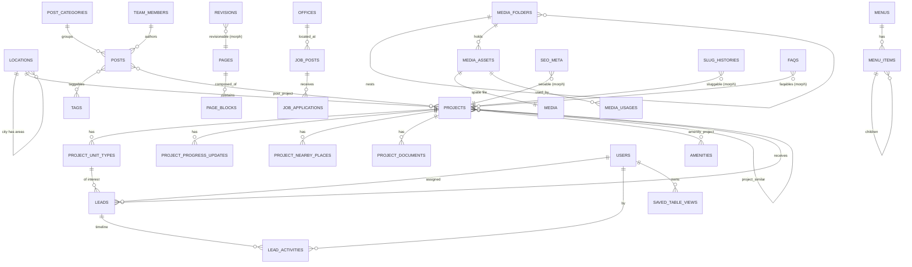

# Data model conventions, ERD, morph map, framework tables (REQUIREMENT §11)

> Verbatim from REQUIREMENT.md v1.0.0 (25 Oct 2026). IDs and wording unchanged. `§` references to REQUIREMENT/DESIGN resolve through the section map in `CLAUDE.md`.

## 11. Data model (`DM`)

Conventions: MySQL 8.0+ / MariaDB 10.11+, InnoDB, `utf8mb4_unicode_ci`; `id` BIGINT unsigned auto-increment; `timestamps()` on all tables unless noted; money in BDT as BIGINT unsigned (whole taka); coordinates `DECIMAL(10,7)`; enums as `VARCHAR(30)` backed by PHP enums (portable across MySQL/MariaDB); JSON columns validated by schema classes. No translatable fields (§7.9). Soft deletes where marked (SD).

### 11.1 ERD (core)

Polymorphic relations (morph map aliases, ARC-006): `seo_meta.seoable`, `revisions.revisionable`, `media_usages.usable`, `taggables.taggable`, `faqables.faqable`, `slug_histories.sluggable`, `activity_log.subject`. Morph map: `project, unit_type, location, facet_page, page, page_block, post, post_category, tag, testimonial, partner, faq, team_member, office, job_post, progress_update, setting`.

### 11.2 Entities

Entity → file: DM-USER, DM-VIEW `spec/admin.md` · DM-LOC `spec/locations.md` · DM-PROJ, DM-UNIT, DM-AMEN, DM-PROG, DM-NEAR, DM-PDOC, DM-SIMILAR, DM-FACET `spec/projects.md` · DM-PAGE, DM-BLOCK `spec/page-builder.md` · DM-REV, DM-MENU, DM-SET, DM-SEO, DM-SLUGH `spec/cms.md` · DM-POST, DM-PCAT, DM-TAG `spec/news.md` · DM-TEST, DM-PART, DM-FAQ, DM-TEAM, DM-OFF `spec/social.md` · DM-JOB, DM-APP `spec/careers.md` · DM-LEAD, DM-LEADH, DM-SUBS, DM-WEBH `spec/leads.md` · DM-MASSET, DM-MFOLD, DM-MUSE `spec/media.md` · DM-REDIR, DM-404, DM-SNAP `spec/seo.md`.

Framework tables: `sessions`, `cache`, `cache_locks`, `jobs`, `job_batches`, `failed_jobs`, `password_reset_tokens`, `notifications`, `activity_log`, `media` (spatie).

Soft deletes: users, locations, projects, pages, posts, team_members, job_posts, job_applications, leads, newsletter_subscribers, media_assets. Purge: soft-deleted leads and applications permanently deleted after 365 days; media after 30 days (CMS-MED-008).
