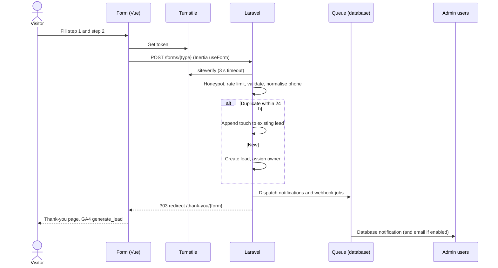

# Leads & forms (REQUIREMENT §7.4, DM-LEAD, DM-LEADH, DM-SUBS, DM-WEBH)

> Verbatim from REQUIREMENT.md v1.0.0 (25 Oct 2026). IDs and wording unchanged. `§` references to REQUIREMENT/DESIGN resolve through the section map in `CLAUDE.md`.

### 7.4 Leads and inquiries (`FR-LEAD`)

**Lead types and forms**

| Type | Form location | Fields (required *) |
|---|---|---|
| `project_inquiry` | PG-04 enquiry panel; PG-20 "enquire about all" | Step 1: Purchase timeline (Immediately / 1–3 months / 3–6 months / 6+ months), Purpose (Own residence / Investment / Business use), Preferred contact time (Morning 9–11:30 / Afternoon 12–4 / Evening 4–7). Step 2: Name*, Phone*, WhatsApp (checkbox "same as phone"), Email, Message, Unit type of interest, Consent* |
| `site_visit` | PG-04 "Book a site visit" | Name*, Phone*, Preferred date* (tomorrow … +60 days, Fridays allowed), Preferred time slot*, Visitors count (1–10), Message, Consent* |
| `brochure_download` | PG-04 brochure dialog | Name*, Phone*, Email, Consent* |
| `callback` | Sticky bar "Call me back", footer | Name*, Phone*, Preferred time*, Consent* |
| `contact` | PG-17 | Name*, Phone*, Email, Subject* (General / Sales / After-sales / Media / Other), Message* (20–2000), Consent* |
| `landowner` | PG-10 | Name*, Phone*, Email, Land location (area or free text)*, Land size (katha)*, Road width (ft), Plot facing, Ownership (Single / Joint / Other), Documents (up to 3 files: PDF/JPG/PNG, ≤ 5 MB each, private), Message, Consent* |
| `nrb` | PG-11 | Name*, Country of residence*, Phone with country code*, WhatsApp, Email*, Preferred contact time in Bangladesh time*, Budget band, Message, Consent* |
| Newsletter | Footer, PG-14 | Email*, Consent* (separate entity DM-SUBS, double opt-in by email when SMTP enabled; single opt-in otherwise, recorded) |
| Job application | PG-16 | See FR-CAR |

**Requirements**

| ID | Requirement |
|---|---|
| FR-LEAD-001 | Every lead stores: type, source page URL, project (nullable), unit type (nullable), UTM parameters (source, medium, campaign, term, content) captured from the landing URL into `sessionStorage` and submitted as hidden fields, referrer host, GA client ID (from `_ga` cookie when consent granted), IP (hashed after 90 days, NFR-PRIV-04), user agent, submitted_at. |
| FR-LEAD-002 | Phone validation: Bangladesh mobile `^(?:\+?88)?01[3-9]\d{8}$`; normalised to E.164 `+8801XXXXXXXXX`. NRB and when the country selector ≠ BD: E.164 `^\+[1-9]\d{7,14}$`. |
| FR-LEAD-003 | Spam protection, all free: (a) Cloudflare Turnstile (managed mode) verified server-side via `https://challenges.cloudflare.com/turnstile/v0/siteverify`; (b) honeypot field + minimum fill time 3 s (`spatie/laravel-honeypot`); (c) rate limit 5 submissions per 10 minutes per IP per form and 20 per day per phone; (d) content rules: > 3 URLs in message or non-Bengali/Latin script-only messages flag as `spam` status instead of rejecting. If Turnstile is unreachable (timeout 3 s), the submission is accepted and flagged `needs_review`. |
| FR-LEAD-004 | Duplicate handling: same normalised phone + same project within 24 h appends a "touch" (activity entry) to the existing lead instead of creating a new one; the visitor sees a normal success. |
| FR-LEAD-005 | After success, redirect to `/thank-you/{form}` (PG-22) which fires GA4 `generate_lead` with `lead_type`, `project_slug`, `form_location` via `dataLayer` (SEO-ANA-004). The brochure form instead stays on page and starts the download. |
| FR-LEAD-006 | Status pipeline: `new` → `contacted` → `site_visit_scheduled` → `site_visit_done` → `negotiation` → `won` / `lost`; plus `spam` and `needs_review`. Any status can move to `lost` or `spam`. `won` and `lost` require a reason (select + note). Every change is recorded in DM-LEADH with user and timestamp. |
| FR-LEAD-007 | Assignment: on creation, assign to the project's default assignee; otherwise to the round-robin pool of active users with role Sales Executive (by least open leads); otherwise unassigned. Sales Manager can reassign. |
| FR-LEAD-008 | Notifications (no paid APIs, DEC-07): (a) in-dashboard database notifications with an unread count on the top-bar inbox and Leads nav badge, polled every 60 s while the admin tab is visible; (b) optional email via the hosting SMTP account (`settings.notifications.email_enabled`, default **off**) to the assignee and a configurable list of addresses; (c) optional visitor autoresponder email (default **off**). No SMS, push or WhatsApp API. |
| FR-LEAD-009 | Leads admin: list (advanced table ADM-TBL), kanban board by status (drag to change status, keyboard accessible alternative via status menu), detail drawer with timeline (submissions, touches, notes, status changes, assignments), notes (rich text, internal), follow-up date with overdue highlighting, click-to-call (`tel:`) and WhatsApp (`https://wa.me/{number}?text=`) links. |
| FR-LEAD-010 | Export CSV/XLSX of current filtered view (ADM-TBL-012). Phone numbers exported as text to keep the leading `+`. |
| FR-LEAD-011 | Landowner and job uploads are stored on the private disk (`storage/app/private`), served only through an authorised controller, virus-scan not available on shared hosting → files are never executed or rendered inline; served as `Content-Disposition: attachment` with `X-Content-Type-Options: nosniff`. |
| FR-LEAD-012 | Outbound webhook (free, for future CRM): optional URL + secret in settings; on lead create/update, a queued POST with JSON body and `X-Signature: sha256=HMAC(body, secret)`; 3 retries with 1/5/15-minute backoff; delivery log kept 30 days. |
| FR-LEAD-013 | WhatsApp click-to-chat on PG-04 uses `https://wa.me/{e164-without-plus}?text={urlencoded "Hi, I'm interested in {Project}. {url}"}`; clicking fires GA4 `whatsapp_click` and creates **no** lead (no data captured). |
| FR-LEAD-014 | Consent checkbox text and the privacy link are editable in Settings → Forms; the exact text shown is stored with each lead. |

**Lead capture workflow**

**Acceptance criteria**

- **AC-LEAD-01** Given a valid project enquiry, When submitted, Then a lead exists with status `new`, the UTM values from the landing URL, an assignee per FR-LEAD-007, and the browser lands on `/thank-you/project-inquiry`.
- **AC-LEAD-02** Given the honeypot field is filled, When submitted, Then HTTP 422 is not returned (to avoid teaching bots); the response mimics success and no lead is stored.
- **AC-LEAD-03** Given 6 submissions from one IP within 10 minutes, When the 6th is posted, Then HTTP 429 with a friendly message and a `Retry-After` header.
- **AC-LEAD-04** Given phone `01712-345678`, When saved, Then it is stored as `+8801712345678`.
- **AC-LEAD-05** Given a Sales Executive, When they open Leads, Then they see only leads assigned to them.

**Permissions:** `leads.view_all` (Admin, Sales Manager), `leads.view_assigned` (Sales Executive), `leads.update`, `leads.assign`, `leads.export`, `leads.delete` (Admin only; soft delete).

## Data model (REQUIREMENT §11.2)

**DM-LEAD `leads`** (SD)

| Column | Type | Null | Notes |
|---|---|---|---|
| type | varchar(20) | no | §7.4 |
| status | varchar(24) | no | `new` |
| name | varchar(120) | no | |
| phone | varchar(20) | no | E.164 |
| whatsapp | varchar(20) | yes | |
| email | varchar(190) | yes | |
| country | char(2) | yes | ISO 3166-1 |
| project_id | FK projects | yes | |
| unit_type_id | FK project_unit_types | yes | |
| assigned_to | FK users | yes | |
| answers | json | yes | type-specific fields (timeline, purpose, contact time, land details, visit date…) |
| message | text | yes | |
| attachments | json | yes | private paths |
| source_url | varchar(500) | no | |
| utm_source … utm_content | varchar(100) ×5 | yes | |
| referrer_host | varchar(190) | yes | |
| ga_client_id | varchar(60) | yes | |
| consent_text | text | no | FR-LEAD-014 |
| ip | varchar(45) | yes | hashed after 90 days (`ip_hash`) |
| ip_hash | char(64) | yes | |
| user_agent | varchar(255) | yes | |
| follow_up_at | datetime | yes | |
| lost_reason, won_note | varchar(200) | yes | |
| touches_count | int unsigned | no | 0 |
| last_touched_at | timestamp | yes | |

Indexes: (status, created_at), (assigned_to, status), (project_id, created_at), (phone, project_id, created_at) for duplicate check, type, utm_source.

**DM-LEADH `lead_activities`**: lead_id FK, user_id FK null, kind varchar(16) (`submission`, `touch`, `status`, `assignment`, `note`, `follow_up`, `email`), payload json, created_at. Index (lead_id, created_at).

**DM-SUBS `newsletter_subscribers`** (SD): email unique, status (`pending`, `active`, `unsubscribed`), token char(40), confirmed_at, source_url, consent_text, ip_hash.

**DM-WEBH `webhook_deliveries`**: event varchar(30), lead_id FK, status_code smallint null, attempts tinyint, response_excerpt varchar(500) null, delivered_at null, created_at. Pruned after 30 days.
