# Sitemap & page inventory (REQUIREMENT §5)

> Verbatim from REQUIREMENT.md v1.0.0 (25 Oct 2026). IDs and wording unchanged. `§` references to REQUIREMENT/DESIGN resolve through the section map in `CLAUDE.md`.

## 5. Sitemap & page inventory

### 5.1 Sitemap

```mermaid
flowchart TD
  H["/ Home PG-01"] --> P["/projects PG-02"]
  P --> PD["/projects/{slug} PG-04"]
  P --> PS["/projects/type/{segment} PG-03"]
  P --> PST["/projects/status/{status} PG-03"]
  H --> L["/locations PG-05"]
  L --> LD["/locations/{area} PG-06"]
  LD --> LDS["/locations/{area}/{segment} PG-06"]
  H --> A["/about PG-07"]
  A --> AL["/about/leadership PG-08"]
  H --> S["/services PG-09"]
  H --> LO["/landowner PG-10"]
  H --> N["/nrb PG-11"]
  H --> NW["/news PG-12"]
  NW --> NC["/news/category/{slug} PG-13"]
  NW --> NT["/news/tag/{slug} PG-13"]
  NW --> NA["/news/{slug} PG-14"]
  H --> C["/careers PG-15"]
  C --> CJ["/careers/{slug} PG-16"]
  H --> CO["/contact PG-17"]
  H --> F["/faq PG-18"]
  H --> SR["/search PG-19"]
  H --> SH["/shortlist PG-20"]
  H --> CM["/compare PG-21"]
  H --> TY["/thank-you/{form} PG-22"]
  H --> PP["/privacy-policy PG-23"]
  H --> T["/terms PG-24"]
  H --> CP["/{page-slug} PG-25 custom"]
  H --> E["404 / 500 / 503 PG-26"]
```

### 5.2 Page inventory

Every page's layout is specified in `DESIGN.md` §7 under the matching `LAY-*` ID. "Builder" = sections are page-builder blocks (§8.1) editable in admin; "Template" = fixed structure fed by entity data with editable copy fields.

| ID | URL | Purpose | Sections (top → bottom) | Data source | Index | Layout |
|---|---|---|---|---|---|---|
| PG-01 | `/` | Brand, search entry, featured projects, trust | Hero (HERO-*) with search widget; Intro statement; Featured projects carousel; Segments (4 tiles); Stats counters; Ongoing projects; Construction progress highlight; Testimonials; Partners marquee; Latest news (3); Landowner CTA band; Footer | Builder (page `home`) | index | LAY-HOME |
| PG-02 | `/projects` | Browse and filter all projects | Page header (H1 "Projects in Bangladesh"); Filter bar; Result count + sort; Grid/Map toggle; Project cards (12/page); Pagination; Location links block; CTA band | Template + `projects` | index (unfiltered page 1–n) | LAY-PROJ-LIST |
| PG-03 | `/projects/type/{segment}`, `/projects/status/{status}` | Indexable facet landing pages | Same as PG-02 with facet-specific H1, intro text (editable per facet), FAQ (optional) | Template + `facet_pages` | index | LAY-PROJ-LIST |
| PG-04 | `/projects/{slug}` | Convert interest into a lead | Gallery hero; Title block (name, status, segment, location, price-from if shown); Sticky tab bar (Overview, At a glance, Amenities, Plans, Gallery, Video, Progress, Location, Documents); Overview; At a glance; Amenities; Unit types & floor plans; Gallery; Video; Architect/consultants; Progress; Location (map + nearby); Brochure; Enquiry panel (sticky on desktop); Similar projects; Sticky mobile contact bar | Template + `projects` and relations | index | LAY-PROJ-DETAIL |
| PG-05 | `/locations` | Directory of areas | Header; City groups with area tiles + project counts | Template + `locations` | index | LAY-LOC-LIST |
| PG-06 | `/locations/{area}`, `/locations/{area}/{segment}` | Rank for "{segment} in {area}" | Area hero image; H1 "Flats and commercial spaces in {Area}"; Editable intro (≥ 150 words required to be indexable, FR-LOC-003); Projects in area; Area facts (editable list); Map of area projects; Nearby areas links; FAQ; CTA | Template + `locations` | index if ≥ 1 published project and intro ≥ 150 words, else `noindex,follow` | LAY-LOC-DETAIL |
| PG-07 | `/about` | Company story and trust | Builder: Hero (image); Story; Mission/Values; Milestones timeline; Stats; Gemcon Group parent; Awards; Certifications; CTA | Builder | index | LAY-ABOUT |
| PG-08 | `/about/leadership` | Leadership and team | Header; Leadership grid; Management grid; Team groups | `team_members` | index | LAY-TEAM |
| PG-09 | `/services` | What the company offers | Builder: Hero; Service cards (Residential, Commercial, Land/Plot, Joint venture, After-sales); Process steps; FAQ; CTA | Builder | index | LAY-SERVICES |
| PG-10 | `/landowner` | Acquire land via JV | Builder: Hero; Benefits; Process steps; Terms overview; Track record (handed-over projects); FAQ; Landowner form (FR-LEAD) | Builder + form | index | LAY-LANDOWNER |
| PG-11 | `/nrb` | Serve NRB buyers | Builder: Hero; Why buy; Remote process steps; Payment/legal notes; Testimonials (NRB-tagged); NRB form | Builder + form | index | LAY-NRB |
| PG-12 | `/news` | News and articles index | Header; Featured post; Category pills; Post grid (9/page); Pagination | `posts` | index | LAY-NEWS-LIST |
| PG-13 | `/news/category/{slug}`, `/news/tag/{slug}` | Topic archives | As PG-12 filtered; category intro text | `posts`, `post_categories`, `tags` | category: index; tag: index only if ≥ 3 published posts, else `noindex,follow` | LAY-NEWS-LIST |
| PG-14 | `/news/{slug}` | Article | Breadcrumb; Title; Meta (date, category, read time); Cover image; Body (rich text); Tags; Share; Related posts (3); Newsletter CTA | `posts` | index | LAY-NEWS-DETAIL |
| PG-15 | `/careers` | Employer brand and roles | Builder intro (culture, benefits); Open roles list with department/location/type filters; "No openings" state with CV drop | Builder + `job_posts` | index | LAY-CAREERS |
| PG-16 | `/careers/{slug}` | Job detail and application | Title, meta, description, requirements, benefits, deadline; Apply form | `job_posts` | index while open; 410 Gone 30 days after close (SEO-TEC-012) | LAY-CAREER-DETAIL |
| PG-17 | `/contact` | Contact and offices | Header; Contact form; Office cards (address, phone, email, hours, map); WhatsApp; Social | Settings + `offices` + form | index | LAY-CONTACT |
| PG-18 | `/faq` | Common questions | Header; Category tabs; Accordions; CTA | `faqs` | index | LAY-FAQ |
| PG-19 | `/search?q=` | Site-wide search results | Query box; Results grouped: Projects, News, Pages; Empty state | Scout (FR-SRCH-010) | `noindex,follow` | LAY-SEARCH |
| PG-20 | `/shortlist` | Saved projects (browser) | Header; Cards from localStorage IDs; Empty state; "Enquire about all" | `projects` by IDs | `noindex,nofollow` | LAY-SHORTLIST |
| PG-21 | `/compare?ids=` | Compare up to 3 projects | Comparison table of facts | `projects` by IDs | `noindex,nofollow` | LAY-COMPARE |
| PG-22 | `/thank-you/{form}` | Post-submit confirmation and conversion tracking | Confirmation message (per form, editable); Next steps; Related projects; WhatsApp | Settings per form | `noindex,nofollow` | LAY-THANKS |
| PG-23 | `/privacy-policy` | Legal | Rich text; last-updated date | Builder (legal page) | index | LAY-LEGAL |
| PG-24 | `/terms` | Legal | Rich text; last-updated date | Builder (legal page) | index | LAY-LEGAL |
| PG-25 | `/{page-slug}` | Any custom page | Builder blocks | Builder | per-page setting | LAY-CUSTOM |
| PG-26 | 404, 410, 419, 429, 500, 503 | Errors | Message; Search box (404); Popular projects (404); Home link | Settings (editable copy) | `noindex` | LAY-ERROR |

Reserved slugs that custom pages (PG-25) cannot use: `projects, locations, about, services, landowner, nrb, news, careers, contact, faq, search, shortlist, compare, thank-you, privacy-policy, terms, admin, login, api, internal, storage, build, sitemap, sitemaps, robots.txt, up`.
