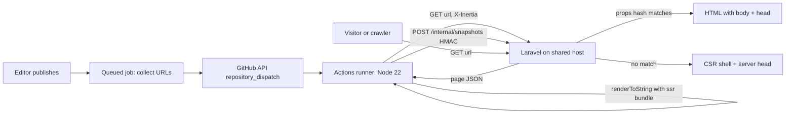

# SEO — rendering/snapshots, technical, on-page (REQUIREMENT §9.1–9.3, DM-REDIR, DM-404, DM-SNAP)

> Verbatim from REQUIREMENT.md v1.0.0 (25 Oct 2026). IDs and wording unchanged. `§` references to REQUIREMENT/DESIGN resolve through the section map in `CLAUDE.md`.

## 9. SEO requirements (highest priority)

### 9.1 Rendering on shared hosting (`SEO-REN`)

Constraint: the host is shared hosting (Phase 1 Q1). Inertia v3 production SSR needs a long-running Node ≥ 22 process (`php artisan inertia:start-ssr` under a process monitor); shared hosting cannot keep one alive. Inertia falls back to client-side rendering when SSR is unavailable. The design below gives crawlers full HTML without a Node process on the host, at zero cost.

| ID | Requirement |
|---|---|
| SEO-REN-01 | **Server-rendered head (always on).** The root Blade view (`resources/views/app.blade.php`) renders from the `seo` prop: `<title>`, meta description, robots, canonical, OG and Twitter tags, JSON-LD `<script type="application/ld+json">`, LCP preload (HERO-030), favicon set. Each tag carries the `inertia` attribute so Inertia's client head manager (`<Head>`) replaces rather than duplicates them on client navigation. This works with or without SSR. |
| SEO-REN-02 | **Pre-rendered body snapshots.** The same Vue SSR bundle used for live SSR (`resources/js/ssr.ts`, built by `vite build --ssr`) is executed outside the host in a free GitHub Actions workflow (`.github/workflows/snapshots.yml`, Node 22). For each URL it requests the Inertia page object (`GET {url}` with headers `X-Inertia: true`, `X-Inertia-Version: {manifest hash}`, `X-Snapshot-Token: {secret}`), renders `{ head, body }` with `renderToString`, and uploads the body HTML to `POST /internal/snapshots` signed with HMAC-SHA256. |
| SEO-REN-03 | **Snapshot gateway.** Laravel binds a custom implementation of Inertia's SSR `Gateway` interface (`App\Support\Ssr\SnapshotGateway`). On a full-page (non-XHR) request it computes `propsHash = sha256(json(page.props without volatile keys) + asset version)` and returns the stored body only when the stored hash matches; otherwise it returns `null` and Inertia renders the CSR shell. Volatile keys excluded from the hash and never rendered into public markup: `errors`, `flash`, `csrf`, `auth`, `ziggy.location`, `ui.consent`. Vue then hydrates (`createSSRApp`) the matching markup. A hash match guarantees the snapshot is never stale. |
| SEO-REN-04 | **Triggers.** (a) On publish/unpublish/archive of any entity, a queued job collects affected URLs (the entity URL, its listing and landing pages, home if the entity is featured, location pages of its area) and calls the GitHub REST API `POST /repos/{owner}/{repo}/dispatches` (event `render-snapshots`, payload of up to 100 URLs). (b) A nightly scheduled workflow at 02:30 Asia/Dhaka renders every URL in the sitemaps. (c) A deploy workflow renders all URLs after each production deploy (asset version changes invalidate all hashes). |
| SEO-REN-05 | **Storage and limits.** Snapshots stored in table `ssr_snapshots` (url_hash, url, props_hash, asset_version, body MEDIUMTEXT, rendered_at); rows older than 7 days with a non-current asset version purged nightly. Upload endpoint accepts ≤ 2 MB per body, ≤ 120 requests/minute, only with a valid HMAC and timestamp within 300 s. |
| SEO-REN-06 | **Fallback.** If no matching snapshot exists, the page is served as CSR with the full server-rendered head (SEO-REN-01). A `SnapshotMiss` event is counted per URL; the Maintenance screen lists URLs with misses in the last 24 h and a "Render now" button (dispatches the SEO-REN-04 (a) trigger for that URL). Googlebot renders JavaScript, so a miss degrades only non-JS crawlers and social previews (which read only the head and are fully served). |
| SEO-REN-07 | **Upgrade path (F1).** On a VPS, set `INERTIA_SSR_ENABLED=true`, bind Inertia's default HTTP gateway instead of `SnapshotGateway`, and run `php artisan inertia:start-ssr` under Supervisor; no Vue code changes. Admin routes are excluded from SSR in both modes (`Inertia::withoutSsr(['admin/*'])`). |
| SEO-REN-08 | **SSR-safe code rule.** Public components must not touch `window`, `document`, `localStorage` or `matchMedia` during setup or render; such access happens in `onMounted` or in client-only components wrapped by `<ClientOnly>`. ESLint rule and a CI render of every page type enforce it (QA-SEO-03). |
| SEO-REN-09 | **Health.** Daily scheduled check: count of published URLs with a current, hash-matching snapshot ÷ total published URLs ≥ 95%; otherwise an in-dashboard alert on the Dashboard and Maintenance screens. |
| SEO-REN-10 | **Prerequisite.** The codebase lives in a GitHub repository (free plan). Private repos get 2,000 Actions minutes/month on the free plan; a full render of 500 URLs is budgeted at ≤ 6 minutes (concurrency 8). |

**Acceptance criteria**

- **AC-REN-01** Given a published project with a current snapshot, When `curl -A "bingbot" https://{domain}/projects/{slug}` is run, Then the HTML contains the H1 project name, the "At a glance" facts and the JSON-LD block.
- **AC-REN-02** Given an editor changes the project name and publishes, When the same curl runs within 10 minutes, Then the HTML contains the new name; and When it runs before the snapshot is re-rendered, Then the HTML contains the new name in `<title>` and JSON-LD, the body is the CSR shell, and no stale body is served.
- **AC-REN-03** Given the snapshot upload endpoint receives a request with an invalid signature, Then it responds 401 and stores nothing.

**SSR/snapshot flow**

### 9.2 Technical SEO (`SEO-TEC`)

| ID | Requirement |
|---|---|
| SEO-TEC-001 | URL scheme as in §5.2: lowercase, hyphenated ASCII slugs, no file extensions, no IDs, no query strings for indexable content. |
| SEO-TEC-002 | Trailing slash policy: **no trailing slash**. Requests with a trailing slash (except `/`) 301 to the slash-less URL; uppercase paths 301 to lowercase; `index.php` and duplicate slashes normalised. |
| SEO-TEC-003 | Slug history: every slug change writes DM-SLUGH (entity, old slug); requests to old slugs 301 to the current URL. Chains are collapsed (old → current, never old → older → current). |
| SEO-TEC-004 | Canonical tag on every indexable page = its absolute clean URL (https, no query). Paginated pages canonicalise to themselves (`/news?page=2` canonical `/news?page=2`), not to page 1. |
| SEO-TEC-005 | Pagination: `?page=n` links are crawlable `<a href>`; page 1 is reached without `?page=1` (`?page=1` 301 → base). No `rel=prev/next` (ignored by Google) but kept harmless: not emitted. Pages beyond the last return 404. |
| SEO-TEC-006 | HTTPS enforced (301 from http), HSTS `max-age=31536000; includeSubDomains` after a 2-week trial at `max-age=86400`; `preload` not set in v1. `www` → apex 301 (or the reverse, per DEC-17 once the domain is confirmed). |
| SEO-TEC-007 | Status codes: 200 live; 301 permanent moves; 302 only for temporary admin redirects; 404 unknown; 410 archived/deleted content for 90 days (jobs 30 days); 503 with `Retry-After: 3600` during maintenance; 429 rate limits; 500 never cached. |
| SEO-TEC-008 | Redirect manager (admin, DM-REDIR): source path (exact or prefix `/*`), target (path or absolute URL), code (301/302/410), active, hit count, last hit. Loops and chains detected on save; max 2,000 rules; evaluated before routing; CSV import/export. |
| SEO-TEC-009 | 404 monitor (DM-404): path, referrer, hits, first/last seen; ignore list (regex); "Create redirect" action; top 404s widget on Dashboard; entries older than 90 days purged. |
| SEO-TEC-010 | robots.txt served dynamically from Settings → SEO; default body: `User-agent: *` / `Disallow: /admin` / `Disallow: /search` / `Disallow: /shortlist` / `Disallow: /compare` / `Disallow: /thank-you/` / `Disallow: /preview/` / `Disallow: /internal/` / `Sitemap: https://{domain}/sitemap.xml`. On non-production environments the response is always `Disallow: /` and every page sends `X-Robots-Tag: noindex, nofollow`. |
| SEO-TEC-011 | XML sitemaps via `spatie/laravel-sitemap`: index `/sitemap.xml` → `sitemaps/pages.xml`, `projects.xml`, `locations.xml` (areas + area×segment that are indexable), `facets.xml` (segment/status landing pages), `news.xml`, `careers.xml`. Each `<url>` has `<loc>` and `<lastmod>`; project and post entries include `<image:image>` for cover + up to 10 gallery images. Only indexable, published, canonical URLs. Regenerated on publish events (debounced 2 min) and nightly at 02:00; written as static files to `public/sitemaps/`. |
| SEO-TEC-012 | Closed jobs and archived entities leave sitemaps immediately. |
| SEO-TEC-013 | hreflang: not emitted (single language, §7.9). |
| SEO-TEC-020 | **Faceted URL indexing rules.** Indexable: `/projects`, `/projects/type/{segment}`, `/projects/status/{status}`, `/locations/{area}` (FR-LOC-003), `/locations/{area}/{segment}` (FR-LOC-004). |
| SEO-TEC-021 | Any `/projects?…` URL with ≥ 1 filter parameter, a sort other than default, or `view=map` → `noindex,follow`, canonical to the closest indexable page (single segment → its type page; single area → its location page; otherwise `/projects`). |
| SEO-TEC-022 | Single-facet query URLs redirect per FR-SRCH-008. |
| SEO-TEC-023 | Filter links inside the filter UI are rendered as `<a href>` for single-facet options (crawl paths to landing pages) and as `<button>` for multi-facet combinations (no crawl path to noindex URLs). |
| SEO-TEC-024 | `/search`, `/shortlist`, `/compare`, `/thank-you/*`, `/preview/*` are `noindex` and disallowed in robots.txt. |

### 9.3 On-page SEO (`SEO-ONP`)

| ID | Requirement |
|---|---|
| SEO-ONP-001 | Meta title: per-entity override, else template. Templates (editable in Settings → SEO): Project `{name} – {bedrooms_range} Bed {segment_label} in {area}, {city} | Gemcon City` (e.g. "Gemcon Orchid – 3–4 Bed Apartments in Bashundhara R/A, Dhaka \| Gemcon City"); Location `Flats & Commercial Spaces in {area}, {city} | Gemcon City`; Location×segment `{segment_label} in {area}, {city} | Gemcon City`; Facet `{status_label or segment_label} Projects in Bangladesh | Gemcon City`; Post `{title} | Gemcon City`; Page `{title} | Gemcon City`; Home: from settings (default `Gemcon City Limited – Real Estate Developer in Bangladesh`). Length check in admin: warn > 60 chars or < 30. |
| SEO-ONP-002 | Meta description: override, else template — Project: `{name} by Gemcon City: {size_range} sft {segment_label_lower} in {area}, {city}. {status_label}, handover {handover}. Book a site visit.`; Post: excerpt; Location: first 155 chars of intro; Page: page intro. Warn > 160 or < 70 chars. |
| SEO-ONP-003 | Exactly one H1 per page (CMS-PB-004, FR-NEWS-005); heading levels never skip; card titles use H3 inside H2 sections; facts/stat values are not headings (styled `
`/`<dl>`). Enforced by QA-SEO-05 automated check. |
| SEO-ONP-004 | Alt text: required for every non-decorative image at upload (CMS-MED-004); gallery images get unique alt (admin warns on duplicates within a project); generated fallback never used silently — publish checklist lists missing alts. |
| SEO-ONP-005 | Internal linking: breadcrumbs on all pages except home (CMP-BREAD-01) with `BreadcrumbList` JSON-LD; project pages link to their area page, segment page and 3 similar projects; area pages link to nearby areas; posts link to related projects (FR-NEWS-001); footer links to top 8 areas. |
| SEO-ONP-006 | Open Graph: `og:type` (`website` / `article`), `og:title`, `og:description`, `og:url`, `og:image` (1200×630, the entity's `og` conversion of its cover, else default OG image), `og:image:alt`, `og:site_name`, `og:locale=en_US`; Twitter `summary_large_image`. |
| SEO-ONP-007 | Auto-generated OG images: when an entity has no cover, a branded fallback is generated at publish time with GD (brand gradient background, logo, entity title in Manrope 700 TTF, ≤ 2 lines) and stored as a media asset. |
| SEO-ONP-008 | Images: descriptive file names on upload are preserved slugified (`gemcon-orchid-front-elevation.webp`). |

## Data model (REQUIREMENT §11.2)

**DM-REDIR `redirects`**: source varchar(500) (normalised, unique), is_prefix bool, target varchar(500) null, code smallint (301/302/410), is_active bool, hits int unsigned, last_hit_at, created_by.

**DM-404 `not_found_logs`**: path varchar(500) unique (hash index), referrer varchar(500) null, hits int unsigned, first_seen_at, last_seen_at, is_ignored bool.

**DM-SNAP `ssr_snapshots`**: url_hash char(64) unique, url varchar(500), props_hash char(64), asset_version varchar(40), body mediumtext, rendered_at.
